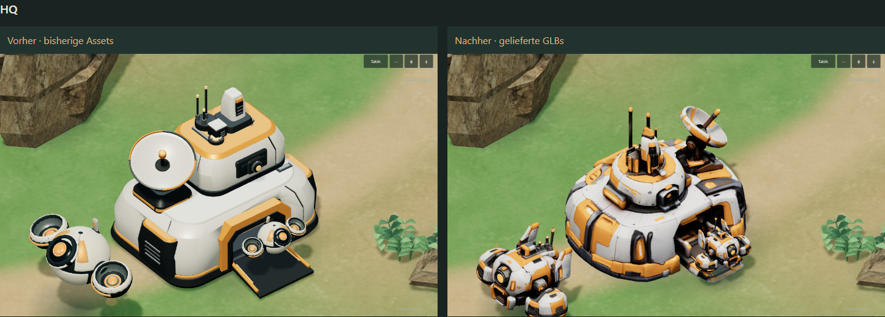
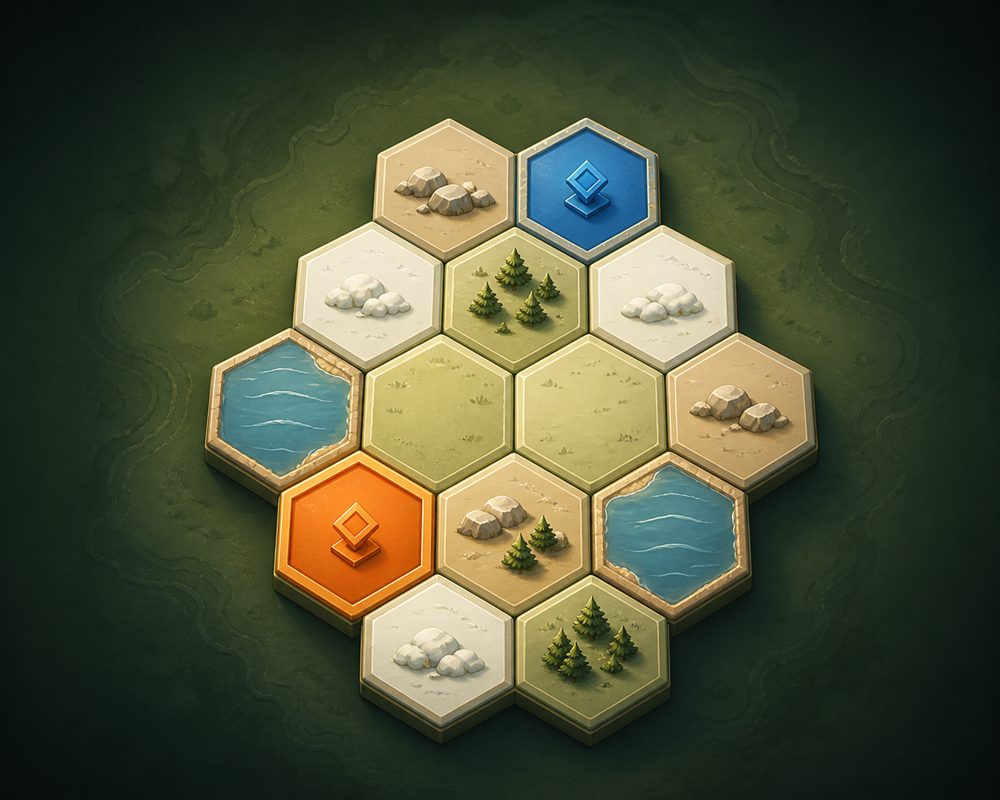
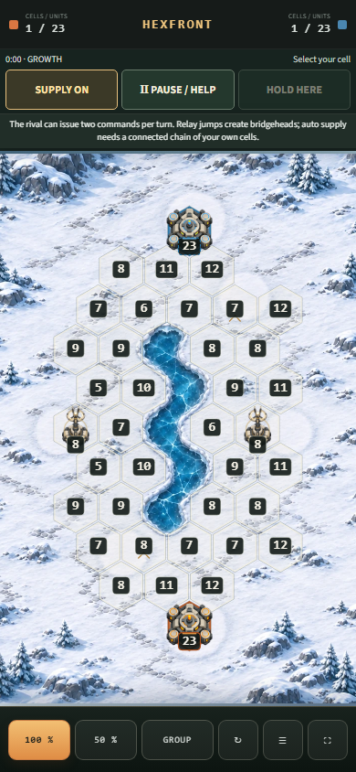
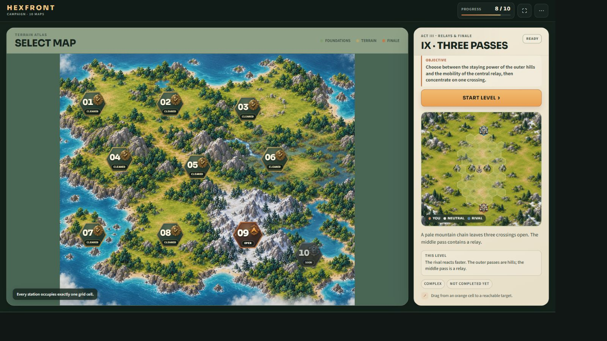
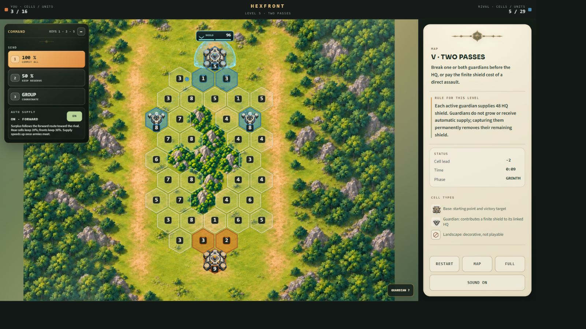
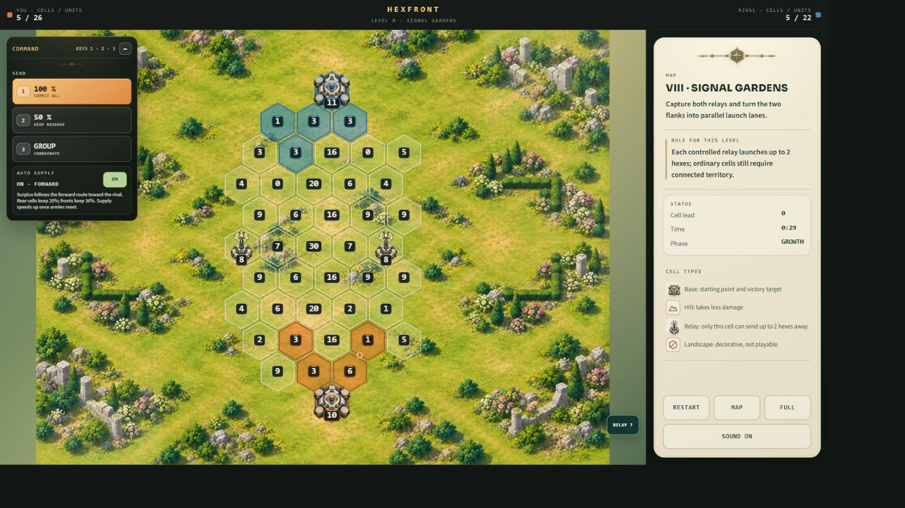
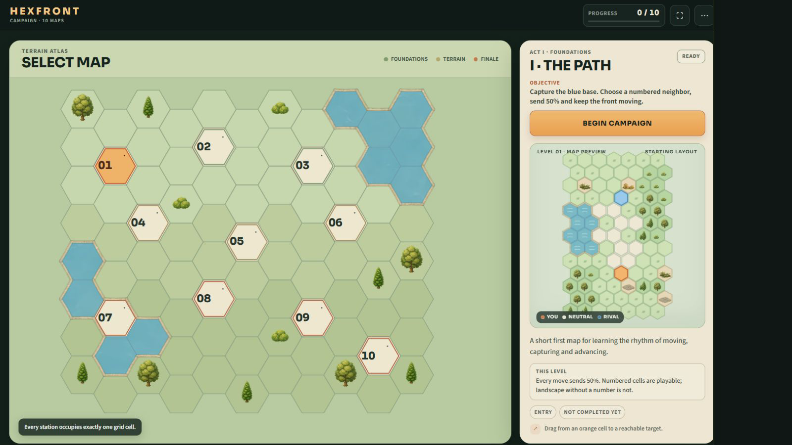
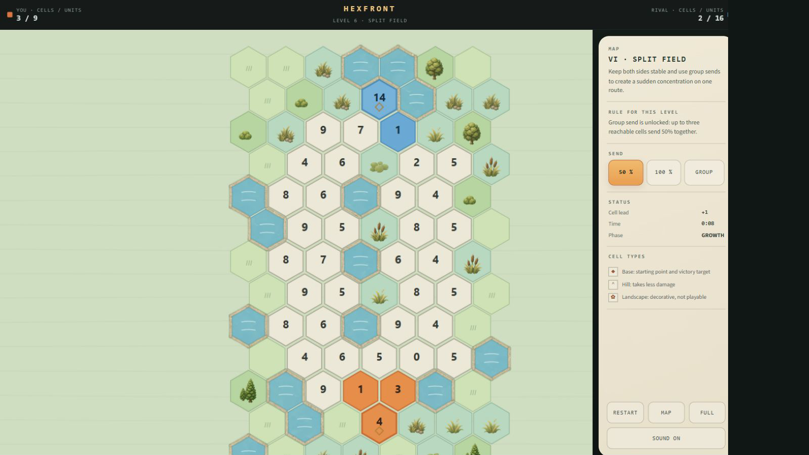
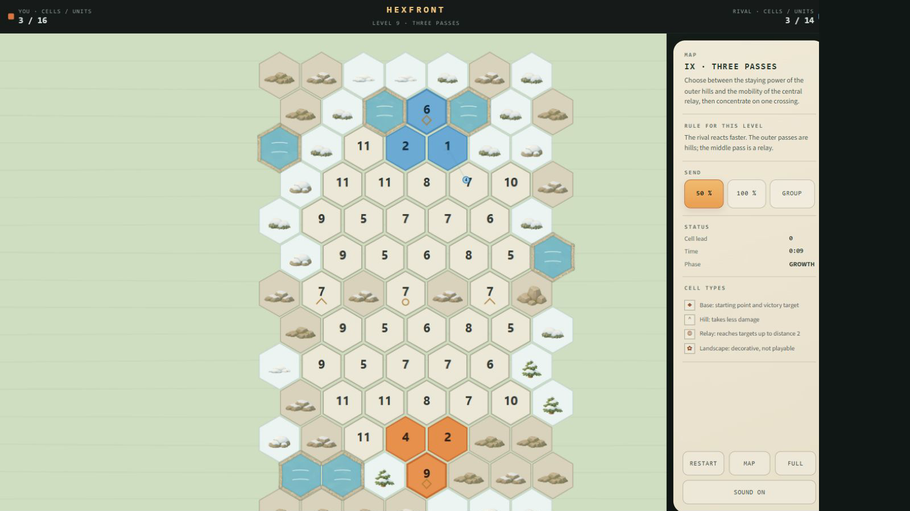

# HEXFRONT

**[▶ Aktuellen Teststand auf dem Handy oder PC spielen](https://rawcdn.githack.com/emfau88/hexwars/d2201fb3e40ab88f443b0fee5c5e863d4756f806/previews/hexfront-improvements-2026-11-02/index.html)**

Teststand vom **2. November 2026**: verbesserter Nachschub, Tap-/Tastatursteuerung, Pause, Eis-Finale und korrigierte mobile Hinweiszeile. Funktioniert direkt im Browser ohne lokalen Server. Falls der Vorschauhost einen Hinweis zeigt, **Open the page** antippen.

**[✓ Testcheckliste mit konkreten Prüfschritten](docs/manuelle-testcheckliste-2026-11-02.md)** · [Verbesserungsplan und offene Abnahme](docs/hexfront-verbesserungsplan-2026-11-02.md)

Der Playlink ist fest auf Vorschau-Commit `d2201fb` mit Spielquellstand `9812ced` gesetzt. Die manuelle Abnahme steht noch aus. Kongregate-Statistiken werden erst innerhalb von Kongregate übertragen.

## ▶ Lane Wars – Meilenstein 2.1

Spielbare Kampagne **Mensch gegen KI** im Branch `codex/lane-wars`: **Erste Front** mit einer Lane und **Wiesenkrieg** mit zwei Fronten. Direkte Gebäudepfeile, transparente Bauvorschauen, Nachschub per Drag/Tap und getrennte lokale Missionsspielstände. Die vorhandene Diorama-Architektur und der M1-Kampfkern bleiben erhalten.

**[▶ M2.1 jetzt im Browser spielen](https://rawcdn.githack.com/emfau88/hexwars/5016cb1caffc011a5dcd4df34f648994e86f724c/experiments/hexfront-lane-wars/index.html)** · **[Screenshots und Nachschubvideo](https://rawcdn.githack.com/emfau88/hexwars/5016cb1caffc011a5dcd4df34f648994e86f724c/experiments/hexfront-lane-wars/m21-review.html)**

**Mobile verbessert:** einklappbare Fabrikverwaltung und deutlich mehr freie Sicht im Hochformat. [Ansichten und Prüfungen](experiments/hexfront-lane-wars/docs/MOBILE-HUD.md).

Der öffentliche Playlink ist auf den Kampagnenstand `5016cb1` festgelegt und benötigt keinen lokalen Server. Falls der Vorschauhost einen Hinweis zeigt, **Open the page** anklicken. Dieser Branch veröffentlicht ausschließlich die Lane-Wars-Vorschau; die älteren Spielvarianten bleiben unverändert.

```powershell
cd experiments/hexfront-lane-wars
node scripts/serve.mjs
```

**[Kampagne lokal spielen](http://127.0.0.1:4181/)** · **[Bilder und Nachschubdemo](http://127.0.0.1:4181/m21-review.html)** · [Kampflabor](http://127.0.0.1:4181/lab.html) · [Bedienung und Tests](experiments/hexfront-lane-wars/README.md) · [M2.1-Ergebnisse](experiments/hexfront-lane-wars/docs/MILESTONE-2.1.md)

Die lokalen Links benötigen den laufenden Server. Node.js ab Version 20 genügt. **Kampagne starten** beginnt direkt; ein Sieg in Erste Front schaltet Wiesenkrieg frei.


## Mixed Squads — ältere Variante

**[Mixed Squads im Browser starten](https://rawcdn.githack.com/emfau88/hexwars/3e514efbe53e463c4e844ddb676ce9da72daaad6/experiments/hexfront-mixed-squads/preview/index.html)**

Vorschau für **`experiment/mixed-squads`**: drei bildschirmfüllende Landschaften, Drohnen und Mechs, cozy Sci-Fi-Menüs und HUD, klarere Hexkonturen und Fraktionsfarben. Falls der Vorschauhost einen Hinweis zeigt, **Open the page** anklicken. Der Link ist auf den geprüften Spielstand `3e514ef` festgelegt.

**[22 Screenshots und Analyse für die weitere Review](experiments/hexfront-mixed-squads/docs/review-2026-10-13)** · [Screenshot-Galerie öffnen](https://rawcdn.githack.com/emfau88/hexwars/3e514efbe53e463c4e844ddb676ce9da72daaad6/experiments/hexfront-mixed-squads/docs/review-2026-10-13/index.html) · [Start, Steuerung und Prüfungen](experiments/hexfront-mixed-squads/README.md)

28 Logiktests und drei Browser-Prüfungen bestanden; alle drei Maps auf Desktop und mobilen Bildschirmformaten geprüft. Die ursprünglichen Spielvarianten und ihre Veröffentlichung bleiben unverändert. Die folgenden Links gehören zu diesen älteren Varianten.

## Isolated 3D experiment — Field Operations

Three playable missions and a redesigned full-screen campaign menu with real 3D map previews, saved unlocks and replay. The original Morgenwacht battlefield is preserved. Windpass adds a canyon with two routes; Auenstrom adds three river crossings.

**[Play the three-mission campaign](https://rawcdn.githack.com/emfau88/hexwars/a1ad71d0361d552086896b68566bbe2bfd26574e/experiments/hexfront-3d/preview/index.html)** · [Previous economy](https://rawcdn.githack.com/emfau88/hexwars/a1ad71d0361d552086896b68566bbe2bfd26574e/experiments/hexfront-3d/preview/index.html?economy=legacy-local) · [Experiment branch](https://github.com/emfau88/hexwars/tree/experiment/hexfront-3d-diorama). If the host shows a notice, click **Open the page**.

Runtime commit: `a1ad71d0361d552086896b68566bbe2bfd26574e`. The pinned preview becomes available after this branch is pushed; local start works independently of GitHub.

**[Rotate all four supplied 3D models](https://rawcdn.githack.com/emfau88/hexwars/a1ad71d0361d552086896b68566bbe2bfd26574e/experiments/hexfront-3d/preview/public/models.html)** · [New HQ / supplied asset pass and comparisons](experiments/hexfront-3d/docs/SUPPLIED_ASSETS.md)

[Local start and controls](experiments/hexfront-3d/README.md) · [Campaign, screenshots and test results](experiments/hexfront-3d/docs/CAMPAIGN.md)

New freestanding HQ with a sealed level foundation, animated radar and team materials; supplied hover-bot and relay integrated. Mech remains viewer-only.



46 logic tests passed. Chromium checks cover three campaign victories, defeats, replay, mouse/touch, mobile framing and the production menu. Full matches use normal simulation commands with an accelerated test clock; no real-device FPS claim. Main and its original deployment remain untouched.

[](https://github.com/emfau88/hexwars/actions/workflows/pages.yml)

HEXFRONT is a compact real-time tactics game for desktop browsers and mobile portrait screens. Expand across a hex grid, distribute growing forces and capture the opposing base.

<p align="center">
  
</p>

## Current screenshots

The November improvement pass adds protected supply, lossless overflow returns, tap/keyboard controls, pause, and the illustrated ice finale. Implementation and remaining external checks are tracked in [the improvement plan](docs/hexfront-verbesserungsplan-2026-11-02.md); reproducible strategy comparisons are in [the current balance report](docs/improvement-balance-2026-11-02.md).



The following captures document the preceding campaign presentation, guardian shields and the dual-relay battlefield.

### Current campaign and battles



<table>
  <tr>
    <th>V · Two Passes — guardians</th>
    <th>VIII · Signal Gardens — relays</th>
  </tr>
  <tr>
    <td width="50%"></td>
    <td width="50%"></td>
  </tr>
</table>

### Earlier release comparison

### Campaign atlas



<table>
  <tr>
    <th>VI · Split Field</th>
    <th>IX · Three Passes</th>
  </tr>
  <tr>
    <td width="50%"></td>
    <td width="50%"></td>
  </tr>
</table>

The upload-ready portal package contains one 1000 × 800 icon and three 1600 × 900 English screenshots in [`docs/portal/kongregate`](./docs/portal/kongregate/README.md).

## Play

[Play this branch's current improvement preview](https://rawcdn.githack.com/emfau88/hexwars/d2201fb3e40ab88f443b0fee5c5e863d4756f806/previews/hexfront-improvements-2026-11-02/index.html)

The [earlier GitHub Pages build](https://emfau88.github.io/hexwars/) is separate from this branch preview.

- Drag from your field to a reachable target, or tap the source and then its target.
- Focus the board and use arrow keys plus Enter to select/send. Escape cancels a selection; `P` opens pause/help. Restart and leaving the mission are explicit actions in that menu.
- Select a field and choose **HOLD HERE** to prevent automatic departures while still allowing manual commands. The global **SUPPLY** preference persists across missions and reloads. Switching it off leaves existing convoys in flight.
- Pause/help also offers board enlargement; scroll or swipe to pan the enlarged board and use tap commands.
- `100%` is the immediate default; your chosen send mode persists between missions and reloads.
- Level II unlocks the tactical `50%` reserve send, while later missions add grouped sends and automatic supply.
- Capture the blue base to win the mission.

## Current state

HEXFRONT is a public, playable vertical slice and browser-portal release candidate with a production-safe build and upload artwork. It is not yet a finished commercial release.

- Ten playable deterministic campaign levels, including the ice finale unlocked by completing Level 9, with sequential unlocks and best-time persistence
- Real-time AI, combat, supply, reinforcement and visible endgame systems
- Production terrain-atlas campaign menu with responsive mission dossiers and map previews
- Desktop and mobile layouts with drag, tap, keyboard, pause, zoom and fullscreen support
- English by default with a persistent in-game `EN | DE` switch
- Campaign-aligned victory, defeat, retry and next-mission flows
- Connected water and shore rendering plus a restrained 16-asset environment set
- Compact CC0 sound palette for commands, UI, captures and results with a persistent in-game sound toggle
- Broad logic, simulation, localization and regression coverage, including persistent command preferences
- Playwright coverage for wide desktop, compact 1100 × 700 desktop and mobile campaign behavior
- Deterministic ten-level balance smoke test

The default `decor-v2` presentation uses mountains, marsh vegetation, snow and natural ground accents. The former lock-like ruin motifs have been replaced by mushrooms, low bedrock, fern/moss and dry grass/fieldstone details without increasing decoration density.

Production builds ignore development query parameters and do not expose the `window.__HEXFRONT__` inspection API. Development and automated-test builds retain those tools for balancing, visual review and browser automation.

Before a commercial release, the remaining priorities are human playtesting, a commercially cleared product name, final audio mix validation on physical devices and validation inside the target distribution portal. Local browser emulation and simulations are documented separately from these external checks.

## Kongregate package

The November 2 improvement pass is still a local test candidate. Existing upload ZIPs predate the latest movement and statistics fixes. Check the [active improvement plan](docs/hexfront-verbesserungsplan-2026-11-02.md) before rebuilding or publishing; a successful build is not release approval. The [Kongregate statistics audit](docs/kongregate-statistics-audit-2026-11-02.md) explains the confirmed live bug and the remaining portal test.

Current local screenshots: [desktop ice finale](docs/qa/improvement-level10/current-ice-desktop-de.png), [mobile ice finale](docs/qa/improvement-level10/current-ice-mobile-de.png), both with German UI. See the [change summary and remaining checks](docs/improvement-release-notes-2026-11-02.md).

Create a fresh portal build with:

```bash
npm run package:kongregate
```

The recommended artifact is `dist/kongregate-upload/hexfront-kongregate-complete.zip`. Upload it in the **WebGL/HTML5 File** field and leave **Additional Files** empty. The ZIP has `index.html` and `assets/` at its root, so the relative production paths stay together.

For an upload form that requires split files, the same command also creates `dist/kongregate-upload/index.html` and `dist/kongregate-upload/hexfront-additional-files.zip`.

## Y8 package

Create the isolated Y8 build with:

```bash
npm run package:y8
```

The build artifact is `dist-y8/hexfront-y8-improved-2026-11-02-r2.zip`. The release ID is also visible in Settings and stored in `build-info.json` inside the ZIP. Only this build loads and initializes the Y8 SDK; the regular production and Kongregate packages remain Y8-free. Its `index.html` and `assets/` directory are stored at the ZIP root for a self-contained HTML5 upload. The Y8 layout removes in-game fullscreen controls, keeps campaign navigation inside the viewport, and uses readable native mission buttons and a 14-pixel minimum for board number badges. Ads are requested after victory or defeat; Y8 decides whether an ad is delivered.

## GameMonetize package

Create the isolated GameMonetize build with:

```bash
npm run package:gamemonetize
```

The build artifact is `dist-gamemonetize/hexfront-gamemonetize.zip`. Only this build loads the GameMonetize SDK and requests one ad at the first mission start of a browser session. It does not request ads after victories or defeats. Main, Kongregate and Y8 builds remain GameMonetize-free.

## Local development

Requires Node.js 20 or newer.

```bash
npm install
npm run dev
```

Quality checks:

```bash
npm run typecheck
npm test
npm run test:browser
npm run balance
npm run balance:profiles
npm run verify:production
```

`npm run dev` exposes development-only inspection and review tools. `npm run verify:production` creates the player-facing release build and fails if a development entry point leaked into it; the browser suite builds in an isolated test mode so it can exercise the same diagnostics without publishing them.

`npm run balance:profiles` compares cautious, aggressive and tactical human-paced deterministic player models against every campaign level. Each profile runs five reproducible variants with small timing and route-priority differences, so the report gives a win rate as well as individual outcomes. They make slower decisions and estimate combat in rounded values; their available target scan is deliberately bounded but still covers a normal local board view. It is a balance-regression indicator, not a substitute for human playtests.

## Documentation

- [Product and game-design audit](./docs/campaign-audit.md)
- [Prioritized roadmap](./docs/campaign-roadmap.md)
- [Campaign balance report](./docs/campaign-balance-report.md)
- [Localization guide for future EN/DE content](./docs/localization-guide.md)
- [Audio sources and licenses](./public/assets/audio/ATTRIBUTION.md)
- [Completed restructuring brief](./docs/auftrag-hexfront-neustrukturierung.md)
- [Visual design references](./docs/mockups/)

The former turn-based prototype is preserved under [`legacy/tactics`](./legacy/tactics) and is not part of the current runtime.
