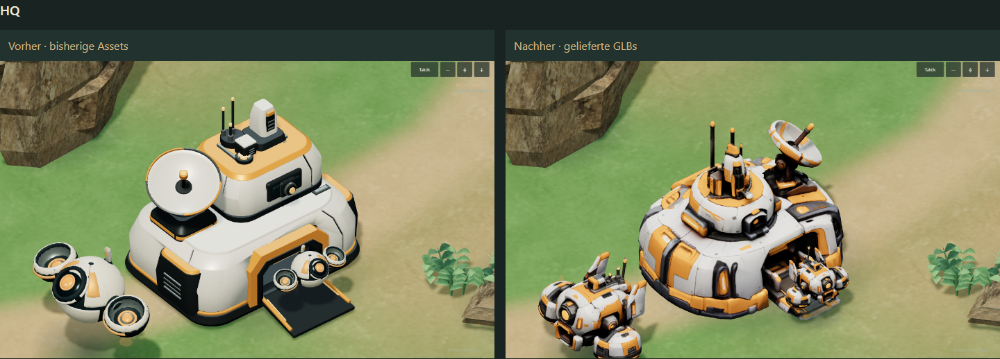
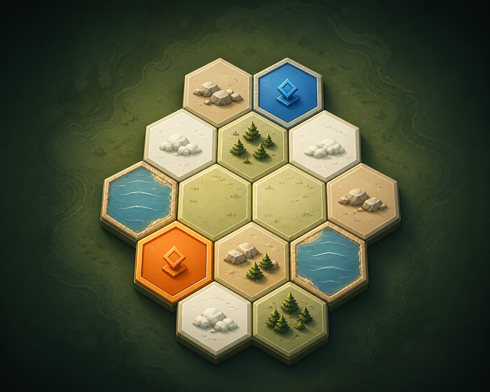
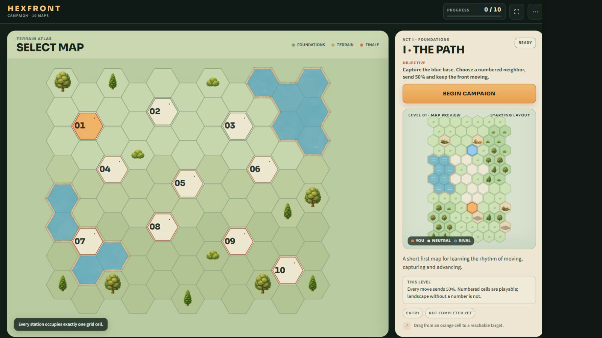
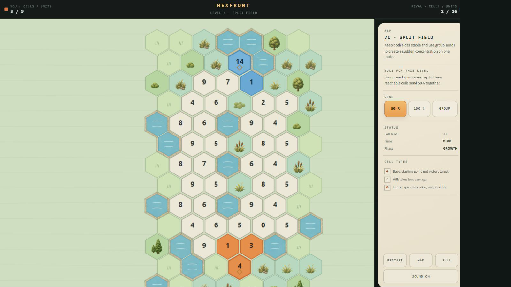
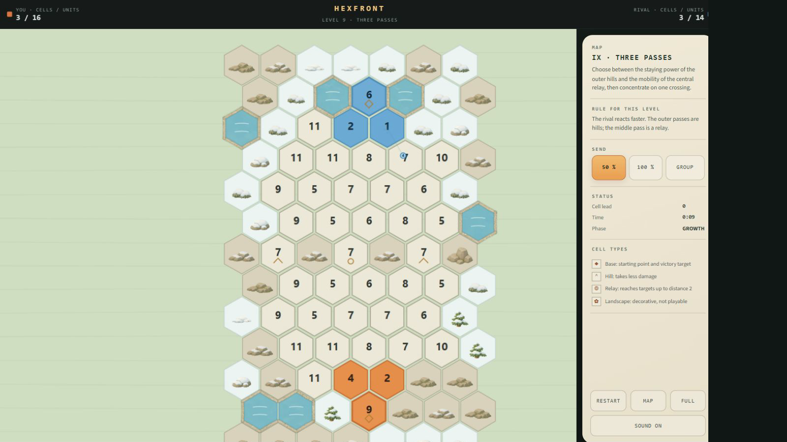

# HEXFRONT

## ▶ Lane Wars – Zentrale Front

Vollständig spielbare **1v1-Partie Mensch gegen KI** mit einer zentralen Lane, vier Fabrikplätzen, drei Robotertypen und drei unterschiedlichen KI-Eröffnungen. Automatische Produktion, Wirtschaft, Umrüstung, begrenzter Sofortnachschub und echtes Spielende durch HQ-Zerstörung. Die bewährte HEXFRONT-Diorama-Optik und das Keramik-HUD bleiben erhalten.

**[▶ Zentrale Front jetzt im Browser spielen](https://rawcdn.githack.com/emfau88/hexwars/c738c46af35780298f154f87e7e327736abc97c0/experiments/hexfront-lane-wars/index.html)** · **[Cooldown-Änderung und Tests](experiments/hexfront-lane-wars/docs/SUPPLY-30.md)**

Der Playlink zeigt den festgelegten Spielstand `c738c46` und benötigt keinen lokalen Server. Falls der Vorschauhost einen Hinweis zeigt, **Open the page** anklicken. Veröffentlicht ausschließlich im Branch `codex/lane-wars`; kein Merge nach main.

**Erste Front** und die Zwei-Lane-Mission **Wiesenkrieg** bleiben unter „Weitere Missionen“ erhalten, ebenso ihre Spielstände, das Kampflabor und die M1.5-Demo. Im Hochformat bleibt die Fabrikverwaltung eingeklappt, bis du sie öffnest.

**Neu:** Roboter kämpfen und sind direkt am Fabrikausgang angreifbar. Mechs schießen mit sichtbarem Abstand (Reichweite 2,8). Als Ausgleich für früher eingreifende Verteidiger haben neue zentrale Partien 800 HQ-LP und 2 HQ-Schaden/s. Bitte eine neue Partie starten; gespeicherte Partien behalten ihre alten HQ-Werte.

**Vorheriger Stand (35 Sekunden):** 79 Logiktests, 30 gezielte 3D-Browserfälle, vollständige Build- und öffentliche Partien mit Sieg/Niederlage, Fortsetzen, Neustart und Hochformat-Touch sowie das Kampflabor. Die sechs reagierenden Referenzpartien dauern 5:27–7:00. Im breiten Audit sind jedoch 28 von 56 Läufen nach zwölf Minuten offen – mehr als zuvor. Diese Balance-Schwäche ist ausdrücklich dokumentiert.

**Aktuell:** Sofortnachschub im Hauptmodus hat **30 Sekunden** Cooldown, auch beim Fortsetzen. 83 Logiktests und gezielte HUD-/Speichertests bestanden. Die sechs neuen Referenzläufe ergeben vier HQ-Entscheidungen und zwei offene Partien nach zwölf Minuten; weitere Balancewerte wurden nicht verändert. [Prüfbericht](experiments/hexfront-lane-wars/docs/SUPPLY-30.md).

**Fabrik als echtes GLB zur Modellfreigabe:** [Drehbare 3D-Vorschau](experiments/hexfront-lane-wars/factory-preview.html) · [Modell, Blender-Quelle und Prüfbericht](experiments/hexfront-lane-wars/docs/factory-model/REVIEW.md). Torsteuerung, Innenraum, Orange/Blau, drei Module und HQ-/Mech-Vergleich. Noch nicht im Spiel integriert; keine weiteren Gameplayänderungen.

```powershell
cd experiments/hexfront-lane-wars
node scripts/serve.mjs
```

[Zentrale Front lokal spielen](http://127.0.0.1:4181/) · [Kampflabor](http://127.0.0.1:4181/lab.html) · [Bedienung und Tests](experiments/hexfront-lane-wars/README.md) · [GDD v0.3.1](experiments/hexfront-lane-wars/docs/GDD.md)

Historische Vorschau: [M2.1 mit Mobile-HUD](https://rawcdn.githack.com/emfau88/hexwars/5016cb1caffc011a5dcd4df34f648994e86f724c/experiments/hexfront-lane-wars/index.html). Die folgenden älteren HEXFRONT-Varianten bleiben unverändert.

## Mixed Squads — ältere Variante

**[Mixed Squads im Browser starten](https://rawcdn.githack.com/emfau88/hexwars/3e514efbe53e463c4e844ddb676ce9da72daaad6/experiments/hexfront-mixed-squads/preview/index.html)**

Vorschau für **`experiment/mixed-squads`**: drei bildschirmfüllende Landschaften, Drohnen und Mechs, cozy Sci-Fi-Menüs und HUD, klarere Hexkonturen und Fraktionsfarben. Falls der Vorschauhost einen Hinweis zeigt, **Open the page** anklicken. Der Link ist auf den geprüften Spielstand `3e514ef` festgelegt.

**[22 Screenshots und Analyse für die weitere Review](experiments/hexfront-mixed-squads/docs/review-2026-10-13)** · [Screenshot-Galerie öffnen](https://rawcdn.githack.com/emfau88/hexwars/3e514efbe53e463c4e844ddb676ce9da72daaad6/experiments/hexfront-mixed-squads/docs/review-2026-10-13/index.html) · [Start, Steuerung und Prüfungen](experiments/hexfront-mixed-squads/README.md)

28 Logiktests und drei Browser-Prüfungen bestanden; alle drei Maps auf Desktop und mobilen Bildschirmformaten geprüft. Die ursprünglichen Spielvarianten und ihre Veröffentlichung bleiben unverändert. Die folgenden Links gehören zu diesen älteren Varianten.

## Isolated 3D experiment — Field Operations

Three playable missions and a redesigned full-screen campaign menu with real 3D map previews, saved unlocks and replay. The original Morgenwacht battlefield is preserved. Windpass adds a canyon with two routes; Auenstrom adds three river crossings.

**[Play the three-mission campaign](https://rawcdn.githack.com/emfau88/hexwars/a1ad71d0361d552086896b68566bbe2bfd26574e/experiments/hexfront-3d/preview/index.html)** · [Previous economy](https://rawcdn.githack.com/emfau88/hexwars/a1ad71d0361d552086896b68566bbe2bfd26574e/experiments/hexfront-3d/preview/index.html?economy=legacy-local) · [Experiment branch](https://github.com/emfau88/hexwars/tree/experiment/hexfront-3d-diorama). If the host shows a notice, click **Open the page**.

Runtime commit: `a1ad71d0361d552086896b68566bbe2bfd26574e`. The pinned preview becomes available after this branch is pushed; local start works independently of GitHub.

**[Rotate all four supplied 3D models](https://rawcdn.githack.com/emfau88/hexwars/a1ad71d0361d552086896b68566bbe2bfd26574e/experiments/hexfront-3d/preview/public/models.html)** · [New HQ / supplied asset pass and comparisons](experiments/hexfront-3d/docs/SUPPLIED_ASSETS.md)

[Local start and controls](experiments/hexfront-3d/README.md) · [Campaign, screenshots and test results](experiments/hexfront-3d/docs/CAMPAIGN.md)

New freestanding HQ with a sealed level foundation, animated radar and team materials; supplied hover-bot and relay integrated. Mech remains viewer-only.



46 logic tests passed. Chromium checks cover three campaign victories, defeats, replay, mouse/touch, mobile framing and the production menu. Full matches use normal simulation commands with an accelerated test clock; no real-device FPS claim. Main and its original deployment remain untouched.

[](https://github.com/emfau88/hexwars/actions/workflows/pages.yml)

HEXFRONT is a compact real-time tactics game for desktop browsers and mobile portrait screens. Expand across a hex grid, distribute growing forces and capture the opposing base.

<p align="center">
  
</p>

## Current screenshots

### Campaign atlas



<table>
  <tr>
    <th>VI · Split Field</th>
    <th>IX · Three Passes</th>
  </tr>
  <tr>
    <td width="50%"></td>
    <td width="50%"></td>
  </tr>
</table>

The upload-ready portal package contains one 1000 × 800 icon and three 1600 × 900 English screenshots in [`docs/portal/kongregate`](./docs/portal/kongregate/README.md).

## Play

[Play the current GitHub Pages build](https://emfau88.github.io/hexwars/)

- Drag from an orange field to a reachable target.
- `50%` sends half of the available force and keeps a reserve.
- Later levels unlock full sends, grouped sends and manual reinforcement.
- Capture the blue base to win the mission.

## Current state

HEXFRONT is a public, playable vertical slice and browser-portal release candidate with a production-safe build and upload artwork. It is not yet a finished commercial release.

- Ten deterministic campaign levels with sequential unlocks and best-time persistence
- Real-time AI, combat, supply, reinforcement and visible endgame systems
- Production terrain-atlas campaign menu with responsive mission dossiers and map previews
- Desktop and mobile-portrait layouts with mouse, touch-drag and fullscreen support
- English by default with a persistent in-game `EN | DE` switch
- Campaign-aligned victory, defeat, retry and next-mission flows
- Connected water and shore rendering plus a restrained 16-asset environment set
- Compact CC0 sound palette for commands, UI, captures and results with a persistent in-game sound toggle
- 43 logic, simulation, localization and regression tests
- Playwright coverage for wide desktop, compact 1100 × 700 desktop and mobile campaign behavior
- Deterministic ten-level balance smoke test

The default `decor-v2` presentation uses mountains, marsh vegetation, snow and natural ground accents. The former lock-like ruin motifs have been replaced by mushrooms, low bedrock, fern/moss and dry grass/fieldstone details without increasing decoration density.

Production builds ignore development query parameters and do not expose the `window.__HEXFRONT__` inspection API. Development and automated-test builds retain those tools for balancing, visual review and browser automation.

Before a commercial release, the remaining priorities are human playtesting and balance evidence, keyboard/tap accessibility, a commercially cleared product name, final audio mix validation on physical devices and validation inside the target distribution portal.

## Kongregate package

Create a fresh portal build with:

```bash
npm run package:kongregate
```

The recommended artifact is `dist/kongregate-upload/hexfront-kongregate-complete.zip`. Upload it in the **WebGL/HTML5 File** field and leave **Additional Files** empty. The ZIP has `index.html` and `assets/` at its root, so the relative production paths stay together.

For an upload form that requires split files, the same command also creates `dist/kongregate-upload/index.html` and `dist/kongregate-upload/hexfront-additional-files.zip`.

## Local development

Requires Node.js 20 or newer.

```bash
npm install
npm run dev
```

Quality checks:

```bash
npm run typecheck
npm test
npm run test:browser
npm run balance
npm run balance:profiles
npm run verify:production
```

`npm run dev` exposes development-only inspection and review tools. `npm run verify:production` creates the player-facing release build and fails if a development entry point leaked into it; the browser suite builds in an isolated test mode so it can exercise the same diagnostics without publishing them.

`npm run balance:profiles` compares cautious, aggressive and tactical human-paced deterministic player models against every campaign level. Each profile runs five reproducible variants with small timing and route-priority differences, so the report gives a win rate as well as individual outcomes. They make slower decisions and estimate combat in rounded values; their available target scan is deliberately bounded but still covers a normal local board view. It is a balance-regression indicator, not a substitute for human playtests.

## Documentation

- [Product and game-design audit](./docs/campaign-audit.md)
- [Prioritized roadmap](./docs/campaign-roadmap.md)
- [Campaign balance report](./docs/campaign-balance-report.md)
- [Localization guide for future EN/DE content](./docs/localization-guide.md)
- [Audio sources and licenses](./public/assets/audio/ATTRIBUTION.md)
- [Completed restructuring brief](./docs/auftrag-hexfront-neustrukturierung.md)
- [Visual design references](./docs/mockups/)

The former turn-based prototype is preserved under [`legacy/tactics`](./legacy/tactics) and is not part of the current runtime.
