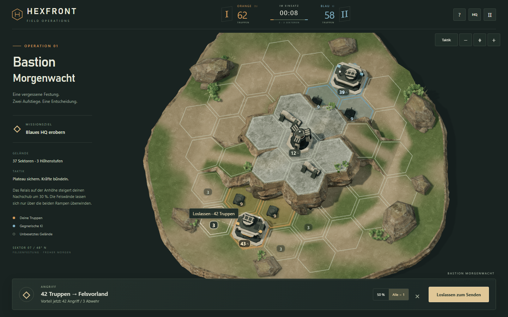
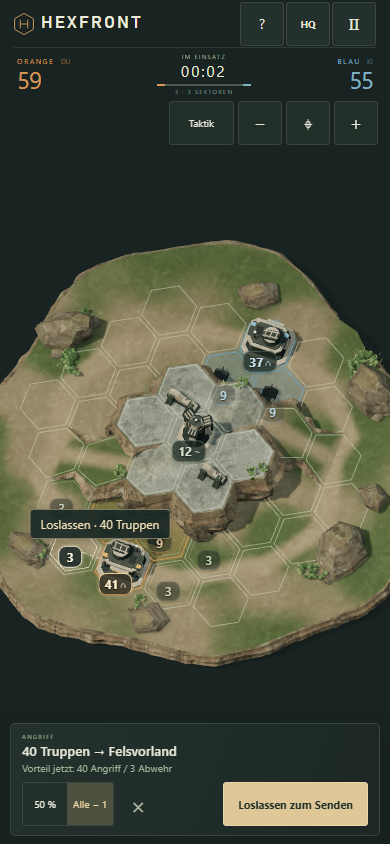

# HEXFRONT — Bastion Morgenwacht

Ein isolierter, tatsächlich spielbarer 3D-Vertical-Slice mit **einem Level**, 37 spielbaren Hexfeldern, zwei HQs, zwei Aufstiegen und einer gegnerischen KI. Orange erobert das blaue HQ; der Verlust des eigenen HQs beendet die Partie.

**[▶ HEXFRONT 3D spielen — mit Drag-and-drop](https://rawcdn.githack.com/emfau88/hexwars/47f5d8b59d5f89de398397c8893bcc30d2030d31/experiments/hexfront-3d/preview/index.html)** · [Experiment-Branch](https://github.com/emfau88/hexwars/tree/experiment/hexfront-3d-diorama)

**Drag-and-drop-Fix veröffentlicht:** Produktions-Commit `47f5d8b59d5f89de398397c8893bcc30d2030d31`. Nach dem erneuten Hotspot-Verbindungsaufbau gelang der Push. Der Link oben enthält den Fix; Ziehbefehle wurden auch über diese öffentliche URL mit Maus und Touch geprüft.

**Drag-and-drop wiederhergestellt:** Eigenes Feld greifen → zum Ziel ziehen → loslassen und senden, wie im Original. Die Klickbedienung bleibt zusätzlich verfügbar. [Steuerung, Gestentrennung und Prüfungen](docs/DRAG.md).

**Overlay-/HUD-Pass:** Ruhigere Zahlenplaketten mit klarer Priorität für Quelle, Ziel, HQs und Bewegungen. Teamfarben bleiben erhalten; mobile Antippflächen sind mindestens 44 Pixel groß. Der kompakte Match-HUD schafft bei 390 × 844 ohne Auswahl 168 Pixel zusätzliche Kartenhöhe, die sichtbare Plakettenfläche sinkt im gleichen Gefechtszustand um 42 %. Mehr Kartenbereich bedeutet wegen der begrenzten Portraitbreite nicht proportional größere Hexfelder. [Vorher/Nachher, Gestaltung und vollständige Spiel-/Eingabetests](docs/HUD.md). Gelände, Assets, Kameraregeln und Gameplay bleiben unverändert.

**Art-Pass Morgenwacht:** Gebrochene, geschichtete Felsflanken, eine eigene Familie aus Kommandobunkern und Relais, ruhige Erdwege und CC0-Felsmaterialien ersetzen die bisherige gleichmäßige Low-Poly-Dekoration. [Vorher/Nachher, Referenzanalyse, Tests und ehrliche Bewertung](docs/ART.md).

**Kamera-Update:** Standard ist jetzt eine orthografische **70°-Taktikansicht**, ergänzt um eine feste 55°-Dioramaansicht. Framing, begrenzter Zoom und Verschieben richten sich nach der tatsächlichen projizierten Geometrie. [Vorher/60°/70°/80°-Vergleich und Eingabetests](docs/CAMERA.md).

**Felder und Besitz:** Deutliche Hexkonturen bleiben ständig sichtbar. Eroberte Bodenflächen und ihre äußeren Ränder werden orange beziehungsweise blau eingefärbt. Eine zusätzliche helle Innenkontur markiert Auswahl und erreichbare Ziele, ohne die Teamfarbe zu ersetzen. Bodenstruktur, Schatten und echte Höhen bleiben erkennbar.

**Veröffentlicht und geprüft am 12.10.2026:** Der Testlink zeigt den aktuellen Produktions-Build mit Drag-and-drop, Overlay-/HUD-Pass, Art-Pass, 70°-Kamera, Teamflächen und Rampen ohne Querstreifen. Der Experiment-Branch ist auf GitHub. Start, Ziehbefehle, Uhr und Pause wurden über die öffentliche URL auf Desktop und Mobile geprüft. Alle 25 ausgelieferten Dateien stimmen bytegenau mit dem eingecheckten Produktionsstand überein. [Aktuelle Online-Nachweise und Hosting-Grenzen](docs/PUBLISH.md).

Die Vorschau verwendet [raw.githack.com](https://raw.githack.com/) als Auslieferungsdienst für dieses öffentliche Repository. **Beim ersten Öffnen auf „Open the page“ klicken.** Dafür sind weder Vercel-Konto noch Anmeldung nötig. Das bisherige Pages-Spiel bleibt unverändert. [Veröffentlichung, Prüfnachweise und Aktualisierung des Testlinks](docs/PUBLISH.md).





## Starten

Node.js 20 oder neuer. Das Experiment hat keine zur Laufzeit zu installierenden npm-Abhängigkeiten: Three.js und die benötigten Asset-Dateien sind versioniert und liegen lokal vor.

Im vorhandenen vollständigen Arbeitsordner direkt mit `cd hexwars-art-publish/experiments/hexfront-3d`, `npm ci` und `npm run dev` starten. Ein eigener Checkout lässt sich so anlegen:

```sh
git clone --branch experiment/hexfront-3d-diorama https://github.com/emfau88/hexwars.git
cd hexwars/experiments/hexfront-3d
npm ci
npm run dev
```

Öffnen: **http://127.0.0.1:4174**

Separater Produktions-Build:

```sh
npm run build
npm run preview
```

`dev` und `preview` verwenden denselben Port; den vorherigen Server zuerst mit Strg+C beenden. Der Build entsteht ausschließlich in `experiments/hexfront-3d/dist/`. Diesen Ordner kann jeder statische Webserver auch in einem Unterverzeichnis ausliefern. Es werden weder externe CDNs noch Portaldienste oder Konten für das Spiel benötigt. Nicht als `file://` öffnen: glTF-Dateien werden über HTTP geladen.

Für ein Smartphone im selben lokalen Netz kann der Server ausdrücklich freigegeben werden:

```powershell
$env:HOST = '0.0.0.0'
npm run dev
```

Dann die LAN-Adresse des Computers mit Port 4174 öffnen. Eine entsprechende lokale Firewall-Freigabe ist gegebenenfalls nötig. Standardmäßig bindet der Server nur an Loopback.

## Spielen

1. **Operation starten**. Orange ist die südliche Fraktion.
2. Ein eigenes Feld, Gebäude oder seine Truppenzahl greifen und zum Ziel ziehen. Helle Konturen markieren erreichbare Ziele; die Linie zeigt die begehbare Route.
3. **Loslassen sendet sofort.** Außerhalb des Spielfelds oder auf der Quelle loslassen bricht ab; Felswände und unerreichbare Ziele senden keine Truppen. Alternativ Quelle und Ziel antippen und **Befehl geben**.
4. `50 %` teilt eine Garnison; `Alle − 1` lässt eine Einheit zurück. Eigene Zwischenfelder dürfen durchquert werden. Wird eine Route erobert, trifft der Konvoi dort auf den Gegner.
5. Das gegnerische HQ einnehmen. Bei Sieg oder Niederlage lässt sich das identische Level neu starten.

Maus und Touch unterstützen Drag-and-drop und zusätzlich die bisherige Klick-/Tippsteuerung. Die gewählte Stärke (`50 %` / `Alle − 1`) gilt für beide. **Ziehen von einem eigenen Feld gibt einen Befehl; Ziehen am Hintergrund verschiebt die vergrößerte Karte.** Zwei Finger navigieren und zoomen immer; die Maus kann auch mit rechter oder mittlerer Taste auf jedem Feld verschieben. Escape, Touch-Abbruch und ein zweiter Finger brechen einen begonnenen Truppenzug ab. **Taktik/Diorama** wechselt zwischen zwei festen orthografischen Perspektiven (70°/55° über dem Boden). Mausrad, Pinch oder +/− zoomen zwischen Übersicht und 2,2-facher Vergrößerung; die vergrößerte Karte lässt sich begrenzt ziehen. `⌖` stellt die vollständige taktische Übersicht wieder her. Auf sehr kurzen Smartphones nutzt du **+ für Details** und ziehst den Ausschnitt zum gewünschten Feld. Sichtbare Gebäude wählen ihre eigene logische Zelle; Felswände melden eine ungültige Auswahl. `?` öffnet die kurze Anleitung. Die Leertaste pausiert, wenn kein Steuerelement fokussiert ist. Die Partie pausiert auch beim Verlassen des Tabs; nach Rückkehr bewusst fortsetzen.

**Taktik:** Die beiden schmalen Aufstiege sind Engpässe. Bergauf besitzt der Verteidiger +30 % Stärke, bergab der Angreifer +15 %. Das HQ bietet +20 % Verteidigung. Es gilt nur der größere Verteidigungsbonus; es wird kein zusätzlicher alter Hill-Bonus angewendet. Das Relais erhöht die eigene Produktion um 30 %. Ein Angriff kann sich während der Anreise durch gegnerische Verstärkungen verändern.

## Prüfungen

```sh
npm test
npm run build
```

Für die optionalen Chromium-Tests:

```sh
npm install --no-save --package-lock=false playwright@1.62.1
npx playwright install chromium
npm run test:browser
npm run test:camera
node tests/territory.mjs
npm run test:art
npm run test:overlay
npm run test:drag
```

`node tests/hosted.mjs` prüft eine über `PREVIEW_URL` angegebene Produktions-URL mit echten Maus-/Touchbefehlen und nimmt die Abgabe-Screenshots auf. Mit `PREVIEW_URL=local` startet der Test selbst einen Produktionsserver auf Port 4178; alternativ akzeptiert die Variable eine eigene URL. In PowerShell: `$env:PREVIEW_URL='local'; node tests/hosted.mjs`. Den aktuellen Testlink dazu ausdrücklich als `PREVIEW_URL` angeben. Die öffentliche Vorschau und der lokale Aufruf im Unterverzeichnis sind geprüft. Der Test bestätigt bei raw.githack.com zunächst den angezeigten Link auf genau dieses Repository und diesen Commit. `--art --match --drag` prüft die Ziehsteuerung; `--mobile` beschränkt einen Wiederholungslauf auf Touch. Fehlgeschlagene Requests werden erfasst; blockierte Drittanbieterwerbung der Hosting-Bestätigungsseite steht separat unter `hostWarnings`.

Für die aktuellen Art-Abgabebilder: `$env:PREVIEW_URL='local'; node tests/hosted.mjs --art`. Die reinen Landschaften und unveränderten Vorher-Aufnahmen liegen in `docs/art/`. Der 70°-Vergleich benutzt identischen Spielzustand und Viewport. Für die Eingabeprüfung ohne Überschreiben historischer Kameraberichte: `$env:TEST_OUTPUT='docs/art'; node tests/camera-input.mjs`.

Der neue Overlay-Vergleich in `docs/hud/` enthält Start, laufendes Gefecht, Auswahl, Befehl und Bewegung bei exakt gleichen logischen Zuständen. `npm run test:overlay` vergleicht mit der geschützten Baseline. Aktuelle öffentliche Aufnahmen: `$env:TEST_OUTPUT='docs/hud-live'; node tests/hosted.mjs --art --match`, mit dem Play-Link als `PREVIEW_URL`. [Ergebnisse und Grenzen](docs/HUD.md).

Für die historischen Kamera-Abgabebilder: `$env:PREVIEW_URL='local'; node tests/hosted.mjs --camera`. Der Winkelvergleich und die Eingabetests speichern ihre Belege in `docs/camera/`. `docs/screenshots/` und `docs/QA.md` dokumentieren zusätzlich die ursprüngliche Prototype-Abnahme vor dem Kamera-Update.

Der Browsertest startet eigene lokale Server, testet Desktop und Touch-Portrait, schreibt Screenshots und einen maschinenlesbaren Bericht nach `test-results/` und beendet die von ihm gestarteten Prozesse. Eine vorhandene Playwright-Installation lässt sich alternativ über `PLAYWRIGHT_MODULE` angeben; `PLAYWRIGHT_BROWSERS_PATH` wird von Playwright unterstützt.

Die Testseite `?qa=1&clock=manual` stellt ausschließlich im Entwicklungs-Build eine **manuell fortschaltbare Uhr und lesbare Diagnosen** bereit. Matchtests benutzen normale Maus-/Touch-Befehle und verändern keine Garnisonen oder Gewinner. Die Produktionsvariante deaktiviert die Diagnose-API und die manuelle Uhr.

## Umsetzung und Isolation

- Eigenständiges ES-Modul-Projekt, eigener Lockfile, eigener Node-HTTP-Server und Build. Kein Import aus der bisherigen Kampagne.
- Three.js r169 mit WebGL 2, orthografischer Kamera, PBR-Materialien, Schatten, Kontaktschatten, Weltkoordinaten-Texturen und gebündelter statischer Geometrie.
- Durchgehende, geschlossene Geländeoberfläche; Seitenflächen werden nur an tatsächlichen Höhenunterschieden und am äußeren Diorama-Rand erzeugt. Keine schwebenden Einzel-Hexblöcke.
- Hex-Höhen 0/1/2 sind Daten. Die vier expliziten Übergangskanten der zwei Rampen bestimmen Navigation, KI, sichtbare Rampengeometrie und Bewegungsanimation.
- Fünf optimierte CC0-Texturen aus zwei Poly-Haven-Materialien und vier Quaternius-Farne. Eigens modellierte Felsfamilie, geschlossene Plateauflanken, Kommandobunker, Relais, Betonruinen und gebogene Blatt-/Grasgeometrie. Unbenötigte Altmodelle werden nicht mehr ausgeliefert. Keine KI-Hintergrundgrafik und keine Tacticus-Assets.
- Statische Modelle werden nach Material gebündelt; Fahrzeuge werden instanziert. `HQ/LQ` schaltet Renderauflösung und Schattenauflösung um.

Die bestehende 2D-Version, `legacy/`, Root-Scripts, Portalpakete und `.github/workflows/pages.yml` bleiben unverändert. Die vorhandene Pages-Pipeline veröffentlicht nur `main`; dieses Experiment ändert keine Veröffentlichung und wird nicht automatisch gemergt.

Weitere Details: [Entscheidungen und Repository-Analyse](docs/DECISIONS.md), [Asset-Quellen und Lizenzen](ASSET_LICENSES.md), [Aktuelle Art-Qualität und Tests](docs/ART.md), [historischer Prototyp-QA-Bericht](docs/QA.md).

## Ehrliche visuelle Einordnung

Das Ergebnis zeigt einen zusammenhängenden, materialisierten 3D-Ansatz mit echter spielbarer Topografie. **Das visuelle Produktionsniveau von Tacticus wird noch nicht erreicht.** Der Art-Pass verbessert Felsoberflächen, Bruchformen, Gebäudesilhouetten und Materialtrennung sichtbar. Das unveränderte Hexplateau bleibt an seiner Oberkante geometrisch erkennbar; maßgeschneiderte hochauflösende Sculpt-/Bake-Assets, detaillierterer Architekturverschleiß sowie professionelles Figuren- und Animations-Artwork fehlen weiterhin. Die Spielflächen sind bewusst ruhiger und weniger dicht dekoriert. Die vollständige Einzelbewertung steht in [ART.md](docs/ART.md).

Die automatisierten Partien belegen Spielbarkeit und realistische Gewinn-/Verlustmöglichkeiten, aber keine langfristig belastbare Balance. Die Zielspanne von 3–6 Minuten ist ein Richtwert; schnelle Angriffe, langsame Entscheidungen und Verteidigung können davon abweichen. Für eine Produktentscheidung sollten mehrere Menschen auf echten Android-/iOS-Geräten spielen. Mobile Emulation belegt weder echte Geräte-FPS noch thermische Stabilität.
