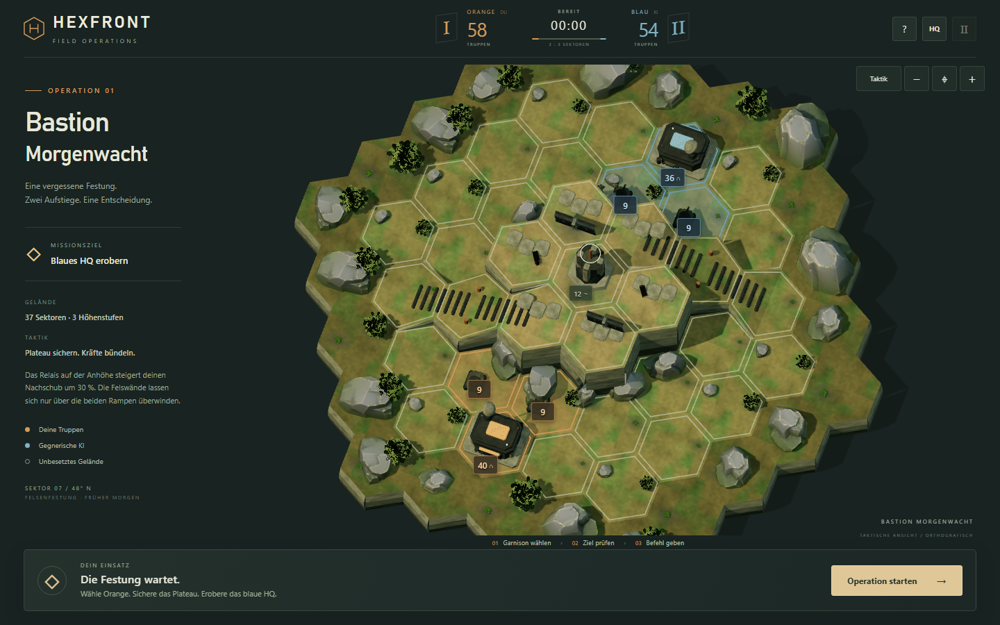
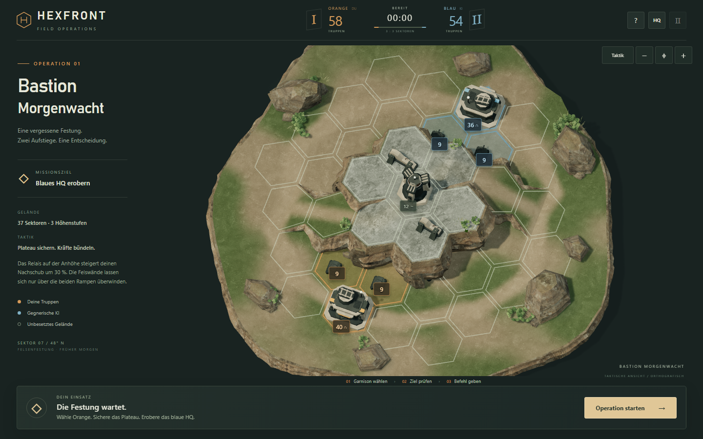
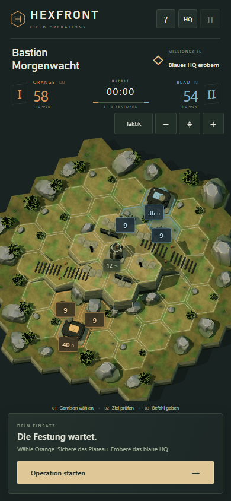
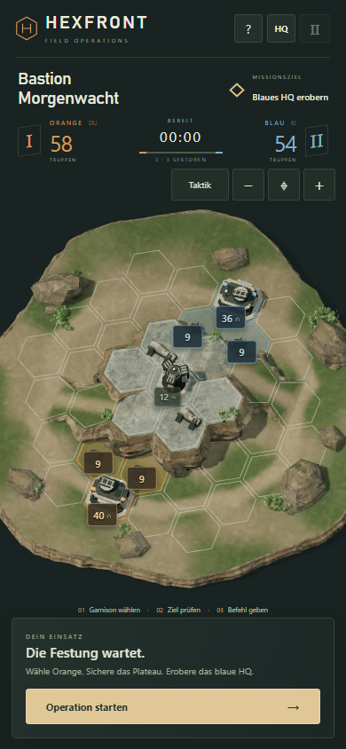
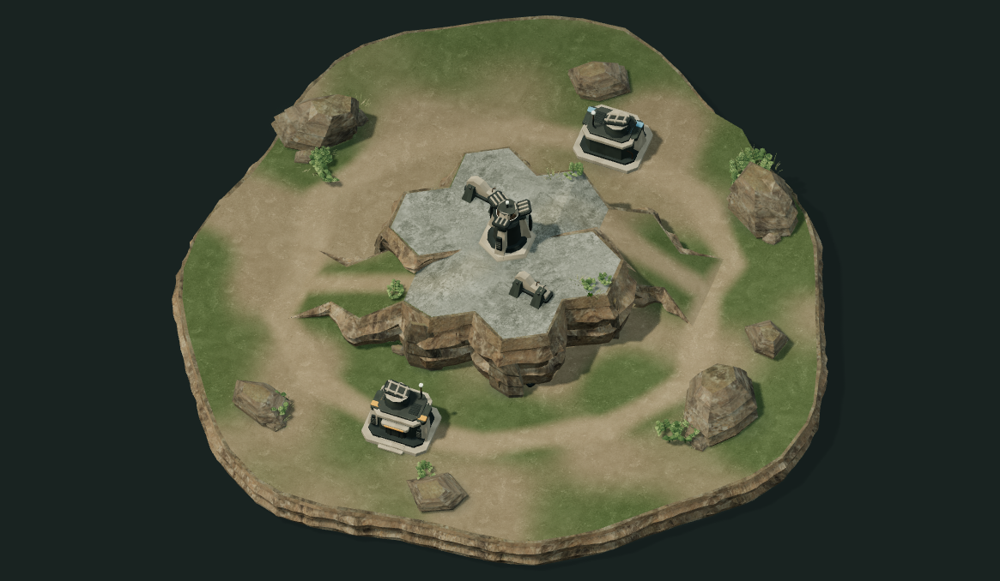

# Art Direction – Morgenwacht

Art-Pass ab Commit `8cfb89c448029f0e81a7c70fc20b17cd1cc4fdae`, 12.10.2026. Unverändert: 37 Felder, Höhen, Rampengraph, HQ-Positionen, Spiel/KI, Kamera und UI.

## Referenzanalyse vor der Modellierung

Visuell geprüft: zwei echte Gameplaybilder aus [Multiplayer.it, Tacticus-Review](https://multiplayer.it/recensioni/warhammer-40000-tacticus-recensione-strategico-ios-android.html), Bilddateien `warhammer-tacticus_5_6P4Ju1Z` und `warhammer-tacticus_2_9tHGitU`. Die lokale Referenzablage liegt außerhalb des Repositorys; keine dieser geschützten Grafiken wird als Spielasset oder als eigene Arbeit geliefert.

Beobachtungen: breite und ruhige begehbare Flächen; erkennbare große Bruchkanten statt vieler kleiner Steine; Vegetation konzentriert in zusammenhängenden Inseln; harte Architektur hebt sich vom weicheren Boden ab; breite Lichtkanten und dunklere Kontaktzonen erzeugen Miniaturwirkung. Die Referenz arbeitet selbst mit vereinfachten Formen – entscheidend sind Silhouetten, Materialtrennung und Komposition. Keine Übernahme von Fraktionen, Symbolen oder Gebäuden.

## Konzept

Graubraune, gebrochene Schieferformationen tragen eine verlassene Signalbastion. Trockenes Erdreich und gedämpfter Salbei rahmen festgetretene Wege. Heller, poriger Beton bildet die tragenden Gebäudeteile; Graphitmetall liegt in zurückgesetzten technischen Zonen. Kleine Ocker- und Blaugrau-Akzente kennzeichnen Teams. HQs verwenden eine gemeinsame Familie aus gekanteten Schutzwangen, gestuftem Sockel und kompakter Kommunikationskrone. Das Relais übernimmt diese Formsprache als offener dreiteiliger Signalturm.

Die Detailhierarchie bleibt: große gebrochene Felsflächen → erkennbare Architektur → wenige Pflanzen- und Geröllgruppen. Hexmitten bleiben frei. Keine neue Dekoration pro Feld.

## Ressourcenauswahl

- [Poly Haven](https://polyhaven.com/license): CC0, inklusive kommerzieller Nutzung und Redistribution. Ausgewählt: [Rock Boulder Dry](https://polyhaven.com/a/rock_boulder_dry) von Dimitrios Savva/Rico Cilliers und [Rock Wall 02](https://polyhaven.com/a/rock_wall_02) von Rob Tuytel. Ausgeliefert werden nur fünf benötigte Maps: Diffuse 1024² sowie OpenGL-Normal/Roughness 512², als WebP optimiert.
- [Quaternius Modular Sci-Fi MegaKit](https://quaternius.com/packs/modularscifimegakit.html): CC0 bestätigt. Die vorhandenen modularen Wände ergeben im kleinen Spielmaßstab keine ausreichend eigenständige HQ-Silhouette; Hauptarchitektur wird gezielt modelliert.
- [Kenney Nature Kit](https://kenney.nl/assets/nature-kit): CC0 bestätigt, für diesen Pass zu stark vereinfachte Naturformen.
- Vier vorhandene Quaternius-Farne bleiben als kleine Ergänzung erhalten. Große Felsen und die Plateauhaut erhalten eigens modellierte Bruchformen, damit sie präzise zum unveränderten Höhen- und Rampensystem passen.

Vorher-Aufnahmen: [Desktop](art/desktop-before.png), [Mobile](art/mobile-before.png), [reine Landschaft](art/desktop-before-landscape.png). Alle bei 70°, identischem Startzustand und 1440 × 900 bzw. 390 × 844.

## Umsetzung und bewusste Reduktion

Der Pass liegt in `src/art.js`; `scene.js` bindet ihn in die bestehende Szene, Materialbündelung und Auswahl ein. Die bisherigen Gelände-/Dekobauer wurden ersetzt. `map.js`, `game.js`, `camera.js`, `main.js`, `style.css` und `index.html` bleiben gegenüber dem Ausgangscommit unverändert. Es gibt keine neuen Spielfunktionen.

- **Felswände:** Geschlossene, mehrfach unterteilte Flanken mit variabler Ausladung, gebrochenen Schichtkanten, versetzten Bruchflächen und vier angefügten Felsschultern. Weltbasierte Variation hält Anschlüsse zusammen. Nur der dekorative Außenrand wird organischer; alle spielbaren Top-Dreiecke behalten ihre ursprünglichen Höhen.
- **Felsfamilie:** Sieben unterschiedliche eckige Grundrisse, gestufte Profile und unterschiedliche Neigungen. Drei große und vier mittlere Formationen bilden gezielte Randgruppen; zwölf kleine Splitter ergänzen diese Gruppen und vier Felsfußbereiche. Keine regelmäßige Objektverteilung über freie Hexfelder.
- **Architektur:** Beide HQs teilen geschützte Betonwangen, Sockel und Treppen, zurückgesetzte Türen, Lüftungsgitter, Leitungen, Schraubpunkte, Dachaufbau und gerahmtes Antennenfeld. Teamfarben bleiben kleine Bänder. Das zentrale Relais trägt drei erhöhte Kommunikationspaneele und eine mittige Schüssel. Vier beschädigte Betonmauern ersetzen die alten Modulwände.
- **Boden:** Ein gemeinsamer 1024²-Atlas mischt trockene Erde, zurückhaltende Grasinseln, helle Laufspuren und felsige Hochflächen in Weltkoordinaten. Photografische Details werden gedämpft; ein separater Höhenkanal erzeugt dezentes Relief. Keine kontrastreichen Einzeltexturen pro Hex.
- **Materialhierarchie:** Matter, heller Beton; dunkleres, nur schwach metallisches Gerät; rauer brauner Schichtfels; kühlere Plateauoberflächen; gedämpfte Vegetation. Fels-Normalmaps sind bewusst schwach eingestellt. Texturmaßstab, Farbgebung und Licht gleichen die Quellen an.
- **Vegetation:** Neun Gruppen an bewusst gewählten Rändern und Felsfüßen; gebogene Gräser, verzweigte Blätter und vier Farne. Spielflächen bleiben überwiegend frei. Die Blattgeometrie wurde nach der ersten Sichtprüfung reduziert.
- **Licht:** Ein warmes gerichtetes Hauptlicht, schwache kühle Aufhellung und gedämpftes Hemisphärenlicht. PCF-Schatten mit weicherem Rand und vorhandene Kontaktflächen verankern die Objekte. Kein Bloom, keine zusätzliche Postprocessing-Kette.

Statische Geometrie wird weiterhin nach Material zusammengefasst. Die alten großen Quaternius-Felsen, der Busch, die Modulwand und die Konsole sind aus dem spielbaren Paket entfernt. Der Build bereinigt ausschließlich sein geprüftes `dist`-Verzeichnis, damit gelöschte Assets nicht in der Auslieferung zurückbleiben.

## Visuelle Iterationen

Die [Zwischenaufnahme nach dem Aufbau der Großformen](art/phase-2-landscape.png) wurde ohne HUD geprüft. Dabei fielen zu starke Hell-Dunkel-Unterschiede der Architektur, zu gleichförmige Schichtbänder und zunächst offene Rampenflanken auf. Korrigiert wurden Materialhelligkeit, Reliefverteilung, alle Rampenflanken, die Windungsrichtung beschädigter Mauern und die Größe der Relaiskrone. Eine spätere Geometrieprüfung erkannte zu große Ausladungen an kurzen äußeren Randkanten; dort wurde das Relief begrenzt, während das Plateau die kräftigeren Bruchformen behält. Auf Nutzerwunsch wurden anschließend die querliegenden Rampenstreifen samt regelmäßigem Befestigungsbesatz entfernt; die Rampen zeigen durchgehenden Boden. Danach wurden Nahansichten und Mobile erneut geprüft. Ein automatischer Build war ausdrücklich nicht das alleinige Abnahmekriterium.

### Vergleich mit identischer Perspektive

Jeweils 70° über der Bodenebene, Zoom 1, Startzustand 00:00, dieselben 37 Sektoren und Garnisonen; Desktop 1440 × 900 und Mobile 390 × 844. Der Screenshot-Test vergleicht den vollständigen logischen Spielzustand mit der gespeicherten Baseline. Die unveränderte automatische Einpassung berücksichtigt die neuen Objektabmessungen.

| Ansicht | Vorher | Nachher |
|---|---|---|
| Desktop | [Originalbild](art/desktop-before.png) | [Originalbild](art/desktop-after.png) |
| Mobile | [Originalbild](art/mobile-before.png) | [Originalbild](art/mobile-after.png) |
| Landschaft bei 70° | [Ohne Overlay](art/desktop-before-landscape.png) | [Ohne Overlay](art/desktop-after-landscape.png) |

<table><tr><th>Vorher · Desktop</th><th>Nachher · Desktop</th></tr><tr><td></td><td></td></tr></table>
<table><tr><th>Vorher · Mobile</th><th>Nachher · Mobile</th></tr><tr><td></td><td></td></tr></table>

Die folgende reine Landschaft nutzt zusätzlich die **bereits vorhandene 55°-Dioramaansicht**. HUD, Truppenmodelle, Zahlen, Konturen, Besitzflächen und Zielmarker sind für diese Aufnahme ausgeblendet. Dies ist eine Runtime-Aufnahme der echten Geometrie, kein KI-Rendering und kein Hintergrundbild.

Nahaufnahmen bei vorhandenem Detailzoom: [HQ](art/hq-detail.png), [Plateau und Relais](art/plateau-detail.png). Die finalen Produktionsbilder sind [Desktop](art/final-desktop.png) und [Mobile](art/final-mobile.png).

## Bewertung gegenüber dem Auftrag

| Bereich | Ergebnis und verbleibende Grenze |
|---|---|
| Felsgeometrie | Geschichtete, aufgebrochene Flanken und unterschiedliche größere Formationen wirken massiver. Die logische Hexkante bleibt an der Plateauoberseite sichtbar; frei gesculptete Felsmassive mit individuell gebackenen Normalmaps sind nicht vorhanden. |
| Materialien | Echte CC0-Oberflächendetails, Normal/Roughness und ein zusammenhängender Bodenatlas schaffen klarere Trennung. Beton/Metall verwenden sparsame prozedurale Verwitterung; individuelle Gebrauchsspuren und sorgfältige UV-Bakes fehlen noch. |
| Gebäudesilhouetten | Die HQ-Familie und das dreiteilige Relais sind deutlich charakteristischer als zuvor. Die Details bleiben bewusst kompakt und erreichen kein vollständig von Environment-Artists ausgearbeitetes Produktionsasset. |
| Visuelle Hierarchie | Plateau und strategische Gebäude dominieren; große Felsen und Pflanzen sitzen in wenigen Gruppen. Die Szene enthält weniger breit verteilte Dekoration. |
| Beleuchtung | Einheitliche Lichttemperatur, mildere Materialkontraste und weichere Schatten. Kontaktwirkung entsteht durch Schattenkarten und dezente Kontaktflächen; kein gebackenes AO/GI pro Asset. |
| Spielflächen | Ruhige, freie Hexmitten, lesbare Höhen, erhaltene Umrisse und Orange/Blau-Flächen. Randdekoration darf im taktischen Fit teilweise abgeschnitten sein; spielbare Ecken bleiben sichtbar. |
| Stilkonsistenz | Eine gemeinsame Architektur- und Felsfamilie, zurückhaltend angepasste CC0-Texturen und sehr wenige externe Pflanzen. |
| Desktop/Mobile | Desktop zeigt Material- und Gebäudedetails; Mobile bewahrt Silhouetten und Spielflächen, feine technische Details sind in der Gesamtübersicht naturgemäß klein. |

**Das vollständige visuelle Produktionsniveau von Tacticus ist nicht erreicht.** Dies ist ein sichtbar verbesserter, integrierter Art-Pass mit echter neuer Geometrie und Materialarbeit. Für einen gleichwertigen Premium-Look fehlen vor allem ein weiterer gezielter Sculpt-/Bake-Pass für die Felsen, maßgeschneiderte Architekturtexturen und professionell ausgearbeitete Figuren/Animationen. Diese Einschränkung wird nicht als durch mehr Kleindekoration lösbar dargestellt.

## Funktionale und visuelle Abnahme

Alle folgenden Ergebnisse beziehen sich auf den finalen Art-Stand **ohne Rampenquerstreifen**:

- **15 bestehende Logik-/Kameratests bestanden:** unveränderter Rampengraph, Höhengrenzen, Pfade, Boni, KI, Sieg/Niederlage und Neustart.
- **Geometrieprüfung:** pro Ansicht 259 Bodenproben stimmen bis auf 0,0001 Einheiten mit den logischen Topflächen überein; 738 Strahlen treffen Felswände und Rampenflanken. Keine fehlende Stichprobe, kein ungültiger Vertex. [Nachher-Bericht](art/after-report.json).
- **Maus/Touch:** jeweils alle 37 Felder bei 1440 × 900, 390 × 844, 320 × 568, 375 × 667 und 430 × 932 ausgewählt. Bei 320 × 568 sind 33 Felder direkt in der Übersicht und vier nach Detailzoom erreichbar. Keine abgeschnittene spielbare Ecke. Höhen 0/1/2, untere Felder neben Felswänden, beide HQ-Dächer, 70°/55°-Wechsel, Zoomgrenzen, Pinch/Mausrad, Ziehen und Fit geprüft; Gesten lösen keine Spielbefehle aus. [Eingabebericht](art/input-report.json).
- **Vollständige Partien:** Desktop 1366 × 768 und Touch-Portrait 390 × 844 jeweils Sieg nach 238,30 s Spielzeit mit 47 echten UI-Befehlen, während die KI 35 Befehle ausführt. Danach Neustart, Niederlage ohne Gegenwehr nach 239,55 s bei 37 KI-Befehlen und erneuter Neustart. Pausieren, ungültiger Angriff durch eine Felswand, alle drei Höhen und Qualitätsschalter ebenfalls geprüft. [Matchbericht](art/match-report.json).
- **Testmethode:** Eine deterministische Strategie bedient die normalen Maus-/Touchflächen. Die Entwicklungsuhr wird in kleinen Simulationsschritten fortgeschaltet; Gewinner, Garnisonen und Besitz werden nicht direkt umgeschrieben. Das ersetzt keine Spieletests durch Menschen.
- **Produktionsmodus:** separater lokaler HTTP-Server, normale laufende Uhr, echte Bewegungskommandos und Pause auf Desktop/Mobile. Keine QA-API, keine fehlenden Assets/HTTP-Fehler, keine Browserausnahme, kein horizontaler Layoutüberlauf. [Produktionsbericht](art/production-report.json), [Dateien und Hashes](art/build-report.json).
- **Isolation:** Karte, Spiellogik, Kamera, Main-Controller, HTML und CSS sind bytegleich zum Ausgangscommit. [Hashnachweis](art/invariants-report.json).

Die Übersicht, reine Landschaft, HQ-/Plateau-Nahaufnahmen, Desktop-/Mobile-Produktion und beide Ansichten im laufenden Gefecht wurden tatsächlich visuell angesehen. Screenshots dokumentieren außerdem [Desktop-Gefecht](art/desktop-battle.png), [Mobile-Gefecht](art/mobile-battle.png), [Sieg](art/desktop-victory.png) und [Niederlage](art/mobile-defeat.png).

### Rendering und Ladeumfang

| Messung | Ausgangsstand | Finaler Art-Pass |
|---|---:|---:|
| Renderer-Zeichenaufrufe im identischen Startzustand | 119 | 111 |
| Gemeldete Dreiecke im Startzustand | 74.134 | 55.907 |
| Produktionsdateien | 29 | 24 |
| Produktionsdaten unkomprimiert | 1.599.313 Bytes | 2.295.203 Bytes |

Damit sinken die Zeichenaufrufe um rund 6,7 % und die gemeldeten Dreiecke um 24,6 %. Die bessere Texturbasis erhöht gleichzeitig den Downloadumfang. Die fünf Materialdateien sind auf zusammen 1.124.878 Bytes reduziert; Normal/Roughness werden nur in 512² ausgeliefert. Schatten-/Renderauflösung lassen sich weiterhin über `HQ/LQ` reduzieren.

Im Vorher/Nachher-Aufnahmelauf betrug die Zeit bis zur fertigen Ansicht lokal etwa 2,53/2,09 s (Desktop/Mobile) vorher und 2,95/2,59 s nachher. Das sind einzelne lokale Software-Render-Durchläufe, keine belastbare Netzwerk- oder Gerätebenchmark. Im abschließenden Produktionstest betrug die Ladebereitschaft 3,98/2,71 s.

| Finaler Software-Renderlauf | Median Framezeit | P95 Framezeit |
|---|---:|---:|
| desktop | 83.3 ms | 100 ms |
| mobile | 50 ms | 66.7 ms |

Gemessen wurde Chromium über **ANGLE/SwiftShader**, also Software-Rendering, Pixelverhältnis 1. Die jeweils 120 gemessenen Frames dienen der transparenten Dokumentation dieser Umgebung. Daraus wird ausdrücklich keine 60-FPS-Aussage für echte Android-/iOS-Geräte abgeleitet. Geräte-FPS, höhere Pixeldichten, thermische Stabilität und Safari/WebKit bleiben ungeprüft.

## Reproduktion und Veröffentlichung

Startbefehle stehen in der [Experiment-README](../README.md). `npm run test:art` erneuert ausschließlich die Nachherbilder; die historische Baseline bleibt erhalten. Optionales `--baseline` dient nur einer bewusst neuen Ausgangsaufnahme und darf nicht zum Überschreiben dieses Vorher-Vergleichs verwendet werden.

Alle externen Dateien, Autoren, Quellen, Lizenzen, Original-/Auslieferungs-Hashes und Optimierungen stehen in [ASSET_LICENSES.md](../ASSET_LICENSES.md) und den referenzierten Provenienzdateien. Die fünf ausgewählten WebP-Texturen belegen zusammen 1.124.878 Bytes; keine kompletten Pakete und keine Referenzscreenshots werden ausgeliefert.

Der Pass ist ausschließlich im Experiment-Branch gespeichert. Main, Pages-Workflow und frühere Veröffentlichungen bleiben unverändert. Push und erneutes Deployment sind gemäß der bisherigen Anweisung zurückgestellt. Der README-Testlink zeigt deshalb weiterhin die ältere veröffentlichte Fassung, nicht diese Art-Überarbeitung.
