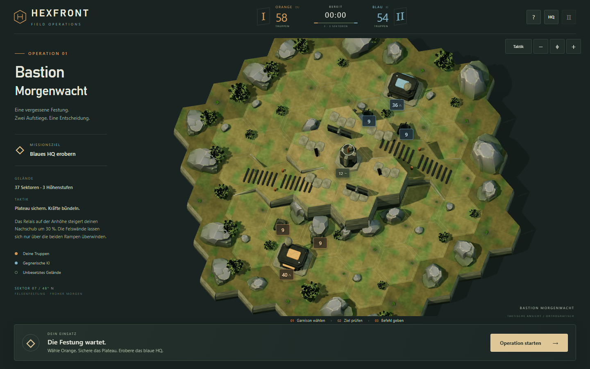
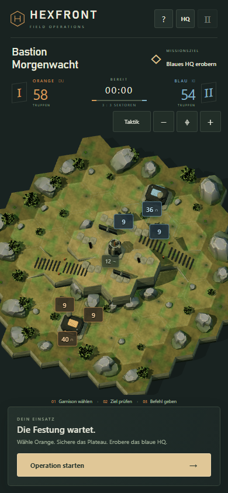

# Kamera und Schlachtfeldübersicht

Kamera-Nachtrag zum isolierten Prototyp, 12.10.2026. Ausgangsstand: `622b485fc273b0b54255c35c3427fc4b13c8e920`. Branch: `experiment/hexfront-3d-diorama`. Keine Änderung an Leveldaten, Kampfregeln, KI, Modellen, Texturen, Hauptspiel oder Deployment.

## Entscheidung: 70° über dem horizontalen Boden

**70° ist die Standard-Taktikansicht.** Alle 37 spielbaren Felder besitzen eine sichtbare Oberfläche; hinter dem Plateau gehen keine kompletten Sektoren mehr verloren. Die Hexe sind weniger zusammengedrückt, beide HQs und beide Rampen sind klar erkennbar. Die Ausrichtung bleibt konstant: Orange unten, Blau oben.

60° erhält größere Felswände, verdeckt aber mehr der dahinterliegenden Flächen. 80° verbessert einige Boden-Sichtlinien noch etwas; im direkten Bildvergleich werden Wände, Rampenneigung und Baukörper deutlich flacher. 70° erhält die räumliche Lesbarkeit des Dioramas bei guter taktischer Übersicht. Die drei Winkel wurden tatsächlich gerendert, nicht anhand einer Winkelzahl allein ausgewählt.

Ein kleiner **Taktik/Diorama**-Schalter bietet zusätzlich eine feste **55°-Dioramaansicht**. Sie passt die gesamte Miniatur einschließlich des dekorativen Außenrands ein. Die Taktikansicht passt sämtliche spielbaren Felder und dazugehörigen hohen Objekte ein; Teile des unspielbaren Dekorationsrands dürfen dabei außerhalb des Bildes liegen. Es gibt keine freie Rotation.

## Vergleichsbilder

Identischer Ausgangszustand, dieselbe Karte, Qualität HQ, 1 CSS-Pixel pro Screenshot-Pixel, manuelle Uhr bei 00:00, Operation noch nicht gestartet. Die Vorher-Bilder wurden **vor** der Kameraänderung aufgenommen. Die frühere Kamera maß tatsächlich 43,12° auf Desktop beziehungsweise 48,33° auf Mobile über dem Boden.

| Ansicht | Desktop, 1440 × 900 | Mobile Portrait, 390 × 844 |
|---|---|---|
| Vorher | [Originalbild](camera/desktop-before.png) | [Originalbild](camera/mobile-before.png) |
| 60° | [Runtime-Screenshot](camera/desktop-60.png) | [Runtime-Screenshot](camera/mobile-60.png) |
| **70°, Standard** | [Runtime-Screenshot](camera/desktop-70.png) | [Runtime-Screenshot](camera/mobile-70.png) |
| 80° | [Runtime-Screenshot](camera/desktop-80.png) | [Runtime-Screenshot](camera/mobile-80.png) |

Finaler Produktions-Build:





## Messung und sichtbares Ergebnis

Für eine reproduzierbare Näherung werden **sieben Bodenpunkte pro Feld** geprüft: Mitte und sechs um 68 % zum jeweiligen Eckpunkt versetzte Punkte. Ein Punkt gilt als sichtbar, wenn die Kamera-Sichtlinie nicht zuvor massive Geometrie trifft. Ausgeschnittenes Blattwerk, Fahrzeuge und HTML-Zahlen werden bei dieser geometrischen Stichprobe nicht als Hindernis gezählt. Sie ersetzt die visuelle Screenshot-Prüfung nicht. Ein HQ verdeckt absichtlich Teile seines eigenen Bodens; die HQ-Sichtbarkeit wurde deshalb zusätzlich am Modell und durch Dach-Klicks geprüft.

| Perspektive | Felder mit mindestens 1 freien Probe | Mindestens 6 von 7 frei | Alle 7 frei |
|---|---:|---:|---:|
| Vorher Desktop | 34 / 37 | 23 / 37 | 12 / 37 |
| Vorher Mobile | 36 / 37 | 24 / 37 | 13 / 37 |
| 60°, beide Viewports | 37 / 37 | 25 / 37 | 15 / 37 |
| **70°, beide Viewports** | **37 / 37** | **27 / 37** | **17 / 37** |
| 80°, beide Viewports | 37 / 37 | 29 / 37 | 17 / 37 |

Die Aussage ist ausdrücklich **nicht**, dass alle 37 Flächen vollständig frei von Gebäuden oder Felsen wären. Alle 37 besitzen bedienbare Stellen; absichtliche Bebauung und kleinere Verdeckungen bleiben Teil der Miniatur.

Die projizierte Begrenzung der spielbaren Bodenflächen wächst auf Desktop von rund **646 × 458 auf 660 × 642 Pixel**, auf Mobile von **290 × 224 auf 354 × 345 Pixel**. Das sind etwa **43 % beziehungsweise 88 % mehr Fläche des Begrenzungsrechtecks**. Es handelt sich nicht um gezählte Landschaftspixel. Die finale Canvas-Fläche beträgt 1165 × 678 beziehungsweise 390 × 447 Pixel. Die ganze spielbare Geometrie passt mit Rand in die Standardansicht; der dekorative Umgebungsrand ist kein Teil dieser Messung.

Die verbleibenden Seitenwände, Schatten und geneigten Aufstiege sind bei 70° gut zu sehen. Zahlen liegen über ihrer tatsächlichen Oberfläche; bei Kollisionen verbinden feine Linien eine versetzte Anzeige mit ihrem Feld. Die bestehende neutrale Hexkontur wurde leicht verstärkt. Farben, Typografie, Befehlsablauf und Assets bleiben erhalten.

## Framing und Eingabe

- `src/camera.js` berechnet eine orthonormale Kamerabasis aus dem Höhenwinkel **über XZ**, projiziert die tatsächlichen Geometrie-Vertices und bestimmt daraus Maßstab, Mittelpunkt und Frustum. Keine gerätespezifischen Zoomfaktoren und keine Näherung über eine große Welt-AABB.
- Hohe HQ-Antennen, Relais, Mauern und Felsen innerhalb des Spielfelds werden mit ihrer ganzen Geometrie berücksichtigt. Die Projektionen werden pro fester Ansicht zwischengespeichert. Ein `ResizeObserver` berücksichtigt den tatsächlich verfügbaren Canvas und die tatsächliche Höhe der Befehlsleiste, einschließlich Textumbruch.
- Zoom: Übersicht bis **2,2×**, per Tasten, Mausrad oder Pinch. Mausrad und Pinch behalten ihren Bezugspunkt auf der Karte. Verschieben ist nur im vergrößerten Ausschnitt möglich und endet an den berechneten Projektionsgrenzen. Die Karte kann nicht vollständig weggeschoben werden. `⌖` setzt Winkel, Zoom und Versatz auf die Taktikübersicht zurück.
- Kleine, kurze Smartphones behalten zuerst die vollständige Übersicht. Ein dezenter Hinweis erklärt **+ für Details**, anschließend **Ziehen · ⌖ zurück**. Es wird nicht behauptet, dass in der Gesamtübersicht bei 320 × 568 jedes Hex bereits eine 44-Pixel-Touchfläche hätte.
- Drag und Pinch können auch auf Truppenlabels beginnen. Nach einer Bewegung über acht CSS-Pixel wird der zugehörige Tap/Klick unterdrückt; ein zweiter Finger löst keinen Feldbefehl aus. Die eigentliche Befehlsbestätigung bleibt erhalten.
- Ein reproduzierbarer Chromium-Grenzfall auf 320 × 568 wurde korrigiert: Der Browser adressierte einen Tap auf sichtbarem Boden an einen benachbarten Truppenbutton. Jetzt entscheidet der tatsächliche DOM-Treffer an den unveränderten Touch-Koordinaten, anschließend das 3D-Picking. Nur der dazugehörige künstliche Button-Klick wird unterdrückt; der nächste bewusste Label-Tap funktioniert sofort. [Regressionstest-Protokoll](camera/touch-target-report.json).
- Picking prüft echte geneigte Bodenflächen **und die davorliegende massive Geometrie**. Gebäude werden ihrem logischen Basisfeld zugeordnet. Ein Klick auf eine Felswand erzeugt verständliches Feedback und verändert die bestehende Auswahl nicht. Es wird nicht durch ein Plateau in eine verdeckte Zelle geklickt. Die ursprünglichen Meshes bleiben nur als CPU-Pickflächen erhalten; gerendert werden weiterhin die gebündelten Materialmeshes.
- Label-Anker verwenden auch auf Rampen die tatsächliche Oberflächenhöhe. Auswahl, Zielpfad, Truppenwerte und Overlay-Projektion folgen jeder Kameraänderung; das logische Axial-Koordinatensystem bleibt unverändert.

## Prüfungen

`npm test`: **15 Tests bestanden**, einschließlich Winkeldefinition, Geometrie-Fit über verschiedene Seitenverhältnisse, Pan-Grenzen sowie aller bestehenden Navigations-, Kampf- und Matchtests. `npm run build`: **29 lokale Laufzeitdateien, 1,52 MiB**, Diagnose-API im Produktions-Build deaktiviert.

Der Eingabetest verwendet echte Chromium-Mausklicks und Touch-Ereignisse. Er kontrolliert die empfangene logische Feld-ID, ohne Feldbesitz oder Einheiten zum Testen zu verändern. Geprüfte Auflösungen: **1440 × 900, 390 × 844, 320 × 568, 375 × 667 und 430 × 932**. Alle 37 Felder werden im jeweiligen Viewport tatsächlich angetippt, bei Bedarf mit Detailzoom. Dabei kommen alle drei Höhenstufen und die Felder direkt an Felswänden vor. Zusätzlich: beide HQ-Dächer und sichtbare zentrale Felswände bei 70° und 55°, Ansichtwechsel mit bestehender Auswahl, Mausrad/Pinch, Drag, Zoomgrenzen, Reset, HUD-Abstände und ein Größenwechsel bei bestehender Auswahl. Die genauen Ergebnisse stehen in [input-report.json](camera/input-report.json).

| Viewport | Direkte Boden-Taps in Übersicht | Zusätzliche Boden-Taps im Detailzoom | Abgeschnittene spielbare Ecken | Zoom / Pan / Reset |
|---|---:|---:|---:|---|
| 1440 × 900 | 37 | 0 | 0 | Bestanden |
| 390 × 844 | 37 | 0 | 0 | Bestanden |
| 320 × 568 | 33 | 4 | 0 | Bestanden |
| 375 × 667 | 37 | 0 | 0 | Bestanden |
| 430 × 932 | 37 | 0 | 0 | Bestanden |

Die vier dicht belegten Stellen des kleinsten Formats wurden über die normalen Plus-Tasten und Touch-Verschiebung erreicht. [Kompakte Übersicht](camera/320-input.png) und [Detailausschnitt](camera/320-detail.png) zeigen diesen Kompromiss. HQ-Dach-/Felswandtests wurden zusätzlich bei 1440, 390 und 430 Pixel Breite in beiden Ansichten ausgeführt. Keine JavaScript-Fehler in den erfolgreichen Durchläufen.

Der vollständige Matchtest läuft zusätzlich bei **1366 × 768** und **390 × 844** durch den normalen Auswahl-/Ziel-/Bestätigungsablauf. Auf beiden Größen: **Sieg nach 238,3 Sekunden Simulationszeit**, 47 menschliche Befehle, 35 KI-Befehle; **Niederlage nach 239,55 Sekunden** ohne Gegenwehr, 37 KI-Befehle. Neustart, Pausieren und Qualitätswechsel bestanden. Während der Partie werden alle Höhenstufen ausgewählt und bei laufenden Truppenbewegungen die Kameraperspektiven gewechselt. Die Uhr wird für den Test in regulären 50-ms-Simulationsschritten fortgeschaltet; dies sind keine gemessenen menschlichen Spielzeiten. [Match-Bericht](camera/match-report.json).

Der abschließende lokale **Produktions-Build** wird unabhängig davon mit laufender Echtzeituhr, tatsächlichen Maus-/Touchbefehlen und Pause geprüft. Die Abgabebilder stammen aus diesem Build, ohne eingeblendete Testdaten. [Produktionsbericht](camera/production-report.json).

Die vollständigen Matchläufe verwendeten bereits die neue Kamera. Die danach abschließend korrigierten HUD-Abstände und Chromes Touch-Zielkorrektur wurden mit der obigen Eingabesuite, dem gezielten Regressionstest und dem Produktionsablauf erneut geprüft; ein weiterer kompletter Match wurde nach diesen letzten Korrekturen nicht wiederholt.

Reproduzieren, nach Installation des in der README genannten Playwright:

```powershell
npm test
npm run test:camera
npm run test:browser
npm run build
$env:PREVIEW_URL = 'local'
node tests/hosted.mjs --camera
```

`tests/camera.mjs --baseline` diente einmalig der Erfassung des vorherigen Quellstands. Nicht über die versionierten Vorher-Bilder des Nachtrags laufen lassen. Die Vergleichsrohdaten stehen in [baseline.json](camera/baseline.json) und [angles.json](camera/angles.json).

## Grenzen und Veröffentlichung

Die 3D-Materialien und Modelle werden mit diesem Auftrag nicht aufgewertet; die ursprüngliche Distanz zu Tacticus' Environment-Art-Qualität bleibt bestehen. Der Gewinn ist eine besser lesbare, tatsächlich räumliche Taktikansicht. 55° bleibt absichtlich die stärker verdeckte Betrachtungsansicht. Sehr kleine Displays benötigen Detailzoom für dicht belegte Felder. Mobile Tests sind Browseremulation, keine Prüfung mit echten Android-/iOS-Geräten.

Die verfügbare Browserumgebung rendert über **SwiftShader**. Der Matchtest erfasst Median-Framezeiten von etwa 167 ms auf Desktop und 133 ms im mobilen Viewport. Damit sind **60 FPS nicht nachgewiesen**; diese Software-Rendering-Zahlen sind kein verlässlicher Hardware-Benchmark. Der Kamerawechsel fügt keine GPU-Drawcalls hinzu. Ein Geräte-Performance-Pass bleibt nötig.

Code, Vergleichsbilder und Prüfergebnisse werden lokal auf dem bestehenden Experiment-Branch committed und separat archiviert. GitHub-Push und neues Hosting bleiben wie gewünscht zurückgestellt. **Die bisherige Vercel-URL zeigt weiterhin den vorherigen Kamerastand.** Main und das bestehende GitHub-Pages-Spiel wurden nicht verändert.
