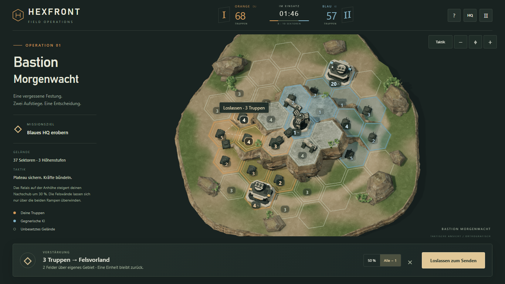
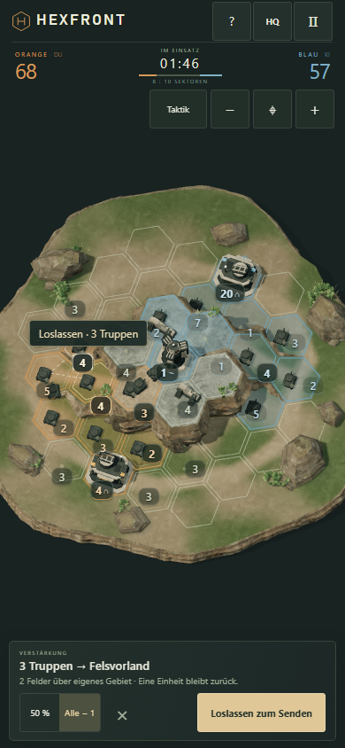

# Drag-and-drop-Steuerung

Gezielter Eingabe-Fix auf `experiment/hexfront-3d-diorama`, ausgehend von `80d18f14a84ca71312df9afb2ebd83f8d385ea9f`. Keine Änderungen an Spiellogik, KI, Balancing, Karte, Assets oder Kamerawinkeln.

## Bedienung

- Eigenes Feld, Gebäude oder Zahlenplakette mit linker Maustaste oder einem Finger greifen, zum Ziel ziehen und loslassen. Der Befehl wird genau einmal gesendet, ohne zusätzlichen Bestätigungsklick.
- Eine Bewegung über acht CSS-Pixel beginnt die Ziehgeste. Ein kurzes Antippen bleibt eine normale Auswahl. Quelle → Ziel → „Befehl geben“ funktioniert weiterhin, auch per Tastatur auf den vorhandenen Buttons.
- Die bestehende Stärke `50 %` / `Alle − 1` gilt für beide Eingaben. Vor einem halben Zug die Garnison antippen und `50 %` wählen.
- Helle Konturen und die Linie folgen dem tatsächlichen Weg über eigenes Gebiet und Rampen. Der Hinweis am Zeiger zeigt die sendbare Truppenzahl; unerreichbare Ziele und Felswände sind ungültig. Loslassen auf der Quelle, außerhalb oder über einem HUD-Element sendet nichts.
- Die vergrößerte Karte am Hintergrund bzw. einem nicht eigenen Feld ziehen. Mit der Maus auch rechte/mittlere Taste zum Verschieben; mit Touch zwei Finger zum Zoomen/Verschieben. Ein zweiter Finger bricht einen begonnenen Truppenbefehl ab. Der verbleibende Finger löst anschließend keinen Befehl aus.
- Escape, verlorene Eingabe, Touch-Abbruch, Tab-/Fokuswechsel, Größenänderung und Pause brechen laufende Ziehbefehle ab. `⌖` setzt weiterhin die Kamera zurück.

## Umsetzung

Die Szene unterscheidet nach dem Startpunkt zwischen Befehl und Kamera. Zielsuche verwendet die tatsächliche Bildschirmposition statt des durch Pointer Capture ersetzten Event-Ziels. Zahlen behalten ihre logische Zell-ID; sichtbare Gebäude werden ihrer Zelle zugeordnet und Felswände bleiben blockiert. Die bestehende `Battle.send`-Prüfung entscheidet auch beim Loslassen über Besitzer, Route, Pause und verfügbare Truppen.

Während einer Befehls-Ziehgeste bleiben das responsive Framing und bereits sichtbare Zahlenanker stabil. Das eingeblendete Befehlsfeld darf die Ziele nicht unter dem Finger verschieben. Nach dem Loslassen passt sich der Kartenbereich wieder normal an. Ein vom Browser erzeugter abschließender Klick wird unterdrückt, damit weder ein zweiter Befehl noch eine unerwartete Neuauswahl entsteht. Eine neue Pointer-down-Geste hebt die Sperre sofort auf; bewusste schnelle Folgetipps bleiben möglich. Die Testeingaben warten nach HUD-Wechseln auf zwei dargestellte Frames, bevor sie Zielkoordinaten ablesen.

Beim Touch-Test wurde eine Besonderheit behoben: Der Verlust des impliziten Pointer Capture einer Zahlenplakette beim Übergang zur Karte ist kein Eingabeabbruch. Nur der tatsächliche Verlust an der Karte bricht die Geste ab.

## Prüfnachweise

- [Gestentests](drag/input-report.json): reale Maus- und Touch-Ereignisse auf Desktop 1440 × 900 und Mobile 390 × 844. Direkter Zug aus dem Ruhezustand, stabile Projektion, genau ein Befehl, anschließende Eroberung, halbe Stärke, Feldoberfläche, Klickalternative, ungültiger Weg, Felswand, außerhalb, eigenes Quellfeld, Abbruch, Zoom/Pan und Pause.
- [Vollständige Desktop-Partie](drag/match/desktop-report.json) und [abschließende Touch-Partie](drag/match/browser-report.json): reguläre Befehle per Drag-and-drop, auf allen Höhen, ohne Garnisonen oder Besitzer umzuschreiben. Die Testuhr wird zwischen den Eingaben fortgeschaltet; dies ist kein menschlicher Reaktionszeit-Benchmark.
- [Kamera-/Eingabeprüfung](drag/camera/input-report.json): fünf Viewports, Auswahl aller Sektoren, Zoom, Pinch, Verschieben und Reset. Die Kamerageste beginnt nun ausdrücklich auf dem Hintergrund; eigene Felder geben wie gewünscht Truppenbefehle.
- Beide vollständigen Partien bestanden: Sieg jeweils nach 238,30 Sekunden mit 47 Drag-and-drop-Befehlen und 35 KI-Befehlen; anschließend Neustart, Niederlage nach 239,55 Sekunden und erneuter Neustart. Alle drei Höhen wurden genutzt.
- Alle 15 vorhandenen Logik-/Kameratests mit `npm test` bestanden. Der isolierte Produktions-Build deaktiviert weiterhin die Diagnose-API.





Browserprüfungen verwenden Chromium mit Software-Rendering. Physische Android-/iOS-Geräte und Safari bleiben ungeprüft. Auf sehr kleinen Displays bleibt der vorhandene Detailzoom sinnvoll.

## Reproduktion

```powershell
npm test
npm run test:drag
$env:TEST_OUTPUT='docs/drag/match'
node tests/browser.mjs --drag
$env:TEST_OUTPUT='docs/drag/camera'
node tests/camera-input.mjs
npm run preview:prepare
$env:PREVIEW_URL='local'
$env:TEST_OUTPUT='docs/drag/production'
node tests/hosted.mjs --art --match --drag
```

Playwright-Installation und Startanleitung stehen in der [README](../README.md).
