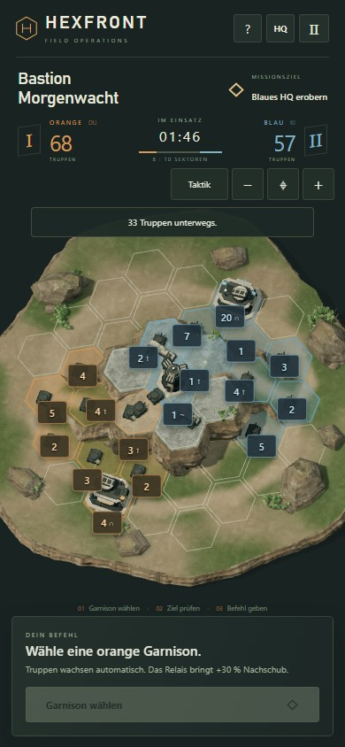
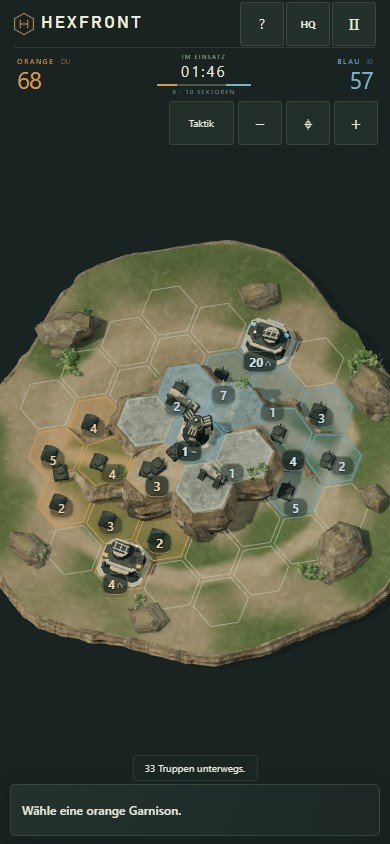
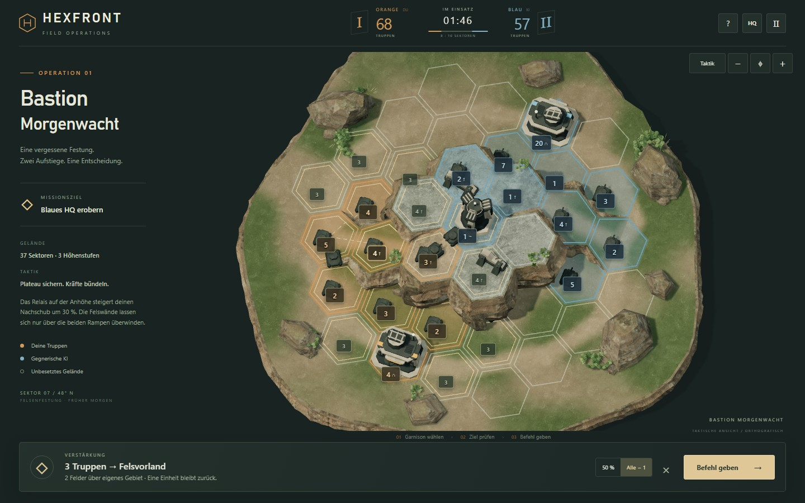
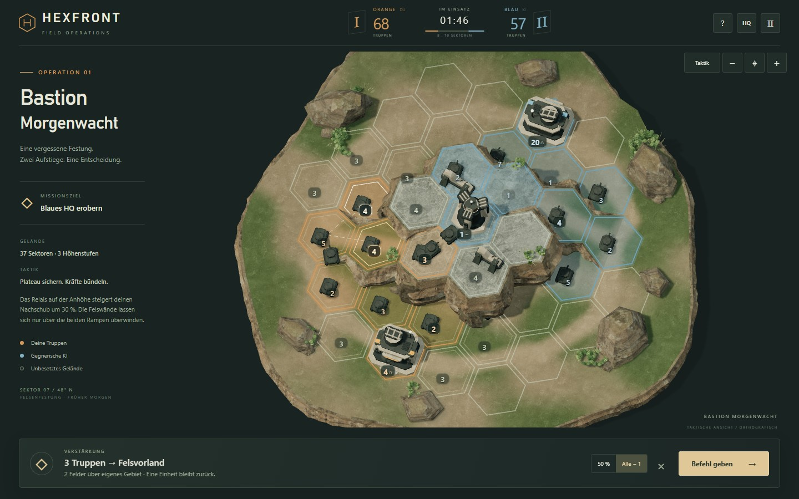

# Overlay- und Mobile-HUD-Pass

Ausgangsstand: `df540de846540ed9a8c38a33de9e4afc38a9e190`, 12.10.2026. Ein gezielter UI-Pass auf dem bestehenden Experiment-Branch.

## Gestaltung und Verhalten

- **Plakette und Antippfläche getrennt:** Eine sichtbare Zahlenplakette ist nur 20–22 Pixel hoch. Die unsichtbare runde Antippfläche besitzt auf Mobile mindestens 44 Pixel Durchmesser. Zahlen verwenden 12 Pixel auf Mobile und 13 Pixel auf Desktop, statt kleiner und schlechter lesbar zu werden. Dreistellige und größere Werte bekommen bei Bedarf mehr Breite.
- **Drei Gewichtungen:** Quelle, vorgemerktes Ziel, HQs, Relais, Garnisonen ab 30 Truppen und Endpunkte laufender Bewegungen erhalten kräftigere Plaketten. Erreichbare Ziele, direkte Frontstellungen und der Mausfokus bleiben gut präsent. Andere Felder treten bei einer Auswahl über den Hintergrund zurück; der Zahlentext wird nicht pauschal ausgeblendet.
- **Kontext bewahrt Informationen:** Eigene und gegnerische Garnisonen sowie das Relais bleiben sichtbar. Neutrale Felder erscheinen wie zuvor bei Erreichbarkeit oder Fokus, jetzt außerdem bei laufender Bewegung dorthin. Der dichte Vergleich zeigt unverändert 18 Zahlen ohne Auswahl und 26 bei der Befehlsvorbereitung.
- **Teamkodierung:** Ruhige orange/blaue Unterkante und helle getönte Zahlen statt großer gesättigter Rechtecke. Die eingefärbten Besitzflächen und dauerhaften Hexkonturen bleiben erhalten.
- **Befehle:** Quelle hat eine warme Kontur; das vorgemerkte Ziel eine helle Kontur. Der Zielzustand bleibt beim Wechsel zu den Befehlsbuttons bestehen. Erreichbarkeit nutzt eine schwächere innere Hexkontur und weniger Bodenfüllung. Höhenpfeile an jeder normalen Zahl entfallen; Gelände und Höhenangabe der Auswahl bleiben verfügbar.
- **Meldungen:** Kurze Meldungen stehen am unteren Befehlsbereich statt quer über dem oberen Schlachtfeld. Fehlertexte bleiben vollständig lesbar und blockieren keine Eingaben.
- **Mobiler Match-HUD:** Nach dem Start werden Missionstitel und Briefing ausgeblendet, die Kopfzeile verkleinert und der Status verdichtet. Truppenstände, Zeit, Pause, Hilfe, Qualität und Kamera bleiben verfügbar. Ohne Auswahl bleibt eine kompakte Aufforderung; bei Auswahl erscheinen Stärke, Route/Kampfprognose, 50 % / Alle − 1, Abbrechen und Primäraktion. Pause und Ergebnis besitzen eigene sichtbare Zustände. Die große Startansicht bleibt erhalten.
- **Desktop:** Gleiche Komposition und bestehendes Briefing; nur ruhigere Plaketten und ein kleineres Panel ohne Auswahl.

## Visueller Vergleich

Identische manuell fortgeschaltete Spieluhr, normale Maus-/Touch-Befehle und exakt identische logische Spielzustände. Es werden keine Garnisonen, Besitzer oder Gewinner umgeschrieben. Der Vergleichszeitpunkt liegt bei 106,05 Sekunden. Beim Nachherlauf werden sämtliche Zustände mit der gespeicherten Baseline verglichen.

| Messung bei 390 × 844 | Vorher | Nachher |
|---|---:|---:|
| Kartenbereich vor dem Start | 447 px hoch | 447 px hoch |
| Kartenbereich im Match ohne Auswahl | 447 px | 615 px |
| Kartenbereich mit vorbereitetem Befehl | 447 px | 553 px |
| Unteres Panel ohne Auswahl | 136 px | 52 px |
| Unteres Panel bei Befehlsvorbereitung | 136 px | ca. 113 px |
| Sichtbare Plakettenfläche, Gefecht ohne Auswahl | 15.912 px² | 9.239 px² |
| Sichtbare Plakettenfläche, Befehlsvorbereitung | 20.840 px² | 13.175 px² |

Damit erhält Mobile im Match ohne Auswahl 168 Pixel bzw. rund 38 % mehr **Kartenbereich**. Das ist ausdrücklich keine Behauptung, dass jedes Hexfeld 38 % größer wird: In Portrait begrenzt auch die Bildschirmbreite den unveränderten Kamera-Fit. Alle Sektoren bleiben in der Übersicht erhalten; die vorhandenen Zoom- und Verschiebefunktionen nutzen den freigewordenen Raum. Die sichtbare Zahlenfläche sinkt im Gefecht um rund 42 % auf Mobile und 44 % auf Desktop.

<table><tr><th>Mobile vorher · laufendes Gefecht</th><th>Mobile nachher · gleicher Zustand</th></tr><tr><td></td><td></td></tr></table>
<table><tr><th>Desktop vorher · Befehl</th><th>Desktop nachher · gleicher Befehl</th></tr><tr><td></td><td></td></tr></table>

Weitere Zustände: [Start Mobile](hud/mobile-after-start.jpg), [Auswahl](hud/mobile-after-selection.jpg), [Befehl Mobile](hud/mobile-after-command.jpg), [Truppen unterwegs](hud/mobile-after-movement.jpg), [Gefecht Desktop](hud/desktop-after-battle.jpg).

## Sichtprüfung und Nachbesserung

Die Vorher- und Nachherbilder wurden tatsächlich angesehen. In der ersten mobilen Fassung drängten quadratische 44-Pixel-Antippflächen einzelne Zahlen zu weit vom Feld weg. Die Platzierung berücksichtigt deshalb runde Antippflächen und reserviert HQ-/Relais-Anker zuerst. Versetzte Werte behalten eine Verbindungslinie zum zugehörigen Feld. Die logische Zell-ID, Raycasts, Gebäudezuordnung und Gestenerkennung bleiben Grundlage der Auswahl.

Gleiche Klassen, Prioritäten und Zahlentexte werden nicht unnötig pro Frame neu in den DOM geschrieben. Es wurden keine zusätzlichen 3D-Objekte, Texturen oder Postprocessing-Effekte ergänzt.

## Prüfungen und Grenzen

- Alle 15 vorhandenen Logik-/Kameratests bestanden.
- [Vergleich vorher](hud/before-report.json), [Vergleich nachher](hud/after-report.json): Start, Match ohne Auswahl, dichtes Gefecht, Auswahl, Befehl und Bewegung auf Desktop 1440 × 900 und Mobile 390 × 844; unveränderte Spielzustände, kleinere sichtbare Plaketten, erhaltene Textgrößen und 44-Pixel-Antippflächen.
- Der Touch-Flächentest erlaubt 0,01 Pixel numerische Toleranz: Chromium meldete für eine CSS-Höhe von exakt 44 Pixeln nach Projektion 43,999969 Pixel.
- [Unveränderte Kern-Dateien](hud/invariants-report.json): Spiellogik, KI, Balancing, Karte, Höhen, Kameramodul, Art-Geometrie und sämtliche externen Assets/Vendor-Dateien entsprechen dem Ausgangscommit. Änderungen liegen in Präsentation und Eingabe-Overlays.
- [Fünf Eingabe-Viewports](hud/input-report.json): 1440 × 900, 390 × 844, 320 × 568, 375 × 667 und 430 × 932. Jeweils alle 37 Felder auswählbar, keine abgeschnittene spielbare Ecke, Zoomgrenzen, Verschieben, Pinch/Mausrad, Reset und erhaltene Auswahl beim Ansichtswechsel bestanden. Bei 390/430 und Desktop außerdem beide HQ-Dächer und Felswand-Auswahl bei 70° und 55° geprüft.
- **Kleine Startübersichten:** Bei 320 × 568 benötigen sieben Felder den vorhandenen Detailzoom, bei 375 × 667 eines. Bei 390 × 844, 430 × 932 und Desktop sind alle 37 direkt erreichbar. Größere Antippflächen können in sehr kleinen Übersichten mehr Bodenfläche abdecken; die vorhandene Zoom-Hilfe bleibt deshalb notwendig.
- [Produktions-Build](hud/build-report.json): 25 Dateien einschließlich der neuen kleinen Overlay-CSS-Datei, keine neuen 3D-Assets, Diagnose-API deaktiviert. Statisches Vorschauverzeichnis und Build bytegleich geprüft; eingecheckte Textdateien nutzen LF.
- [Vollständige Partien](hud/match-report.json): Desktop 1366 × 768 und Touch-Mobile 390 × 844 jeweils regulärer Sieg nach 238,30 Sekunden mit 47 UI-Befehlen und 35 KI-Befehlen, Neustart, Niederlage nach 239,55 Sekunden ohne Gegenwehr bei 37 KI-Befehlen und erneuter Neustart. Alle drei Höhen, Pause, ungültige Felswand-Route, Qualitätsschalter und Kamerazustände geprüft.
- Der abschließende lokale Produktionslauf lädt ohne Diagnose-API und führt echte Befehle mit normal laufender Uhr aus. Keine Browserausnahmen oder fehlenden Assets. Unverändert 111 Zeichenaufrufe / 55.907 Dreiecke im gemessenen Zustand. Einzelner Software-Renderlauf: Median 83,4 ms Desktop / 66,6 ms Mobile; daraus wird keine reale Geräte-FPS-Zusage abgeleitet.
- Ergebnisbilder: [Desktop-Sieg](hud/desktop-victory.png), [Mobile-Niederlage](hud/mobile-defeat.png). Die öffentliche Vorschau wird im anschließenden Veröffentlichungsschritt geprüft.

Die Tests laufen in Chromium mit Software-Rendering. Physische Android-/iOS-Geräte, Safari, größere Systemschrift und Sonnenlicht-Lesbarkeit bleiben ungeprüft. Die großen Antippflächen und die unveränderte logische Zellzuordnung ersetzen diese Gerätetests nicht.

## Reproduktion

```powershell
npm test
node tests/overlay.mjs
node tests/browser.mjs
$env:TEST_OUTPUT='docs/hud'
node tests/camera-input.mjs
npm run preview:prepare
```

Die optionale Playwright-Installation und Startbefehle stehen in der [Experiment-README](../README.md). `tests/overlay.mjs --baseline` verweigert das Überschreiben der bereits vorhandenen Ausgangsaufnahme. Die manuelle Uhr ist ausschließlich in Entwicklungs-/Testläufen verfügbar und bleibt im Produktions-Build deaktiviert.
