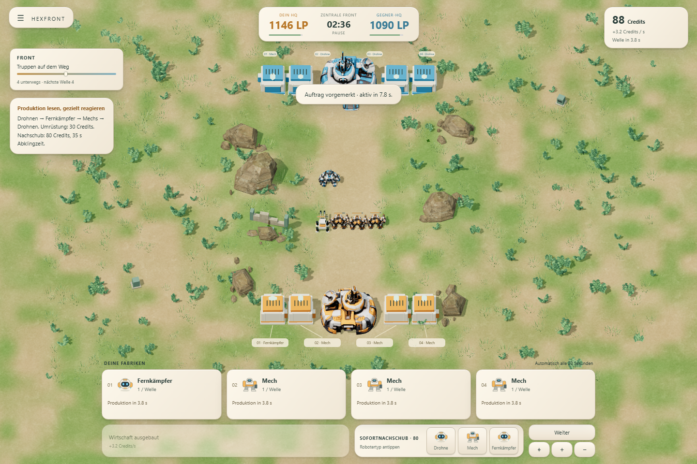
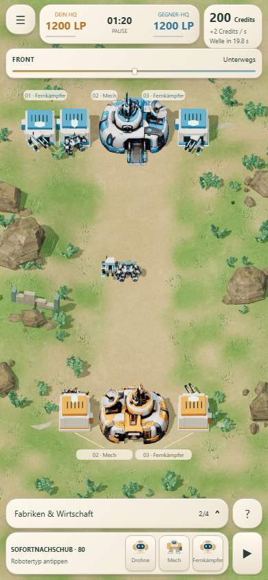

# Zentrale Front – spielbare 1v1-Partie
Stand: 16. Oktober 2026. Branch: `codex/lane-wars`. Ausgangsstand `4dee21b`, Sicherungstag `codex/lane-wars-pre-central-front`. Keine Änderungen an den anderen HEXFRONT-Varianten, kein Merge nach main.

## Spielen und Umfang
Die Hauptschaltfläche startet **Zentrale Front**: eine Lane, vier Bauplätze, zwei wählbare Startfabriken, die bisherigen drei Robotertypen. Gegnerwahl für neue Partien: Vorhut, Eisenkeil, Aufbaukommando oder abwechselnde Strategien. Sieg/Niederlage entsteht ausschließlich durch tatsächliche HQ-Zerstörung. Pause, Neustart und Fortsetzen einschließlich KI-Zustand sind vollständig integriert.

[Lokale Partie](http://127.0.0.1:4181/) · [Kampflabor](http://127.0.0.1:4181/lab.html) · öffentlicher Playlink in der [Branch-README](../../../README.md).

Erste Front bleibt eine eigene Einführung; ihr Sieg schaltet unverändert Wiesenkrieg frei. Alte Spielstände bleiben in getrennten Missionsfeldern erhalten. M1.5-Demo und sämtliche älteren Varianten sind weiterhin erreichbar.

## Entscheidungen und Balance
Alle folgenden Anpassungen gelten **nur für Zentrale Front**. Labor, Erste Front und Wiesenkrieg behalten ihre bisherigen Werte.

| Wert | Bisheriges Wiesenkrieg | Zentrale Front |
|---|---:|---:|
| Startcredits vor Bezahlung der Startfabriken | 200 | 280 |
| Verfügbare Credits nach Spielstart | 0 | 40 |
| Fabrik / Umrüstung | 100 / 30 | 120 / 30 |
| Grundeinkommen | 2/s | 2/s |
| Einmalige Wirtschaft | 80 für +1/s | 80 für +1,2/s |
| Gemeinsame Wellen | 15 s | 20 s |
| Sofortnachschub | 60, 15 s Abklingzeit | 80, 35 s Abklingzeit |
| HQ | 1.200 LP, 8 Schaden / 0,8 s | 1.200 LP, 6 Schaden / 1 s |
| Mech | 120 LP, 7 Sekundärschaden | 110 LP, 9 Sekundärschaden |
| Fernkämpfer | 45 Schaden / 2,4 s | 55 Schaden / 2,8 s |
| Drohnen | bisherige M1-Werte | unverändert |

Der Mech verliert etwas Haltbarkeit und gewinnt eine klarere Aufgabe gegen Schwärme. Fernkämpfer treffen schwere Ziele härter, schießen aber seltener; der Überschussschaden hilft ihnen gegen Drohnen nicht. Der Konterkreis funktioniert in den Laborduell-Tests bei einem und vier Produktionsverbänden. Vier Drohnenfabriken schlagen dort auch zwei Mechs plus zwei Fernkämpfer. Das garantiert keinen Sieg in jeder laufenden Partie.

Eine frühe Wirtschaft kostet zunächst Kampfstärke: bei sofortiger Verwendung werden 80 Credits nach etwa 66,7 Sekunden durch das zusätzliche Einkommen zurückverdient. Eine neue Fabrik kostet 120 und produziert mit der nächsten Welle. Die 18 Wirtschaftskontrollen verwenden paarweise dieselbe Eröffnung und denselben Gegner; nur der Zeitpunkt des Wirtschaftskaufs wird umgestellt. Ein Beispiel: Vorhut gegen Aufbaukommando verliert mit Fabriken zuerst nach 4:04, gewinnt mit Wirtschaft zuerst nach 10:43. Umgekehrt verliert Aufbaukommando gegen Eisenkeil mit früher Wirtschaft nach 4:55, hält mit späterem Ausbau bis 11:01 durch. Es gibt weiterhin deutlich längere Grenzfälle; dies ist keine statistische Gewinnratenmessung.

## Warum Fronten festfahren
Die Messungen stützen keine Erklärung allein durch „unsterbliche“ Roboter. Überlebende sammeln Restlebenspunkte und Feuerkraft an, doch in den regulären Vergleichspartien werden die Verbände weiterhin ausgetauscht. Entscheidend ist das Zusammenspiel aus Ankunftszeit, Angriffstaktung, überschüssigem Schaden auf dasselbe Ziel, Verstärkung und HQ-Abwehr.

Die kontrollierten Varianten ändern jeweils nur einen Parameter gegenüber dem neuen Hauptmodus:
- 15-Sekunden-Wellen lassen im Vergleich vereinzelt Roboter über 60 Sekunden mitkämpfen und entscheiden die drei Referenzpaarungen schon nach 3:26–4:25. Mehr Produktion kann also auch einen frühen Vorsprung verstärken.
- 25-Sekunden-Wellen lösen das Problem ebenfalls nicht pauschal: eine Referenzpartie dauert 10:01.
- Die stärkere alte HQ-Abwehr (10 statt 6 Schaden/s) lässt zwei von drei Referenzpartien bei 12 Minuten noch offen. Kleine Vorstöße werden abgefangen, bevor sie dauerhaften HQ-Schaden erzeugen.
- Nur die Mech-LP von 110 auf 120 zurückzustellen verlängert zwei Referenzpartien auf 10:40 und 11:21.
- Fernkämpfer wieder alle 2,4 statt 2,8 Sekunden feuern zu lassen erzeugt in einer Referenzpartie erneut einen offenen Lauf bei 12 Minuten.

Deshalb bleiben verwundete Einheiten bestehen. Keine Lebensdauer, kein Aufräumen alter Wellen, kein Bevölkerungslimit, keine automatische HQ-Schädigung. Das längere Wellenfenster und die schwächere HQ-Waffe schaffen Raum für Durchbrüche; der Nachschub erlaubt es, den normalen Ankunftsrhythmus gezielt zu verändern.

## Vollständige Partien
Sechs automatisierte Referenzpartien mit beidseitig reagierenden KI-Plänen enden regulär; je zwei davon sind derselbe Vergleich mit vertauschten Fraktionen. Zeit, Schaden und Ausgaben bleiben beim Tausch identisch.

| Vergleich | Sieger | Zeit | HQ Orange : Blau |
|---|---|---:|---:|
| Vorhut gegen Eisenkeil | Eisenkeil | 6:37 | 0 : 1146 |
| Vorhut gegen Aufbaukommando | Aufbaukommando | 4:04 | 0 : 714 |
| Eisenkeil gegen Aufbaukommando | Eisenkeil | 4:55 | 1200 : 0 |

Damit sind die Referenzpartien spielbar und entschieden. Das Ziel von ungefähr 5–8 Minuten ist noch nicht durchgehend getroffen: Vorhut gegen Aufbaukommando ist mit 4:04 kurz, Eisenkeil gegen Aufbaukommando liegt bei 4:55, der dritte Vergleich bei 6:37.

Die gesamte reproduzierbare Untersuchung umfasst **56 Läufe**: 12 Strategie-/Reaktionsvergleiche, 18 Wirtschaftskontrollen, 18 Parameterkontrollen, sechs späte Reaktionstests und zwei gezielte Nachschubtests. **42 enden durch HQ-Zerstörung; 14 sind beim Messstopp von 720 Sekunden offen.** Diese Zahl enthält absichtliche Spiegelungen, starre Pläne und ungünstige Parameterkontrollen; sie ist keine Erfolgsquote des Spiels. Die Simulation beendet diese offenen Partien nicht.

[Alle Verläufe, Aufträge, Minute-Snapshots und Kennzahlen](central-qa/audit.json). `oldest` misst das höchste beobachtete Roboteralter, `old60` die maximale Anzahl über 60 Sekunden alter Roboter. `maxHQQuiet` ist die längste Strecke ohne HQ-Schaden ab Minute zwei, **kein Beweis für eine räumlich stillstehende Front**. `longestStill` erfasst nur aufeinanderfolgende Sekunden mit weniger als 0,3 Fortschrittseinheiten Kontaktbewegung.

## Entscheidungen nach zwei bis drei Minuten
Die kontrollierten Tests haben bis 3:20 identische Zustände. Der Gegner rüstet bei 3:00 um; dessen neue Produktion ist anschließend sichtbar. Alle Befehle bezahlen die regulären Kosten.

| Ausgangslage / Antwort | Ergebnis |
|---|---|
| Eigene Fernkämpfer, Gegner wechselt auf Drohnen; ignorieren | Niederlage 4:46 |
| Gleicher Zustand; bei 3:20 auf Mechs umrüsten | Sieg 6:17, eigenes HQ 942 LP |
| Eigene Mechs, Gegner wechselt auf Fernkampf; nur auf Drohnen umrüsten | nach 12 Minuten noch offen |
| Gleiche Umrüstung plus **ein** Drohnen-Nachschub bei 3:30 | Sieg 5:23, eigenes HQ erhalten |
| Eigene Drohnen, Gegner wechselt auf Mechs; Fernkampfantwort plus **ein** Mech-Nachschub bei 3:30 | Sieg 5:00 |

Nachschub zur normalen Wellenzeit führt nicht zwangsläufig zum gleichen Resultat. Diese Fälle zeigen einen Vorteil bewusster Reaktion und Unterstützung zwischen den Wellen, statt dauerndem Nachbestellen. Vier Fabriken und eine Wirtschaftsstufe begrenzen trotzdem die Zahl langfristiger Investitionen; später tragen hauptsächlich Umrüstung, Reservehaltung und Nachschub den Entscheidungsraum.

## KI, Architektur und Darstellung
Vorhut beginnt mit zwei Drohnenfabriken und baut vor der Wirtschaft aus. Eisenkeil startet mit Mech/Fernkämpfer und kauft Wirtschaft nach der dritten Fabrik. Aufbaukommando startet mit Mech/Drohne und investiert früh ins Einkommen. Beide Fraktionen verwenden dieselben bezahlten Befehle. Die KI beobachtet im Abstand von sechs Sekunden und verwendet für gegnerische Informationen die vorherige Beobachtung. Sie kennt keine gegnerischen Credits oder vorgemerkten Aufträge.

Zwei Fabriken bilden einen stabilen Strategiekern; die übrigen können anhand sichtbarer Produktion angepasst werden, frühestens ab Sekunde 110, höchstens einmal pro 30 Sekunden. Nachschub wird für eine sichtbare Offensive oder HQ-Notlage eingesetzt. Die Gegner sind unterschiedliche Pläne, keine gleich schweren Schwierigkeitsstufen.

Die Kampfengine erhält ihr Einheitenprofil als Daten. Formation, Rollenbezeichnung und Kontergewichte sind am Profil hinterlegt; Match-Befehle prüfen die registrierten Typen. Savegames speichern die tatsächlich verwendeten Einheitenwerte. Für weitere Rollen sind später ein Eintrag, Modell/Icon und KI-Planung erforderlich; die Engine ist nicht mehr auf drei feste Typen in ihrer Aufstellung angewiesen. Jetzt bleiben genau die drei vorhandenen Einheiten.

Original-HQs, Roboter, Wiesen-Diorama und Keramik-HUD bleiben. Vier Fabriken stehen sichtbar neben jedem HQ. Die zentrale Formation fächert Fabrikverbände seitlich auf; ihre Ausfahrtszeiten bleiben für beide Seiten und alle Plätze gleich. Die Tore bleiben der Ausgangspunkt, Blickrichtung folgt dem Ausfahrtsbogen. Die zentrale Kamera zeigt die Schlacht größer. Fernkampfstrahlen bleiben erkennbar, während kurze Waffen als bewegte Geschosse weniger Linien über das Gefecht legen. Alle HUD-Werte stammen aus dem aktiven Modus.

## Technischer Nachweis
- **72 Node-Tests bestanden:** darunter eingefrorene M1-Referenzdatei samt ursprünglichem SHA und identische Zustände/Ereignisse in allen ursprünglichen Szenarien bei zwei Startabständen; zusätzlich neue Wirtschaft, Produktion, Nachschub, Konter, Speichern, KI und vollständige Partien.
- Eine Browserpartie über echte Fabrik-, Wirtschafts-, Umrüstungs- und Nachschub-Schaltflächen bis zum Sieg bei **7:19**, inklusive Neuladen bei laufender Partie. Nur die Testuhr wird beschleunigt; keine manipulierten HQ-Werte.
- Browser und Node stimmen für dieselben vollständigen KI-Partien überein. Ein identischer KI-Spiegel bleibt korrekt offen.
- Fünf Smartphone-Ansichten × drei Missionen geprüft: keine verdeckten HQs, kein horizontales Überlaufen, mindestens 44-Pixel-Bedienflächen. Bei 390 × 844 bleiben im eingeklappten HUD rund 72 % Bildschirmhöhe zwischen den Anzeigen frei.
- Produktionsbuild, Niederlagenanzeige, beide erhaltenen Missionen, Labor (14 Prüfungen) und M1.5 (12 Prüfungen) bestanden ohne Browserfehler. Einzelprotokolle: [Produktionsbuild](central-qa/production/results.json), [alte Missionen](central-qa/legacy-browser/browser-results.json), [Mobile](central-qa/mobile-regression/browser-results.json), [M1.5](central-qa/m15.json), [Node](central-qa/node-tests.txt).

Ausführen: `npm test`, `npm run audit:central`, `npm run build`; mit laufendem Server `npm run test:central-browser`, `npm run test:match`, `npm run test:mobile`, `npm run test:browser`, `npm run test:visual`. Für den statischen Build: `MATCH_URL=http://127.0.0.1:4181/dist/`. Windows PowerShell: `$env:MATCH_URL='http://127.0.0.1:4181/dist/'`.

## Offene spielerische Schwächen
1. Starre oder exakt gespiegelte Produktionspläne können weiterhin lange offen bleiben. Ein natürlicher Durchbruch ist möglich, nicht für jede denkbare identische Eingabe erzwingbar.
2. Das Matchdauerziel ist noch nicht verlässlich. Wirtschaftskontrollen enthalten Partien über zehn Minuten.
3. Der Vorhut-Standardplan ist gegen die beiden anderen reagierenden Pläne schwächer. Die KI erkennt Produktionsmengen, bewertet aber noch keine komplexen zukünftigen Gefechte.
4. Späte Vielfalt besteht aktuell aus drei Kontern, Mischungen und Timing. Sie ist mit diesen Tests belegt, aber noch kein Beleg für langfristigen Wiederspielwert oder menschlich getesteten Spielspaß.
5. Mech-Bewegung bleibt Ganzkörperanimation, der Fernkämpfer ein Modellplatzhalter; keine neue Sound- oder Rig-Produktion. Headless-Browsertests sind kein FPS-Nachweis auf einem echten Smartphone.

