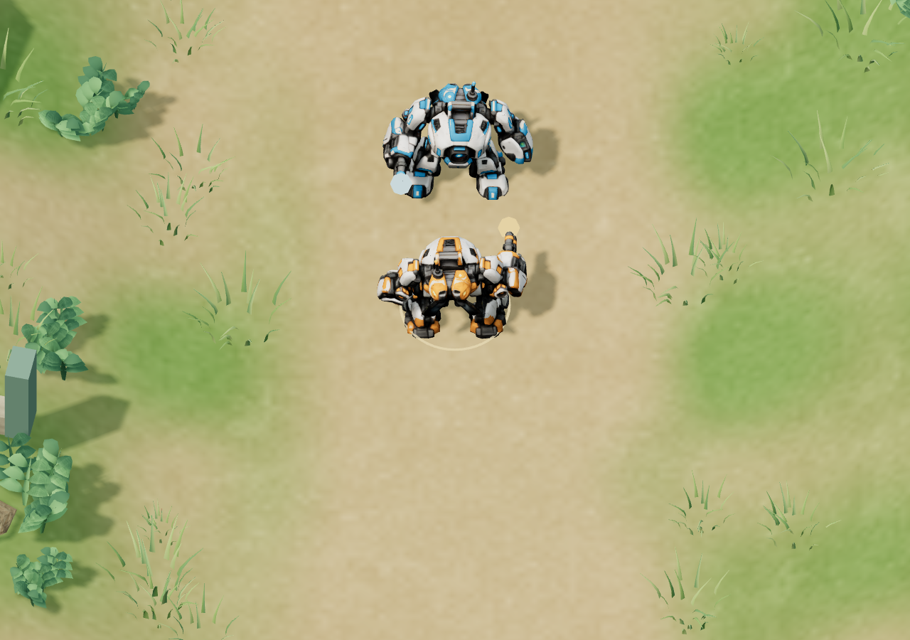

# Fabrikkampf und sichtbarer Mech-Schussabstand
Stand: 16. Oktober 2026 · Branch codex/lane-wars · Ausgangsstand 3a9bba1.

## Spielen
[Zentrale Front im Browser](https://rawcdn.githack.com/emfau88/hexwars/9da12b8e4bac4fd8eff57fc3f91febae4da070dc/experiments/hexfront-lane-wars/index.html).
Bitte eine **neue zentrale Partie** starten. Gespeicherte Partien erhalten den Fabrikkampf und den Mech-Schussabstand ebenfalls, behalten aber ihre bisherigen HQ-Werte.

## Die beiden Korrekturen
Die zentrale Partie enthält keine kampffreie Ausfahrtsphase mehr. Sichtbare Roboter stehen unmittelbar vor dem Fabriktor bzw. dem HQ-Nachschubausgang mit ihrer echten Position, ihren LP und ihrer normalen Waffe in der Simulation. Bei einem erreichbaren Gegner unterbrechen sie den Weg, drehen sich zum Ziel und schießen nach der üblichen Zielerfassung (0,1–0,35 s). Sie sind genauso angreifbar wie ihre Gegner. Nach dem Kampf setzen sie die unterbrochene Route fort, ohne Teleportation, neue LP oder eine neue Identität am Lane-Eingang. Wer am Tor stirbt, taucht später nicht erneut auf.

Die Bewegungsgrenze ist auf dem vorhandenen Basisvorplatz jetzt breit genug, damit Angreifer auch seitliche Fabriktore erreichen können. Zum normalen Lane-Bereich hin verengt sie sich stetig. Keine neue Karte oder Wegwahl.

Mechs schießen mit **2,8 statt 1,6 Reichweite**. Der Fernkämpfer bleibt bei 4,0, die Drohne bei 1,1. In der Messszene beginnen zwei Mechs mit rund **1,656 Welteinheiten Mittelpunktabstand** zu schießen; zwischen ihren tatsächlichen Modellgrenzen einschließlich Waffen bleiben **0,622 Welteinheiten** frei. Gegner können weiterhin an einen Mech herankommen; die Korrektur führt kein automatisches Zurückweichen ein.

## Balanceausgleich
Sofort kämpfende Produktionsverteidiger stärken die Basis erheblich. Die direkte Gegenprobe mit korrigierter Ausfahrt und größerer Mech-Reichweite, aber alter HQ-Stärke, endet in zwei der drei KI-Paarungen auch nach zwölf Minuten nicht. Deshalb wurde die HQ-Stärke in **neuen zentralen Partien** angepasst:

| Wert | Vorher | Jetzt |
|---|---:|---:|
| Mech-Reichweite | 1,6 | 2,8 |
| HQ-LP | 1.200 | 800 |
| HQ-Schaden je Sekunde | 6 | 2 |

Das ist eine spürbare Balanceänderung, keine rein grafische Korrektur. Mech-LP, Einzelschaden, Flächenschaden und Feuerintervall bleiben gleich. Kosten, Einkommen, 20-Sekunden-Wellen, KI-Pläne und Nachschub bleiben gleich. Es gibt weiterhin keinen Endtimer, keinen Einheitenschwund und keinen zusätzlichen Spielmechanismus.

Die alten Missionen, das Kampflabor und die übrigen HEXFRONT-Versionen behalten ihre bisherigen Regeln und Werte. Die unveränderte Standardausführung der Kampfengine wird weiterhin schrittweise gegen die eingefrorene M1-Version verglichen.

## Vollständige Partien und Grenzen
Alle sechs reagierenden Referenzpartien (drei Paarungen plus Fraktionstausch) enden durch HQ-Zerstörung. Gespiegelte Spiele haben dieselbe Dauer, dieselben Schäden und Ausgaben.

| Paarung | Sieger | Dauer | HQ Orange : Blau |
|---|---|---:|---:|
| Vorhut / Eisenkeil | Eisenkeil | 6:59,90 | 0 : 800 |
| Vorhut / Aufbaukommando | Vorhut | 5:27,50 | 800 : 0 |
| Eisenkeil / Aufbaukommando | Eisenkeil | 7:00,10 | 800 : 0 |

Der erneute breite Audit umfasst **56 Läufe**: **28 HQ-Enden, 28 bei 720 Sekunden offene Läufe**. Darin enthalten sind absichtliche Spiegelungen, starre Produktion, wirtschaftliche Varianten und ungünstige Parameterkontrollen. Gegenüber 42 Enden / 14 offenen Läufen im bisherigen Audit gibt es also **mehr ungelöste Grenzfälle**. Die gute Dauer der sechs Referenzpartien ist keine allgemeine Balancefreigabe und keine menschliche Gewinnrate. Drei zusätzliche Gegenproben mit alter HQ-Stärke sind separat gespeichert: eine endet nach 3:52,70, zwei bleiben offen. 720 Sekunden sind ausschließlich ein Messstopp.

Späte Entscheidungen bleiben relevant, aber nicht jede Gegenproduktion reicht für einen Durchbruch:
- Gegen den Wechsel von Fernkampf zu Drohnen bleibt unveränderte Produktion offen. Umrüstung auf Mechs bei 3:20 führt zum Sieg nach **5:09,70**.
- Bei Mech gegen neue Fernkampfproduktion bleibt die Umrüstung auf Drohnen allein offen. Dazu ein bezahlter Drohnennachschub bei 3:30 führt zum Sieg nach **8:41,30**.
- Gegen Mechs verhindert ein Wechsel von Drohnen auf Fernkampf die sonstige Niederlage nach **4:54,55**, erzeugt in dieser Probe aber noch keinen eigenen Sieg.

**Wichtigste offene Schwäche:** Wiederholte identische Mischungen und starre Konter können sich weiterhin aufhalten. Die neue Ausfahrt macht die Kämpfe nachvollziehbarer, löst das grundsätzliche Drei-Typen-/Verstärkungsproblem aber nicht. Die größere Zahl offener Auditfälle ist ein konkreter nächster Balancepunkt. Zusätzliche Mechaniken wurden dafür nicht eingebaut.

## Technische Prüfung
- **79 Logiktests bestanden**, einschließlich aller bisherigen Tests.
- **30 3D-Browserfälle:** beide Fraktionen × vier Fabriktore plus HQ-Ausgang × drei Typen. Echte Treffer in beide Richtungen, Schuss vor dem Lane-Eintritt, zum Ziel gerichtete Modelle und kontinuierliches Weiterfahren.
- Zerstörung am Tor ohne Wiedererscheinen; Angreifer erreichen äußere Tore; symmetrische Positionen; Speicherung im unterbrochenen Ausfahrtskampf; Migration alter Spielstände.
- Mech-Kontermatrix bei einem und vier Produktionsverbänden; vier Drohnenverbände schlagen weiterhin zwei Mechs plus zwei Fernkämpfer im kontrollierten Laborgefecht.
- Statischer Produktionsbuild: vollständiger Sieg ausschließlich mit HUD-Befehlen nach **6:59,75**, Neuladen mitten im Spiel und exakte Fortsetzung; tatsächliche Niederlage ohne Spielerbefehle nach **2:48,80**.
- Drei automatisierte Browserpartien stimmen mit Node überein: zwei Siege, eine symmetrische Partie nach zwölf Minuten weiterhin offen. Kein künstliches Ende.
- Neustarts, alle drei Gegnerwahlen, Geldreservierung/Storno sowie Touch-Bedienung im Hochformat geprüft; keine Konsolen- oder Ladefehler.
- Kampflabor: **14 Browserprüfungen bestanden**, einschließlich Browser-/Node-Übereinstimmung.
- Öffentliche Prüfung nach dem Push folgt.

Rohdaten: [56 Balanceproben](deployment-qa/audit.json), [alte HQ-Stärke als Gegenprobe](deployment-qa/previous-hq-control.json), [Logiktests](deployment-qa/node-tests.txt), [30 Browserfälle und Modellabstand](deployment-qa/browser/results.json), [vollständige Build-Partien](deployment-qa/production/results.json), [Kampflabor](deployment-qa/lab/browser-results.json).

## Reproduzieren
~~~powershell
npm test
npm run dev
# In zweitem Terminal:
npm run test:deployment
$env:CENTRAL_AUDIT_OUTPUT='docs/deployment-qa'
npm run audit:central
node scripts/deployment-controls.mjs
npm run build
$env:MATCH_URL='http://127.0.0.1:4181/dist/'
$env:CENTRAL_QA_OUTPUT='docs/deployment-qa/production/'
npm run test:central-browser
~~~
