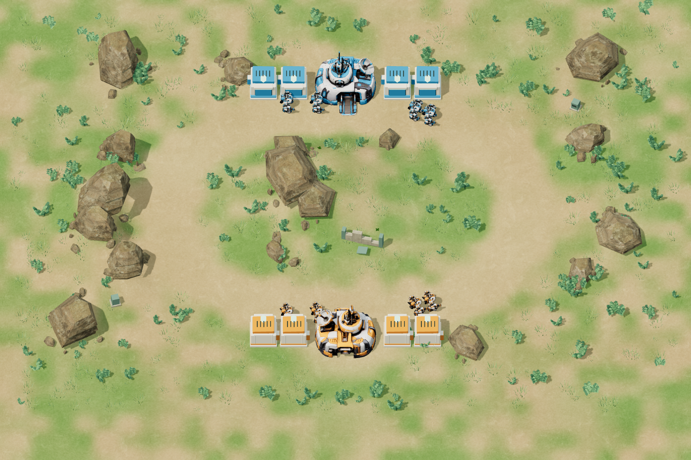

# Korrektur der Fabrikausfahrten

Die gemeldeten Fehler hatten zwei Ursachen: Der alte Weg führte von der Fabrik über einen Vorplatz wieder zurück zur inneren Spitze der Lane. Während der Ausfahrt ignorierte die Positionsfunktion außerdem die zur Blickrichtungsberechnung verwendete Lane-Vorschau. Ausgangspunkt und Blickziel wurden damit identisch; die Modelle behielten eine falsche Ausrichtung.

## Korrektur

- Gebogene, nach Weglänge abgetastete Ausfahrten statt rechtwinkliger Umwege.
- Direkter Anschluss an die vorhandene Lane außerhalb der äußeren Fabriken, bei Lane-Fortschritt 4 beziehungsweise gespiegelt 26. Der alte Anschluss lag bei 0/30.
- Jede Formation erreicht ihre tatsächlichen seitlichen Lane-Positionen. Dadurch entfällt auch der bisherige Sprung zwischen schmaler Ausfahrt und breiter Lane-Formation.
- Die Front folgt während der gesamten Ausfahrt der Wegtangente. Die Ausfahrtsposition wird ohne zusätzlich verzögerte Positionsglättung gezeichnet; Position und Orientierung gehören dadurch zum gleichen Wegpunkt. Zwischen festen Simulationsschritten wird die verbleibende Framezeit für beide gemeinsam berücksichtigt, damit die Ausfahrt flüssig bleibt.
- Jede Einheit benötigt die ihrer eigenen Weglänge entsprechende Laufzeit. Blau verwendet exakt die gespiegelten Werte.
- Keine Änderungen an Roboterwerten, Wirtschaftsregeln, KI oder am eingefrorenen M1-Kampfkern.

Der Anschluss weiter außen verändert die tatsächlichen Ankunftszeiten und den Zeitpunkt des ersten Feindkontakts. Die alten Balanceergebnisse sind deshalb ausdrücklich Referenzwerte des M2-Stands 87865e8, keine Messwerte dieser Korrektur. Es wurden keine weiteren Balancewerte geändert.

## Prüfung

**46 Node-Tests bestanden.** Die fünf neuen Ausfahrtstests prüfen Rückwärts-/Richtungswechsel, konstante Geschwindigkeit, Blickrichtung, Fraktionsspiegelung, alle Formationspositionen, den Eintritt ohne Positionssprung und das Reagieren neu produzierter Einheiten auf Angreifer am eigenen HQ.

Der [gezielte Browsertest](exit-qa/browser-results.json) prüft die tatsächlich gerenderten Instanzmatrizen gegen die gemessene Bewegungsrichtung: alle drei Modelle, vier Bauplätze plus HQ-Ausgang, beide Lanes und beide Fraktionen, insgesamt 612 Bewegungsproben. Der abschließende Lauf enthält keine aufgezeichneten Browserfehler. Ein vorheriger Lauf musste wegen eines abgebrochenen lokalen Hover-Bot-Requests (ERR_ABORTED) wiederholt werden; dieses bereits bei M2 beobachtete Ladeproblem bleibt ungeklärt und wurde nicht herausgefiltert.

Zusätzlich bestehen die **12 M1.5-Browserprüfungen** und [vier vollständige Partien des statischen Builds](exit-qa/matches/browser-results.json), einschließlich exakter Browser-/Headless-Gleichheit, echter HQ-Zerstörung und Neustart:

| Kontrollpartie | Ergebnis Orange | Dauer |
|---|---|---:|
| Gegen Ausgeglichen | Sieg | 6:36 |
| Gegen Druck | Sieg | 7:44 |
| Gegen Wirtschaft | Niederlage | 2:58 |
| Ohne Spielerantwort gegen Druck | Niederlage | 3:11 |

Die wiederholte [12-Partien-Strategiemessreihe](exit-qa/m2-match-audit.json) endet jetzt in 12/12 Fällen durch HQ-Zerstörung, davon acht in 4–7 Minuten. Median: 5:18; höchstens 39 Roboter gleichzeitig. Das sind feste Testplaner, keine menschlichen Spieltests.

Die [18 kontrollierten Wirtschaftspaare](exit-qa/m2-economy-comparison.json) zeigen weiterhin deutliche Timing-Abhängigkeit, diesmal jedoch ausschließlich Niederlagen der drei fest vorgegebenen Produktionspläne. Aus dieser Reihe lässt sich deshalb derzeit keine ausreichend starke Wirtschaftseröffnung ableiten. Die frühere positive Bewertung darf nicht ungeprüft auf die neuen Ankunftswege übertragen werden; eine weitere Abstimmung bleibt offen.

[Späte Reaktionsproben](exit-qa/m2-late-response.json) zeigen weiterhin wirksame Antworten: Gegen den Mechwechsel verliert unveränderte Drohnenproduktion bei 5:57, während Umrüstung auf Fernkampf bei 3:20 noch bei 5:39 gewinnt. Konzentrierte Drohnen gegen Fernkampf gewinnen bei 4:22; auf beide Lanes verteilt ist die Partie nach zehn Minuten noch offen.

## Wiederholen

```powershell
npm test
npm run test:exits
```

Für den gezielten Browsertest muss der Entwicklungsserver laufen; er verwendet eine isolierte Darstellungs-Testseite, ohne eine menschliche Partie zu verändern. Die Diagnose-Testseite gehört nicht zum ausgelieferten Spiel.


