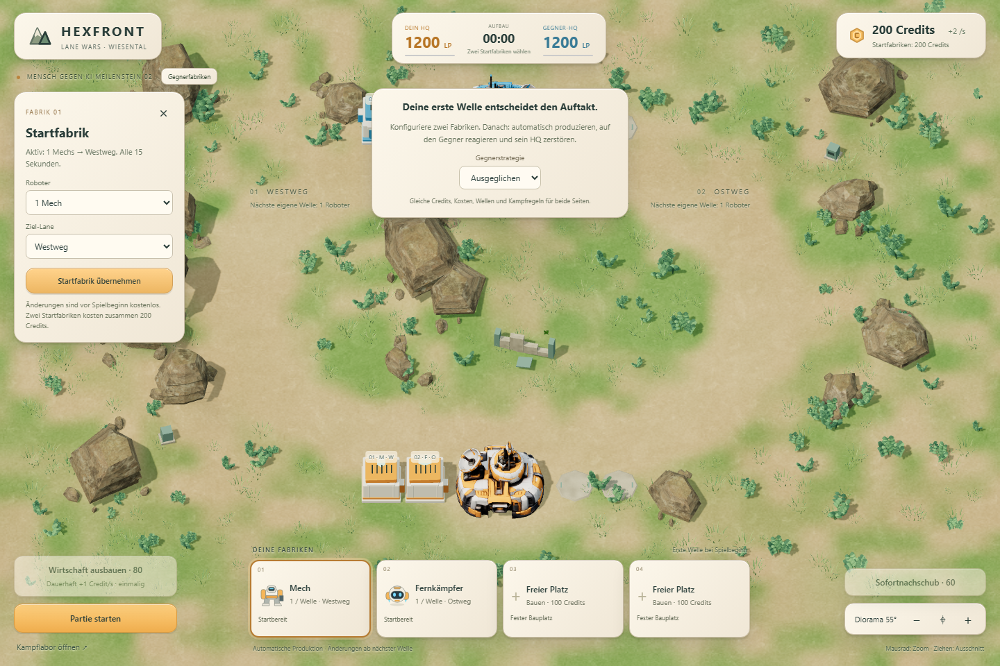
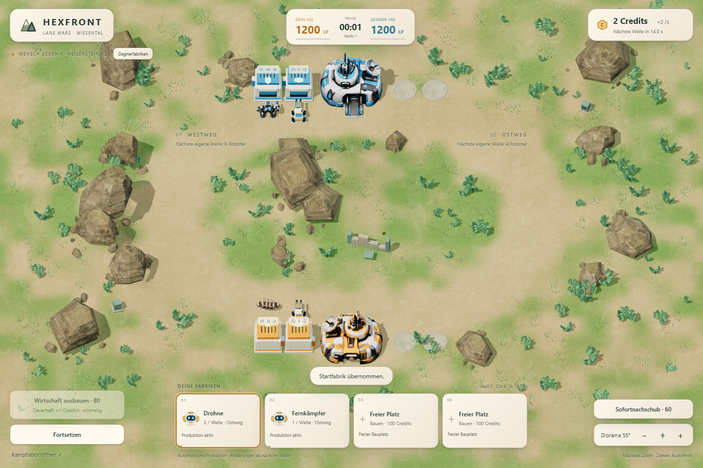
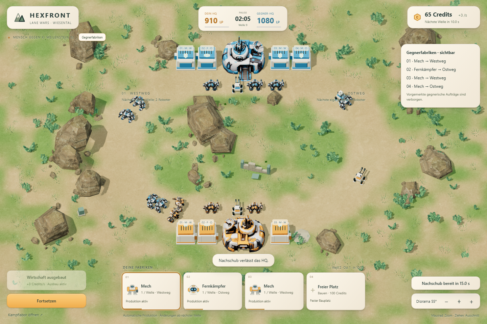
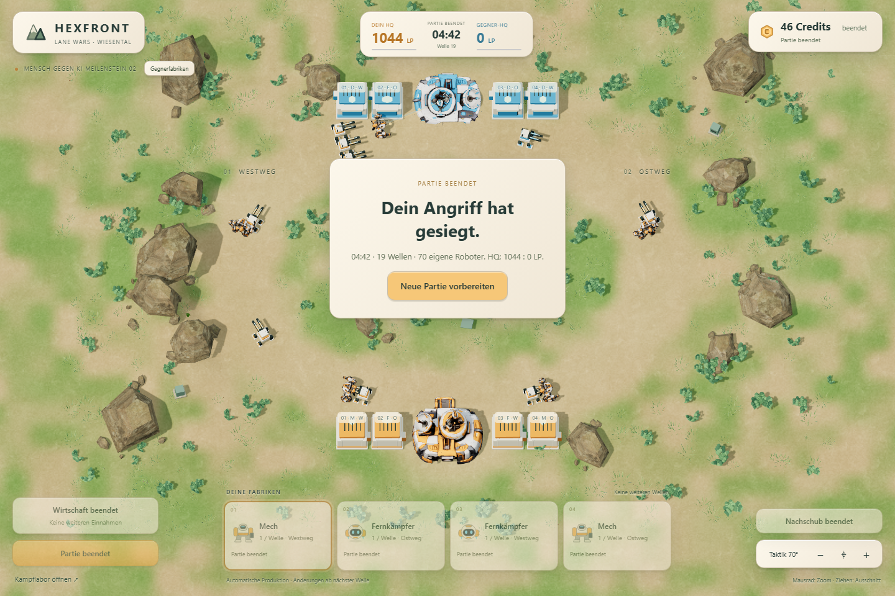

# Meilenstein 2 – vollständige Lane-Wars-Partie

Stand: 14. Oktober 2026. Implementierung ausschließlich im Branch `codex/lane-wars`. M1.5 ist vor Änderungen durch den lokalen Tag `codex/lane-wars-m1.5` bei `3b58f637684c5e5cb558ad34c09ea35cb1898383` gesichert. Kein Merge nach main, keine Änderung an anderen Spielvarianten.

**Nachtrag zur Ausfahrtskorrektur:** Die untenstehenden Matchzahlen und Wirtschaftsvergleiche dokumentieren den ursprünglichen Stand `87865e8`. Die korrigierten Wege ändern Ankunftszeiten und Ergebnisse. [Aktuelle Korrektur, Tests und Vergleichsläufe](FACTORY-EXITS.md).

## Selbst spielen

[Partie starten](http://127.0.0.1:4181/) – der lokale Server muss laufen. Startanleitung und Bedienung stehen in [README](../README.md).

Die beiden Startfabriken konfigurieren und **Partie starten**. Danach können Bau, Umrüstung, Lane-Zuweisung, Wirtschaftsausbau und bezahlter Sofortnachschub bis zur echten HQ-Zerstörung benutzt werden. Ergebnisansicht und Neustart sind vorhanden. Das [Kampflabor](http://127.0.0.1:4181/lab.html) bleibt separat; die [M1.5-Demo](http://127.0.0.1:4181/m15.html) bleibt erreichbar.

## Umsetzung und grafische Integration

Vier feste Bauplätze je Seite, zwei konfigurierbare Startfabriken, kontinuierliches Einkommen und einmaliger Wirtschaftsausbau sind echte Simulationszustände. Beide Seiten produzieren gemeinsam bei 0, 15, 30 … Sekunden. Neubauten und Umrüstungen werden vor der nächsten Produktion übernommen. Vorher sind Korrektur und volle Erstattung möglich. Lane-Wechsel sind kostenlos, bestehende Roboter bleiben auf ihrer Lane.

Jede gebaute Fabrik ist ein kleines dreidimensionales Keramikgebäude mit Fraktionsakzenten, Dachaufbauten, Tor und Ausfahrtsanimation auf den vorhandenen Basisplätzen. Roboter verlassen ihre Ursprungsfabrik. Der Weg bis zum Lane-Eingang kostet echte, typabhängige Laufzeit und ist für beide Fraktionen gespiegelt. Es gibt keine künstliche Warteschlange. Der Basisvorplatz ist außerhalb des Lane-Kampfes; Einheiten treten am Lane-Eingang in die unveränderte Kampfsimulation ein. Sofortnachschub verwendet einen separaten sichtbaren HQ-Ausgang.

Diorama, Landschaft, HQ-, Hover-Bot- und Mech-Modelle und die Keramikgestaltung bleiben erhalten. Die vier Karten zeigen Gebäudezustand, aktuellen Typ/Lane, vorgemerkte Änderung und Produktion. HQ-HP, Credits, Einkommen, Nachschub-Cooldown und Wellenzeit stammen direkt aus der Simulation. Instanzpuffer wachsen bei Bedarf; die Darstellung verschluckt nicht nach 128 Robotern weitere Einheiten.

Die HQ-Erweiterung priorisiert erreichbare Roboter und greift ansonsten das erreichbare HQ an. Eine HQ-Verteidigungswaffe bedient beide Zufahrten gemeinsam. HQ-Schaden beider Seiten wird zusammen verrechnet; gleichzeitige Zerstörung ist ein Unentschieden. Es gibt weder einen Endtimer noch automatische Entfernung alter Roboter.

Der M1-Kern für Bewegung, Zielwahl, Reichweite und Roboterkampf bleibt bytegleich. Die KI erhält öffentliche Sicht mit 2,5 Sekunden Verzögerung, kennt keine vorgemerkten gegnerischen Aufträge und bezahlt dieselben Befehle. Sie baut aus, rüstet um, verteilt Lanes und kauft Nachschub. Bei starker ungeschützter Fernkampfproduktion kann sie Drohnen auf eine Lane konzentrieren. Reguläre Umrüstung erfolgt frühestens nach 30 Sekunden, diese gezielte Antwort frühestens nach 15 Sekunden.

## Teststatus

- **41/41 Node-Tests bestanden**, darunter 15 neue Matchtests und die ursprünglichen Kampf-/Darstellungstests. Geprüft: Einkommen, Kosten, Erstattung, Auftragsgrenzen, Wellen, Umrüstung, Nachschub-Cooldown, Ausfahrtszeiten, HQ-Zielwahl, simultanes Ende, öffentliche KI-Sicht, Fraktionsspiegelung, zeitunabhängige Schrittteilung und späte Reaktionen.
- **14 Labor-Browserprüfungen bestanden**, einschließlich aller ursprünglichen Szenarien.
- **12 M1.5-Browserprüfungen bestanden**: Originalmodelle, beide Routen, erhaltene Demonstrationen, Kamera und Browser-/Headless-Gleichheit.
- **M2 im statischen Build:** Bedienung über echte Schaltflächen, Ausfahrten, Bau/Erstattung/Umrüstung, Nachschub, normale Wiedergabe/Pause, Kamerabedienung, Desktop und schmale Ansicht. Drei vollständige KI-Profilpartien und eine vollständige Niederlage ohne Spielerantwort werden bis zur echten HQ-Zerstörung durchlaufen und exakt mit Headless-Ergebnissen verglichen. Ergebnisansicht und Neustart werden geprüft. Aktueller Beleg: [Browserprotokoll](m2-qa/production/browser-results.json).
- Browser: Chromium 151.0.7922.34. Die beschleunigte Testuhr nutzt dieselben festen Schritte und Ereignisse wie das normale Spiel. Die normale Echtzeitwiedergabe wurde zusätzlich überprüft.

Ein früher Browserlauf meldete einen abgebrochenen Modellrequest (ERR_ABORTED); ein unveränderter Wiederholungslauf mit zusätzlicher Phasenprotokollierung bestand. Das wurde nicht herausgefiltert. Die Ursache ist nicht abschließend geklärt. Die erfolgreichen Abschlussberichte enthalten keine aufgezeichneten Browserfehler.

Die automatisierten Partien sind reproduzierbare Strategieproben, keine menschlichen Spieltests. Es wird keine allgemeine Balance, durchgängige reale Geräte-Framerate oder verifizierte öffentliche M2-Veröffentlichung behauptet.

## Aktuelle Testwerte und dokumentierte Anpassung

| Größe | M2 |
|---|---:|
| Startcredits / Startfabriken | 200 / zwei zu je 100 |
| Zusätzliche Fabrik | 100 |
| Grundeinkommen | 2 Credits/s |
| Einmaliger Wirtschaftsausbau | 80, danach +1 Credit/s |
| Umrüstung / Lane-Wechsel | 30 / kostenlos |
| Sofortnachschub | 60, 15 s eigene Abklingzeit |
| Produktion | je 15 s: 3 Drohnen oder 1 Mech oder 1 Fernkämpfer |
| HQ | 1.200 HP, 8 Schaden, 0,8 s Intervall, Reichweite 4 |

Wirtschaft 80/+1 übernimmt den ausdrücklich offenen v0.2-Testkandidaten. Die einzige neue Kampfwertanpassung betrifft die zuvor nicht implementierte HQ-Waffe: 8 Schaden und 4 Reichweite statt der GDD-Startwerte 12 und 5. Dadurch ist die gemeinsame Verteidigung weniger stark gegen eintreffende Verbände. HP und Feuerintervall bleiben gleich. Keiner der drei Roboterwerte wurde geändert.

## Vollständige Partien und Dauer

[12-Partien-Messreihe](m2-match-audit.json): drei Gegnerprofile, direkte Fabrikeröffnung oder Wirtschaft zuerst, jeweils mit festem oder reaktivem eigenen KI-Plan. Orange ist die untersuchte Seite. „Offen“ bezeichnet ausschließlich das Ende des Messbudgets bei 600 Sekunden, niemals einen Spielsieg oder einen internen Endtimer.

| Eigener Plan | Eröffnung | Gegner | Ergebnis | Sekunden | HQ Orange : Blau |
|---|---|---|---|---:|---:|
| Fest | Fabrik | Druck | Offen | 600 | 110 : 680 |
| Fest | Wirtschaft | Druck | Sieg | 407,10 | 1036 : 0 |
| Reaktiv | Fabrik | Druck | Offen | 600 | 510 : 202 |
| Reaktiv | Wirtschaft | Druck | Niederlage | 352,20 | 0 : 149 |
| Fest | Fabrik | Ausgeglichen | Sieg | 460,55 | 525 : 0 |
| Fest | Wirtschaft | Ausgeglichen | Sieg | 235,15 | 924 : 0 |
| Reaktiv | Fabrik | Ausgeglichen | Sieg | 318,95 | 675 : 0 |
| Reaktiv | Wirtschaft | Ausgeglichen | Sieg | 417,35 | 435 : 0 |
| Fest | Fabrik | Wirtschaft | Niederlage | 197,70 | 0 : 1200 |
| Fest | Wirtschaft | Wirtschaft | Sieg | 285,60 | 1137 : 0 |
| Reaktiv | Fabrik | Wirtschaft | Niederlage | 570,05 | 0 : 291 |
| Reaktiv | Wirtschaft | Wirtschaft | Sieg | 422,10 | 954 : 0 |

Zehn von zwölf Partien endeten durch HQ-Zerstörung. Median der beendeten Partien: **6:20 Minuten**. Fünf liegen in 4–7 Minuten, zwei darunter, drei darüber; zwei waren nach zehn Minuten noch offen. In dieser Reihe waren höchstens 45 Roboter einschließlich Ausfahrten gleichzeitig vorhanden. Das ist keine globale Obergrenze.

Die reaktive KI gewinnt nicht generell häufiger. Ihre Heuristik kann durch schlecht gewählte Umrüstung und Wechsel der Front einen Vorteil verlieren. Deshalb ist diese Reihe allein kein Beleg, dass jede Reaktion oder jede wirtschaftliche Eröffnung überlegen wäre.

## Wirtschaft gegen zusätzliche Fabrik

Die 12-Partien-Reihe verändert teilweise zugleich produzierte Typen und Taktik. Zusätzlich wurden deshalb [18 kontrollierte Eröffnungstests](m2-economy-comparison.json) durchgeführt: identische Startarmee, spätere Fabriktypen und Lanes, Nachschubfolge und Gegner je Paar. Nur die Reihenfolge „Wirtschaft zuerst“ oder „Fabriken zuerst“ ändert sich. Beide Planer entscheiden alle 2,5 Sekunden.

Beispiele:

| Fester Produktionsplan / Gegner | Fabriken zuerst | Wirtschaft zuerst |
|---|---|---|
| Gemischt / Ausgeglichen | Sieg 6:27, 120 eigene HP | Niederlage 4:51 |
| Fernkampf / Ausgeglichen | Sieg 3:48, 348 eigene HP | Sieg 3:38, 1152 eigene HP |
| Fernkampf / Druck | Sieg 3:20, 972 eigene HP | Sieg 3:20, 874 eigene HP |
| Drohnen / Wirtschaft | Nach 10:00 offen | Niederlage 5:02 |

Der frühe Ausbau ist damit eine spielbare Option, aber keine allgemeine Pflicht. Im Fernkampfpaar gegen Ausgeglichen verbessert er die überlebenden HP und die Endzeit deutlich; bei gemischter Produktion kostet derselbe frühe Verzicht auf Fabrikwellen den Sieg. Der Fabrikausbau ist ebenfalls nicht in jeder Lage überlegen. Das begründet die vorläufige Beibehaltung von 80/+1, jedoch keine endgültige Abstimmung.

Nach vier Fabriken ist der einmalige Ausbau langfristig attraktiv: Es gibt dann keine weitere dauerhafte Produktionsinvestition. Wie stark diese spätere Kaufentscheidung wirklich unter Druck steht, muss mit menschlichen Partien geprüft werden.

## Entscheidungen nach zwei bis drei Minuten

[Sieben späte Vergleichsproben](m2-late-response.json) halten den bisherigen Aufbau gleich. Der Gegner rüstet bei 3:00 um, sichtbar ab der Welle bei 3:15. Die Antwort erfolgt erst bei **3:20**, ohne Kenntnis vorgemerkter Gegnerbefehle.

| Situation nach dem gegnerischen Wechsel | Eigene Antwort bei 3:20 | Ergebnis |
|---|---|---|
| Eigene Drohnen gegen neue Mechs | Keine | Nach 10:00 offen, eigenes HQ 290 HP |
| Gleiche Ausgangslage | Auf Fernkampf umrüsten | Sieg 4:31, eigenes HQ unbeschädigt |
| Eigene Mechs gegen neuen Fernkampf | Keine | Niederlage 4:20 |
| Gleiche Ausgangslage | Drohnen auf beide Lanes verteilen | Niederlage 7:41 |
| Gleiche Ausgangslage | Dieselben Drohnen auf eine Lane konzentrieren | Sieg 4:24, eigenes HQ 390 HP |

Die letzten beiden Antworten haben dieselben Umrüstungskosten und Nachschubzeitpunkte. Der Unterschied ist die Lane-Verteilung. Eine aufmerksame Entscheidung nach Minute drei kann daher noch einen erkennbaren Vorteil erzeugen und eine Niederlage in einen Sieg drehen.

Ein bloßes Typenschema reicht nicht: In einer weiteren Probe gewinnt die unveränderte Fernkampfproduktion gegen einen gegnerischen Drohnenwechsel nach 7:43; blindes Umrüsten auf Mechs führt dagegen zu einem nach zehn Minuten offenen Spiel. Bereits vorhandene Verbände, Reichweite, Ankunftszeit und Konzentration bleiben entscheidend.

## Wichtigste spielerische Schwächen

1. **Matchdauer:** 4–7 Minuten sind noch kein zuverlässiger Bereich. Gegenseitig kompensierende Produktion kann lange Patts erzeugen. Ohne Verluste könnten Einheiten weiter anwachsen; es wurde keine versteckte Begrenzung eingeführt.
2. **Fernkampf und Lane-Konzentration:** Konter funktionieren, sind aber empfindlich gegenüber Frontbreite und Zeitpunkt. Ein reines „Typ A schlägt Typ B“ würde den tatsächlichen Kämpfen nicht gerecht. Die KI beantwortet starke Fernkampfproduktion inzwischen auch durch konzentrierte Drohnen, beherrscht diese Entscheidung aber noch nicht zuverlässig.
3. **KI:** Begrenzte Heuristik, keine langfristige Planung. „Reaktiv“ bedeutet nicht automatisch besser; einige Umrüstungen verschwenden Credits und vorhandenen Druck.
4. **Sofortnachschub:** Automatische Fabriken vermeiden repetitive Produktionsbefehle. Bei vollständig ausgebauter Wirtschaft reicht das Einkommen dennoch ungefähr alle 20 Sekunden für weiteren Nachschub. Ob das im menschlichen Spiel zu häufig zum Pflichtklick wird, ist offen; es wurde keine eigenmächtige Auto-Bestellung ergänzt.
5. **Wirtschaft im späten Spiel:** Nach dem vierten Gebäude wird der einmalige Ausbau häufig zur naheliegenden Investition. Die relevante frühe Abwägung ist nachgewiesen; langfristige Vielfalt wurde nicht künstlich durch neue Systeme hergestellt.
6. **Darstellung:** Fernkämpfer weiterhin Platzhalter, Mech ohne Lauf-Rig. Basisvorplätze sind Ausfahrten außerhalb der Lane-Kampfberechnung. Schmale Ansichten sind bedienbar geprüft, das Spiel bleibt PC-first.

## Sichtprüfung

Rohdaten: [Allgemeine Partien](m2-match-audit.json), [kontrollierte Wirtschaftspaare](m2-economy-comparison.json), [späte Reaktionen](m2-late-response.json), [Browser-Abschlussprüfung](m2-qa/production/browser-results.json), [M1.5-Regression](visual-qa/m15-regression-results.json).
