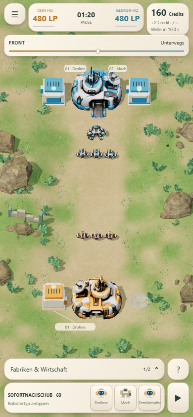
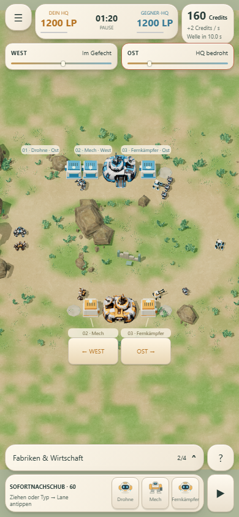
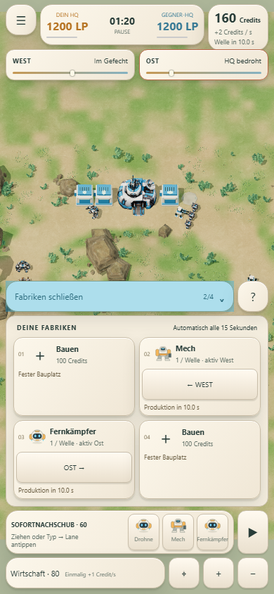

# Mobile Ansicht: mehr Platz für das Gefecht

14. Oktober 2026. Korrektur nach dem persönlichen Smartphone-Test im Hochformat.

Die bisherige Oberfläche zeigte Karten, Wirtschaft, Kameraknöpfe und Hilfstexte dauerhaft. Die früheren Layouttests prüften Überlappungen, aber keine ausreichende freie Spielfeldfläche. Das war für die mobile Abnahme unzureichend.

## Änderung

- Fabriken, Wirtschaft und Kamera öffnen sich über eine einklappbare Verwaltung. Nach Auswahl einer Fabrik bleibt nur deren Editor offen. Ein erfolgreicher Wirtschaftsausbau schließt die Verwaltung.
- Nachschub und Pause bleiben in der schmalen unteren Leiste. Die Richtungspfeile bleiben direkt bei den Gebäuden.
- Frontanzeigen zeigen eine kurze Lagebeschreibung und den Positionsbalken. Ein Tap zeigt die Verstärkungsdetails; bei gewähltem Nachschub bleibt derselbe Tap ein Lane-Befehl.
- Missionshinweise erscheinen auf kleinen Bildschirmen über **?**. Meldungen über neue Aufträge bleiben kurz sichtbar.
- Der Kameraausschnitt nutzt weniger reservierten HUD-Platz und konzentriert sich auf die spielbare Fläche. Keine Änderungen an Karte, Kampf, Laufwegen oder Wirtschaft.

## Browserprüfung

Geprüft mit emulierter Touch-Eingabe, jeweils beide Missionen:

| Größe | Freie Höhe zwischen Frontanzeige und Bedienleiste |
|---|---:|
| 390 × 844 | 611 px / 72,4 % |
| 360 × 640 | mindestens 397 px / 62,1 % |
| 320 × 568 | mindestens 325 px / 57,3 % |
| 412 × 915 | 682 px / 74,5 % |
| 844 × 390 quer | 206 px / 52,8 % |

Diese Messung beschreibt den Bereich zwischen den beiden HUD-Rändern, nicht einen vollständig von Gebäudebeschriftungen freien Pixelanteil. Beide HQs bleiben außerhalb dieser HUD-Flächen. Sichtbare Hauptaktionen haben mindestens 44 × 44 Pixel und werden beim Antippen nicht von anderen Elementen abgefangen.

Touch-Bauen, Stornieren/Erstattung, Umrüstung, kostenloser Gebäuderichtungswechsel, Nachschub auf die Straße, Frontdetails, Hinweise und Wirtschaftsausbau bestanden. Die Verwaltung ist auf kleinen Bildschirmen scrollbar. [Messwerte und Touch-Prüfungen](mobile-hud/browser-results.json).

59 Simulationstests bestanden. Die zusätzliche bestehende Browser-Abnahme prüft Desktop, Touch-Drag, Speichern und vier vollständige Partien auf dem eigenständigen Build. [Regressionsbericht](mobile-hud/regression/browser-results.json).

Die Prüfung ist eine Browseremulation und ersetzt keinen erneuten persönlichen Smartphone-Test. Wiesenkrieg bleibt wegen seiner breiten Zwei-Lane-Landschaft in der Gesamtansicht kleiner als Erste Front; Kamera-Zoom ist in der Fabrikverwaltung erreichbar.

Die veröffentlichte Vorschau wurde zusätzlich bei 390 × 844 mit Touch-Eingabe geprüft: eingeklappte Verwaltung, Fabrikbau in Erste Front, Richtungspfeil und Nachschub in Wiesenkrieg. Keine Browserfehler. [Öffentliches Prüfprotokoll](mobile-hud/public-preview.json).

## Bilder

