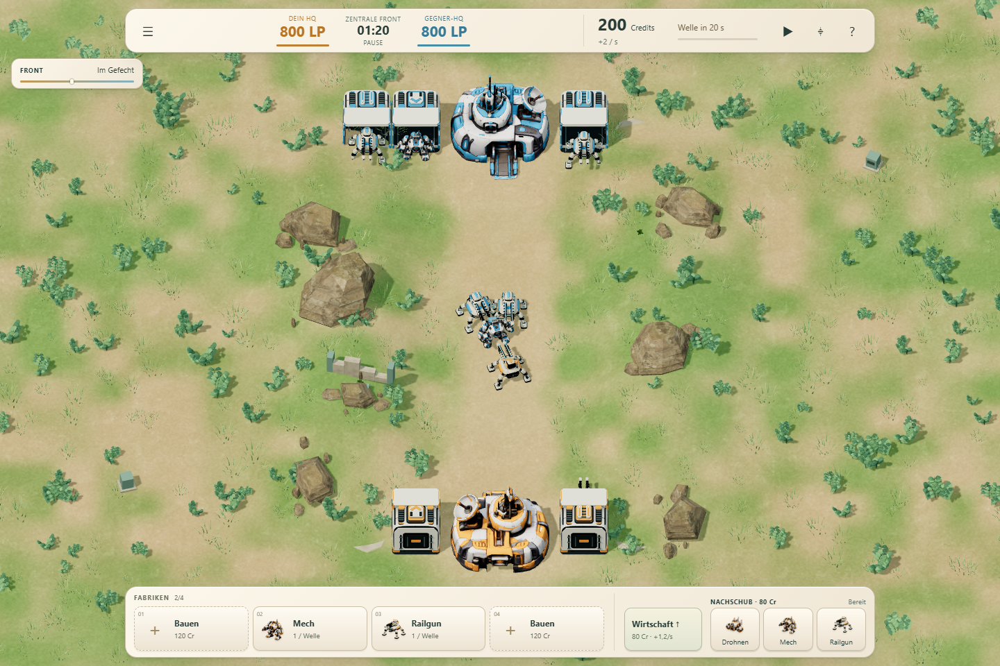
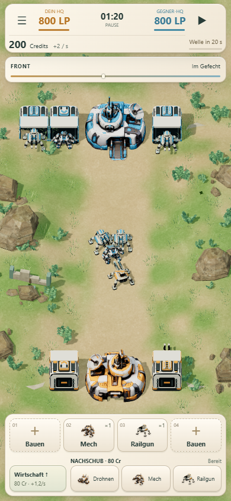

# Kompaktes Keramik-HUD · 17. Oktober 2026

Die Bedienoberfläche wurde in der Lane-Wars-Variante verdichtet. Simulation, Einheitenwerte, Wirtschaft, Wellen, KI, Fabrikmechaniken, Karten und Missionsfreigaben bleiben unverändert.

## Sichtbares Ergebnis

- Eine gemeinsame Statusleiste mit HQ-Lebenspunkten, Uhr, Credits/Einkommen und einem Wellen-Countdown samt Fortschrittsbalken.
- Vier kompakte Fabrikkarten; die Einführung behält ihre zwei Plätze. Produktionsmenge, laufender Typ und vorgemerkte Änderungen sind unterscheidbar. Details öffnen direkt über der Leiste.
- HUD-Porträts aus den vorhandenen echten GLBs; keine Änderungen an den Modellen. Reproduzierbar mit `node scripts/capture-hud-portraits.mjs`.
- Wirtschaft verschwindet nach dem einmaligen Ausbau als Kaufaktion; der Ausbau bleibt am Einkommen mit einem Haken erkennbar. Nachschub bleibt direkt erreichbar.
- Gebäudebeschriftung und Umrandung nur bei Auswahl oder Mauszeigerkontakt. Frontdetails aufklappbar, Einführungshinweis auf Desktop zeitlich begrenzt und manuell schließbar.
- Hochformat: alle Fabrikplätze immer erreichbar, Bearbeitung als darüberliegendes Panel. Kamera und Spielhinweise über das Menü. Touchflächen mindestens 44 × 44 CSS-Pixel.
- Wiesenkrieg behält seine kostenlosen Richtungsschalter und die Nachschubwahl über Lane-Klick oder Ziehen. Alle früheren Varianten und das Kampflabor behalten ihre Dateien.

## Gemessener Platzbedarf

Vergleich bei 1:20 Spielzeit mit dem veröffentlichten Vorgänger `37a6864` ([Messung](baseline.json)).

| Ansicht | Vorher | Jetzt |
| --- | --- | --- |
| Desktop 1440 × 960, untere Leiste | 201 px | 103 px (49 % niedriger) |
| Hochformat 390 × 844, untere Leiste | 111 px, Fabrikkarten verborgen | 139 px, alle vier Plätze sichtbar |
| Permanente Gebäudebeschriftungen in dieser Szene | 5 | 0 |

Im Hochformat beansprucht die ständig bedienbare Fabrikleiste bewusst 28 Pixel mehr als die frühere geschlossene Schublade. Dafür entfallen deren zusätzlicher Öffnungsschritt und die dauerhaften Gebäude-Labels. Zwischen Frontanzeige und Leiste bleiben bei 390 × 844 rund 66 % der Bildschirmhöhe frei; beide HQs bleiben sichtbar. Auf sehr kleinen 320 × 568 Displays ist die Zwei-Lane-Übersicht weiterhin klein, aber die Bedienelemente bleiben erreichbar. Die Kamera lässt sich näher heranholen.

## Prüfung

- 94/94 bestehende Node-Tests bestanden: Bewegung, Zielwahl, Kampf, Wirtschaft, Produktion, Reservierungen, Nachschub, KI, Symmetrie, Save-Migration und historische Profile.
- `npm run build`: eigenständiger statischer Build erfolgreich.
- 24 Browser-Konfigurationen: Zentrale Front, Erste Front und Wiesenkrieg jeweils bei 1440×960, 1024×768, 768×1024, 390×844, 360×640, 320×568, 412×915 und 844×390. Kein Seitenüberlauf, keine verdeckten HQs durch permanente HUD-Flächen, alle geprüften Aktionen mindestens 44×44 und per tatsächlichem Hit-Test erreichbar. [Layout- und Bedienprotokoll](browser-results.json)
- Tatsächliche Touch-/Klickbedienung: Bauen, Reservierung, Storno/Erstattung, Umrüsten zur nächsten Welle, Wirtschaftsausbau, Nachschub/Kosten/Abklingzeit, Lane-Wechsel und Lane-Nachschub, Kamera, Hinweis schließen, Escape/Fokusrückgabe.
- Vollständige Partie über die echten HUD-Buttons: Sieg nach 199 Sekunden, HQ 800:0; Speichern und Browser-Neuladen erhalten den Zustand exakt. Weitere Browserläufe stimmen mit den Headless-Ergebnissen überein: 199 Sekunden Sieg gegen Druck, 97,2 Sekunden Sieg gegen Wirtschaft, spiegelgleiche Belagerung nach 720 Sekunden unentschieden. Ohne Spielerbefehle Niederlage nach 208,95 Sekunden. Das bekannte Patt bei spiegelgleichen Strategien wurde in diesem UI-Auftrag nicht verändert. [Partien](full-match/results.json)
- Desktop-Chromium mit emulierten Touch-Viewports; kein Test auf einem physischen Smartphone und keine neue FPS-Messung.

Die README-Veröffentlichung verweist auf den separaten Laufzeit-Commit; das Online-Prüfprotokoll wird nach dem Push ergänzt.
