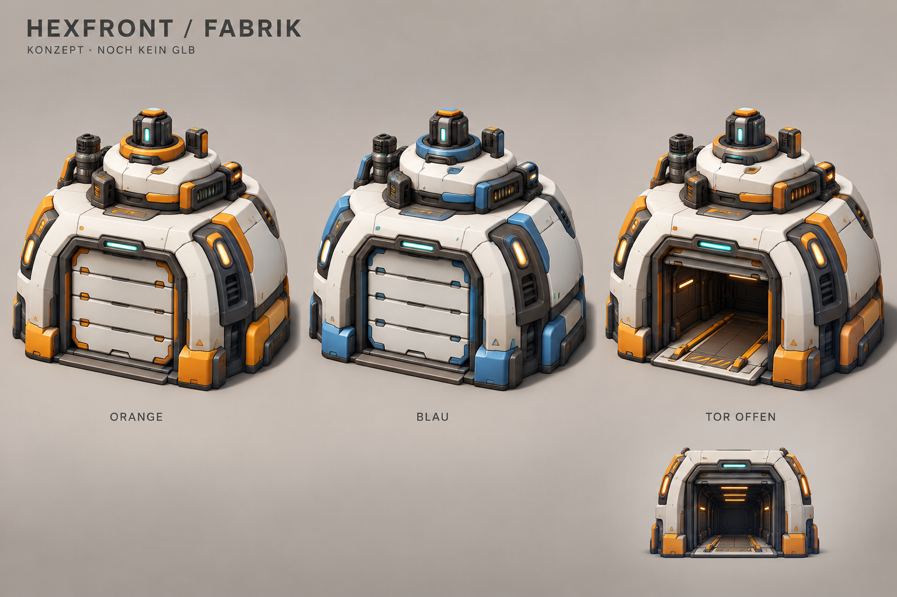

# Fabrik – freigegebene Designrichtung

Stand: 16.10.2026, Branch codex/lane-wars.

**Status: Designrichtung freigegeben; das [tatsächliche GLB](../factory-model/REVIEW.md) ist inzwischen zum Testen im Spiel eingebaut; siehe [Integrationsbericht](../factory-integration/REPORT.md).** Diese ursprüngliche Konzepttafel ist eine Illustration. Die Konzepttafel wurde mit dem eingebauten Imagegen-Werkzeug anhand unseres HQ-Referenzbilds erzeugt. Sie belegt weder Geometrie noch Animation oder Performance. Bestehende Fabriken und Modelle im Spiel sind unverändert.

## Gestalterische Richtung

Kompakter Roboterhangar mit gewölbten elfenbeinfarbenen Keramikschalen, dunklen eingelassenen Technikfugen, klaren Teamfarbflächen und sparsamen Statusleuchten. Abgerundete, sorgfältig ausgeformte Panzerplatten und zurückgesetzte Anschlüsse statt gestapelter Quader. Der niedrige Aufbau ohne Radar bleibt dem HQ visuell untergeordnet.

Orange und Blau verwenden dieselbe Geometrie, Keramik und dunkle Materialien; nur die Teamflächen wechseln die Farbe. Das Grundgebäude bleibt für Drohne, Mech und Fernkämpfer identisch. Ein kleines wechselbares Typzeichen übernimmt die bisherige Produktionskennzeichnung.

Referenz: [vorhandenes HQ](../../../hexfront-3d/docs/imported-assets/viewer-hq.png), insbesondere Materialkontrast, Rundungen und Fugen. Maßgeblich für den Größenvergleich sind die tatsächlich geladenen Dateien public/models/hq.glb und public/models/mech.glb, nicht die Perspektive der Konzepttafel.

## Ursprüngliche Vorgaben – tatsächliche Maße siehe Modellbericht

**Das Tor muss im realen Modell deutlich breiter ausfallen als auf der Konzepttafel.** Der Mech ist bei der aktuellen Darstellungsgröße ungefähr 1,62 breit und 1,45 hoch. Die Illustration ist keine maßhaltige Bauzeichnung. Dünnere seitliche Torpfosten, ein breiterer Durchlass und ein kompakterer Dachaufbau sind deshalb Teil der 3D-Ausarbeitung.

| Vorgabe | Ziel für die Modellierung |
| --- | --- |
| Außenmaß | maximal ca. 1,98 breit × 2,00 tief; ca. 2,05 hoch |
| Freier Durchlass | mindestens 1,72 breit × 1,60 hoch, nach geöffneten Torblättern gemessen |
| Koordinaten | Y nach oben, Front nach −Z, Ursprung mittig am Boden; 1 Einheit = 1 Spieleinheit |
| Frontfläche | Tor/Schwelle bei ungefähr Z = −1,00, keine auskragende Rampe |
| Platzierung | aktuelle Fabrikzentren und gespiegelte Ausrichtung unverändert |
| Freiraum | Mech samt Bewegung und seitlichem Versatz an allen acht Plätzen prüfen |

Die bestehenden Roboter starten direkt vor dem Tor. Die Türanimation muss diese frühe Sichtbarkeit berücksichtigen: während des Spawnzeitpunkts vollständig offen, anschließend schließen. Keine Ausfahrt durch eine noch geschlossene Tür. Bestehende Ereignisse und Simulationszeiten bleiben erhalten.

## Benötigtes 3D-Asset

Die Konzepttafel liefert keine konvertierbare, spielfertige Geometrie. Für nachweisbare HQ-Qualität wird eine sorgfältige Hard-Surface-Modellierung benötigt, beispielsweise als Blender-Quelldatei plus GLB-Export. Ein externer 3D-Artist kann die Tafel zusammen mit dem vorhandenen HQ und Mech als Vorlage verwenden. Eine automatische Bild-zu-3D-Rekonstruktion allein genügt nicht als Abnahme: Tor, verdeckte Rückseite, Innenraum, UVs und Optimierung müssen gezielt ausgearbeitet werden.

Lieferumfang:

- Ein zusammenhängend gestalteter Gebäude-Korpus mit ausgeformten Panzerplatten, Bevels, Fugen und sauberer Schattierung; Details teilweise über Normal-/Roughness-Texturen.
- Modellierter Hangarinnenraum mit Boden und Seitenwänden, auch bei offenem Tor überzeugend.
- Vier separat bewegliche, nach oben teleskopierende Torsegmente mit passenden Pivots und genügend Platz im Torsturz. Clip Door_Open von geschlossen nach offen; umkehrbar für das Schließen. Keine bloß bemalte Torfläche oder leeren Animationsknoten.
- Dedizierte Teamfarbmaterialien oder klar definierte Maske. Orange #f49a43, Blau #469dce; Keramik bleibt neutral.
- In der GLB eingebettete PBR-Texturen und exportierte Transformationen; bearbeitbare Quelldatei mitliefern.

## Vorgeschlagene Leistungsbudgets – noch nicht gemessen

Ziel: 8.000–12.000 Dreiecke pro Gebäude, höchstens 3–4 Materialgruppen und ein gemeinsamer 1K- bis 2K-Textursatz. Acht Instanzen teilen Geometrie und Texturen. Zielgröße etwa 2–3 MB für das gesamte GLB. Ein optionales reduziertes LOD darf später Geometrie sparen; es ist keine zusätzliche Gameplayfunktion.

Zum Vergleich enthält das jetzige HQ ungefähr 44.540 Dreiecke bei 3,29 MB. Dieses Budget achtmal zu vervielfachen wäre für kleine Fabriken unnötig. Die endgültigen Budgets werden anhand der tatsächlichen Ansicht geprüft.

## Freigabe und spätere Integration

Die Tafel kann die **Designrichtung** zur Diskussion stellen. Sie ersetzt keine Freigabe eines fertigen 3D-Modells. Vor dem Einbau wird das tatsächliche GLB in einer drehbaren Vorschau oder in Renderings aus diesem GLB gezeigt: Vorderseite, Rückseite, Draufsicht, Tor offen/geschlossen, beide Farben sowie Größenvergleich mit HQ und Mech.

Nach der vom Nutzer ausdrücklich verlangten Modellfreigabe:

1. GLB laden und Körpergeometrie teilen; Torsegmente pro Instanz steuerbar halten. Der aktuelle Modell-Loader, der Geometrien zusammenführt, darf diese Knoten nicht verschmelzen.
2. Produktionsereignis und aktuelle Öffnungsdauer anbinden, ohne Wellen oder Ausfahrtrouten zu verändern.
3. Transparente Bauvorschau auf dem ganzen Gebäude einschließlich Tor beibehalten. Materialzustände pro Instanz trennen, damit der Baugeist keine anderen Fabriken durchsichtig macht.
4. Produktionskennzeichnung, Neubauanimation, Auswahl und Umrüstung erhalten.
5. Acht gleichzeitige Gebäude, beide Fraktionen, alle drei Roboter, alle Plätze, offene Tore, Bauvorschauen und bestehende Missionen im laufenden Spiel prüfen.

**Historischer Konzeptschritt. Die anschließende Modellierung und Integration sind im verlinkten Bericht dokumentiert.**

[Exakter Bildprompt und Generierung](PROMPT.txt)
