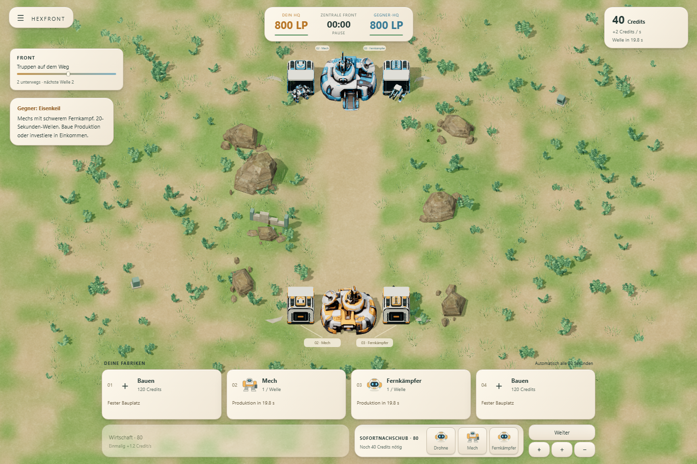
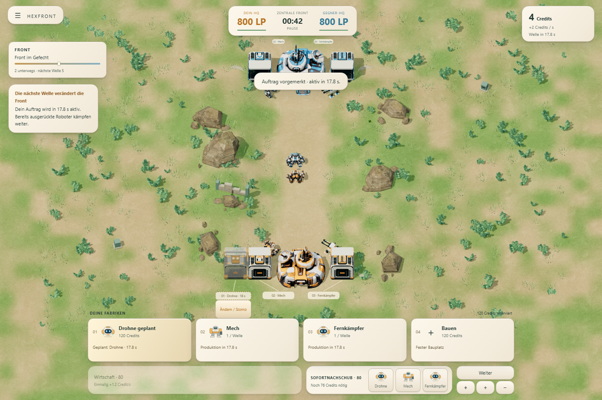
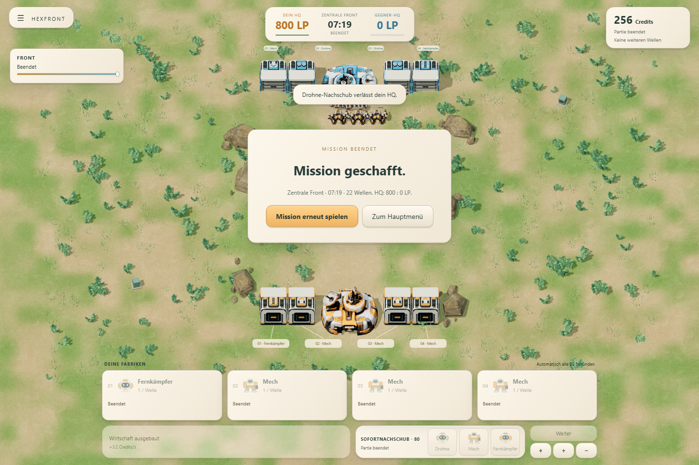

# GLB-Fabrik im spielbaren Lane Wars

Stand: 16.10.2026 · ausschließlich `codex/lane-wars`.

Auf ausdrücklichen Wunsch ist das tatsächliche Fabrikmodell jetzt im Spiel testbar. Der aktuelle öffentliche Playlink steht in der Branch-README. Die separate Modellansicht und die bearbeitbare Blender-Datei bleiben erhalten.

## Eingebaut

- Das unveränderte GLB ersetzt die prozeduralen Fabriken in **Zentrale Front**, **Erste Front** und **Wiesenkrieg**. Die bisherigen Bauplätze, Ausrichtungen und Roboterausfahrten bleiben bestehen.
- Vier echte Torsegmente werden über den exportierten Clip bewegt. Das Tor öffnet vor der gemeinsamen Welle, ist beim Erscheinen der Roboter offen und bleibt bei Einheiten im Durchlass offen. Das ist reine Darstellung: keine neuen Kollisionen, Wartezeiten oder Kampfregeln.
- Orange und Blau, modellierter Innenraum und die drei Produktionsmodule sind angebunden. Ein Umrüstauftrag wechselt das sichtbare Modul bei seiner Aktivierung zur nächsten Welle. Die vorgemerkte Änderung bleibt im bisherigen HUD sichtbar.
- Transparente Bauvorschauen verwenden getrennte Materialzustände und machen weder bestehende noch gegnerische Fabriken durchsichtig. Der Gebäudeklick öffnet weiterhin die zugehörige Fabrikkarte.
- Die kurze Fertigstellungsbewegung betrifft das Dachmodul. Die Torhöhe wird beim Neubau nicht gestaucht, damit ein gerade produzierter Mech nicht durch verkleinerte Geometrie fahren muss.
- Geometrien und Texturen werden geteilt; statische und bewegliche Teile werden gemeinsam instanziert. Acht Fabriken mit gemischten Modulen benötigen **32 Fabrik-Batches** im Hauptpass. Gelände, Roboter, Schatten und Effekte kommen zusätzlich hinzu.




## Technische Prüfung

**88/88 bestehende und Asset-Tests bestanden.** Der statische Build enthält die GLBs und funktioniert ohne externe Modell-CDNs.

Die gezielte Browserprüfung des Builds umfasst Produktionswelle, geöffnete und geschlossene Tore, echte Gebäudeklicks, Bauen, transparente Materialien ohne Übertragung auf andere Gebäude, Umrüstung, Save/Reload, Missionwechsel, beide Fraktionsfarben, alle Slots und Module sowie Hochformat. Eine zusätzliche Prüfung hält einen tatsächlich erzeugten Roboter im Durchlass fest: Das Tor bleibt offen und schließt nach Freigabe. Ein Vergleich der Match-Snapshots bestätigt, dass die Darstellung den Simulationszustand nicht verändert.

[Integrationsprüfung](browser.json) · [Vollständige Partien und HUD-Prüfung](matches.json) · [30 Fabrik-/HQ-Kampffälle](deployment.json) · [12 Ausfahrtkonfigurationen](exits.json)

Die 30 bestehenden Kampffälle und zwölf Ausfahrtkonfigurationen mit allen drei Einheiten, beiden Fraktionen und beiden Lanes bestehen ohne Browserfehler. Die Modelle richten sich weiterhin nach ihrer tatsächlichen Bewegung aus; der Mech behält seinen sichtbaren Schussabstand.

Die vorhandene Browserprüfung einer vollständigen zentralen Partie besteht mit dem neuen Fabrikmodell: Alle Spielerbefehle werden über echte HUD-Schaltflächen eingegeben; nur die Uhr wird beschleunigt. Ein Save/Reload innerhalb der Partie erhält den exakten Zustand. Der Sieg tritt nach **7:19,75** durch Zerstörung des gegnerischen HQ ein. Eine weitere Referenz endet nach **7:15,80** mit Sieg; ohne Spielerbefehle endet die Partie nach **2:48,80** mit Niederlage. Zwei weitere Referenzen bleiben nach zwölf Minuten offen. Diese bereits bestehende Balance-Schwäche wird durch den rein grafischen Einbau nicht behoben; es wurden keine Spielwerte geändert.



## Umfang

Geändert wurden der Fabrik-Renderer und seine Anbindung an die Match-Ansicht. Simulation, Wirtschaft, Produktionsrhythmus, Sofortnachschub, Einheitenwerte, KI und Routen sind unverändert. Das Kampflabor, die M1.5-Demo und andere HEXFRONT-Varianten wurden nicht umgebaut; kein Merge nach `main`.

Die bisherigen [GLB-Geometrieprüfungen](../factory-model/qa/geometry.json) und [Modell-/Quelldateien](../factory-model/REVIEW.md) gelten weiterhin für dasselbe Asset. Die öffentliche Freigabe ist ein spielbarer Teststand, keine Aussage über eine abschließend gelöste Balance oder garantierte Bildrate auf jedem Gerät.

## Wiederholen

```powershell
npm test
npm run build
npm run test:factory-game
npm run test:central-browser
npm run test:deployment
npm run test:exits
```

Für Browserprüfungen läuft `node scripts/serve.mjs` auf Port 4181. `MATCH_URL` wählt den Quellstand oder `/dist/`. Die Ausfahrtdiagnosen verwenden ihre Test-Fixtures im Quellstand.
