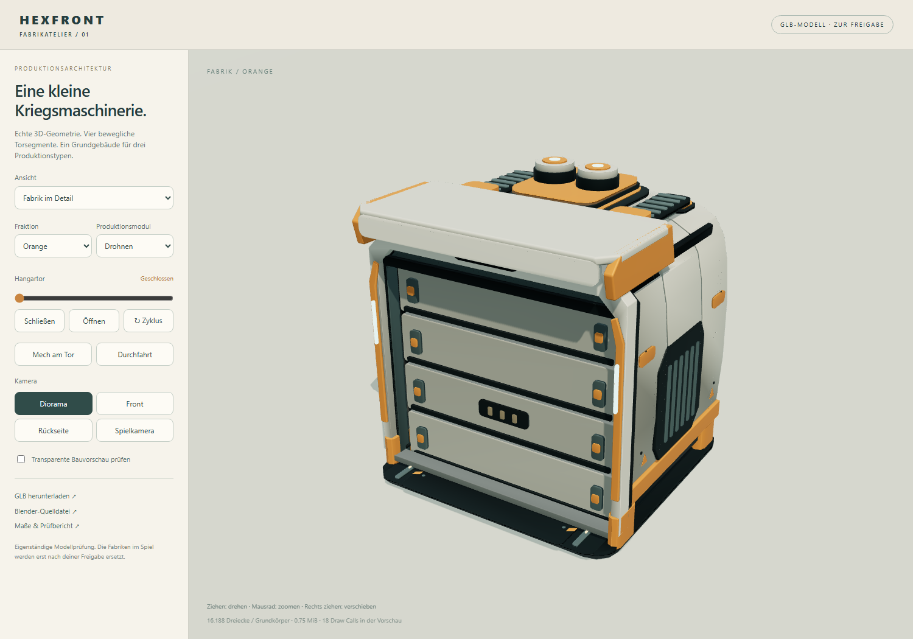
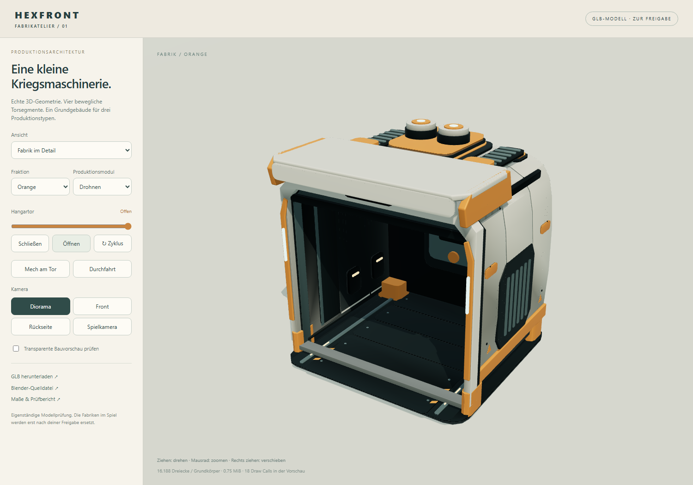
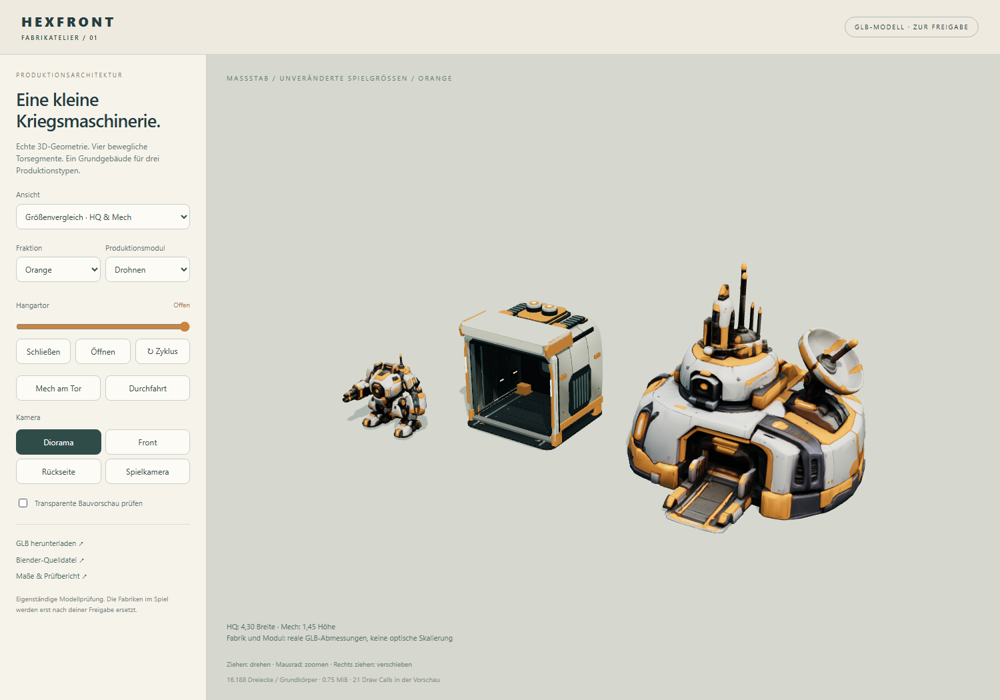

# Fabrik v1 – tatsächliches GLB und Spielintegration

Stand: 16.10.2026 · Branch `codex/lane-wars`.

**Der Nutzer hat den Einbau zum Testen freigegeben.** Die Fabrik ist jetzt in den drei Lane-Wars-Missionen integriert. [Integration und Tests](../factory-integration/REPORT.md). Gameplay und Balance bleiben unverändert. Die folgenden Messwerte dokumentieren das unveränderte GLB und seine separate Modellansicht.

[Öffentliche 3D-Vorschau](https://rawcdn.githack.com/emfau88/hexwars/a85ee3fc570a6aa25f1e4f819e6c58a16a335961/experiments/hexfront-lane-wars/factory-preview.html) · [Drehbare Vorschau lokal](http://127.0.0.1:4181/factory-preview.html) · [GLB](../../public/models/factory-preview/factory.glb) · [Bearbeitbare Blender-Datei](../../art/factory-v1/factory-source.blend) · [Exportmanifest](../../public/models/factory-preview/manifest.json)

## Modell und Bedienung

Die Vorschau lädt die exportierten GLBs. Ziehen dreht, das Mausrad zoomt, Rechtsziehen verschiebt die Kamera. Torregler, Öffnen/Schließen und Zyklus zeigen alle vier beweglichen Segmente. Weitere Ansichten zeigen den tatsächlichen HQ-/Mech-Maßstab, acht Fabriken, beide Teamfarben, transparente Bauvorschauen und drei wechselbare Produktionsmodule. Die Durchfahrt ist eine eigene Modellansicht mit dem bestehenden Mech, keine Änderung seiner Spielbewegung.

Die Fabrik besitzt eine gebogene, in Keramikpaneele unterteilte Außenhaut, eingelassene Kühlfelder, einen ausgeformten Portalrahmen und eine flache industrielle Torkassette. Modellierte Bodenführungen, Seitenrippen, Arbeitsleuchten und die rückwärtige Dockingkonsole bleiben bei offenem Tor sichtbar. Die Quelle enthält einzeln benannte, bearbeitbare Teile und Materialien; nur der Export wird nach Material und beweglicher Baugruppe zusammengefasst.





## Abmessungen und Aufbau

| Merkmal | Tatsächlicher Stand |
| --- | --- |
| Grundkörper B × T × H | 2,074 × 2,044 × 2,140 Spieleinheiten |
| Höhe mit Modul | ca. 2,35 |
| Mech B × T × H | 1,621 × 1,101 × 1,450 |
| Toröffnung | nominell 1,86 breit; gefaltete untere Torkante bei 1,646 über Modellursprung |
| Bauplatzabstand | 2,10; Grundkörper überlappen nicht |
| HQ-Vergleich | bestehendes HQ mit unveränderter Normalisierung auf 4,30 |
| Ausrichtung | glTF Y oben, Front −Z, Ursprung mittig am Boden |

Die Breite wurde gegenüber dem ersten Konzept vorsichtig vergrößert. Das breitere Tor und der flachere Aufbau sind bewusst anders proportioniert als die damalige Illustration. Die optische Abnahme erfolgt an dieser realen Vorschau.

Vier Knoten `Hangar_Segment_1` bis `_4` besitzen jeweils echte Geometrie und unabhängige Translationen. Der GLB-Clip `Door_Open` dauert eine Sekunde und lässt sich rückwärts schließen. Die Segmente fahren zuerst in getrennte Tiefenführungen und anschließend nach oben in die ausgefräste Kassette. Sie werden nicht zusammengestaucht oder ausgeblendet.

Der benannte Knoten `Production_Socket` nimmt die drei gesonderten Modul-GLBs auf: Doppelspulen für Drohnen, Pressbügel mit Winkelzeichen für Mechs und parallele Kühlkanäle für Fernkämpfer. Alle verwenden denselben Anschluss. Es handelt sich ausschließlich um austauschbare Kennzeichnungen vorhandener Produktionstypen.

Orange und Blau liegen als `KHR_materials_variants` in jedem GLB vor. Die Vorschau schaltet die benannten Teamflächen entsprechend um. Kurze Umgebungsverschattung ist in Vertexfarben gebacken; Oberflächenrauheit verwendet eine kleine gemeinsame eingebettete Textur. Es gibt keine externe Texturabhängigkeit.

## Budget und Prüfung

| Asset | Dreiecke | Dateigröße |
| --- | ---: | ---: |
| Fabrikgrundkörper | 16.188 | 785.380 Byte |
| Drohnenmodul | 2.216 | 99.264 Byte |
| Mechmodul | 672 | 47.512 Byte |
| Fernkämpfermodul | 992 | 65.588 Byte |

Die Grundgeometrie liegt über dem frühen Konzeptziel von 8–12 Tausend Dreiecken; dafür bleiben Innenraum, Fugen und vier echte Torsegmente erhalten. Acht Fabriken mit dem größten Modul ergeben 147.232 Dreiecke ohne Schattenpass. In der Vorschau teilen Instanzen Geometrien, Texturen und neutrale Materialien; bewegliche Teile behalten eigene Transformationen. Die Acht-Fabriken-Ansicht benötigt **24 Zeichenaufrufe** einschließlich Boden im Hauptpass. Das ist kein FPS-Versprechen für das spätere Gesamtspiel; Gelände, Roboter, Effekte und Schatten kommen dort hinzu.

- **88/88 Node-Tests bestanden**, einschließlich fünf neuer Assetprüfungen und aller bestehenden Spiellogiktests.
- Die Blender-Prüfung importiert die tatsächlich exportierte Fabrik und den vorhandenen Mech. 144 gerade Durchfahrtposen decken Wippen, Neigung und Rollen bis zur kombinierten Lauf-/Trefferamplitude ab: keine Dreiecksüberschneidung.
- 240 Posen auf den acht bestehenden Ausfahrten des Hauptmodus, mit unveränderter Routenfunktion und tatsächlicher Gelände-Höhenfunktion: keine Überschneidung. Erfasst sind die ersten 1,5 Sekunden in 0,05-Sekunden-Schritten.
- 13 Torstellungen während der gesamten Öffnung: keine Segment-/Segment- oder Segment-/Gehäuseüberschneidungen; auch das gefaltete Paket ist getrennt.
- Browserprüfung: echte GLBs, Drehung, vier Torelemente, beide Farben, alle Module aus der Spielkamera, transparente Vorschau, HQ-/Mech-Vergleich, Durchfahrt, acht geteilte Instanzen mit unabhängigem Tor, Downloads und Hochformat.

[Rohdaten Geometrie](qa/geometry.json) · [Browserprotokoll des Builds](qa/browser.json) · [Prüfung des öffentlichen Links](qa/public-browser.json). Beide Browserläufe bestanden ohne Anwendungs- oder Assetfehler. Der öffentliche Host meldete lediglich einen blockierten externen Werbeaufruf. Der Geometriebericht ist über SHA-256 an genau diese Fabrik- und Mechdatei gebunden. Es handelt sich um abgetastete Oberflächenprüfungen, nicht um einen kontinuierlichen mathematischen Kollisionsbeweis. Bodendreiecke unter 0,16 werden bei der Mechprüfung ausgelassen; Fuß-/Bodenauflage ist keine Wandkollision. Andere Missionen, Geländeanschlüsse und Produktionsereignisse werden beim später freigegebenen Einbau zusätzlich im laufenden Spiel geprüft.

## Bearbeiten und erneut prüfen

`art/factory-v1/factory-source.blend` enthält die editierbaren Architekturteile, Toranimation und drei Produktionsmodule. Blender 5.2.0 LTS wurde für Erstellung und Export verwendet. `model_factory.py` erzeugt dieselbe Modellkonstruktion und exportiert die GLBs; **erneutes Ausführen überschreibt manuelle Änderungen an der Blend-Datei**.

Aus dem Experimentverzeichnis, bei laufendem lokalen Server:

```powershell
node art/factory-v1/sample-routes.mjs
& 'C:/Program Files/Blender Foundation/Blender 5.2/blender.exe' --background --factory-startup --python-exit-code 1 --python art/factory-v1/model_factory.py
& 'C:/Program Files/Blender Foundation/Blender 5.2/blender.exe' --background --factory-startup --python-exit-code 1 --python art/factory-v1/validate_factory.py
npm test
npm run build
npm run test:factory-preview
```

Der Build enthält die Modellvorschau und Blender-Quelle. Der Einbau zum Testen wurde anschließend ausdrücklich freigegeben und ist erfolgt; Details stehen im Integrationsbericht. Die unabhängige Torhierarchie darf dabei nicht durch den bisherigen statischen Modell-Merger verloren gehen.
