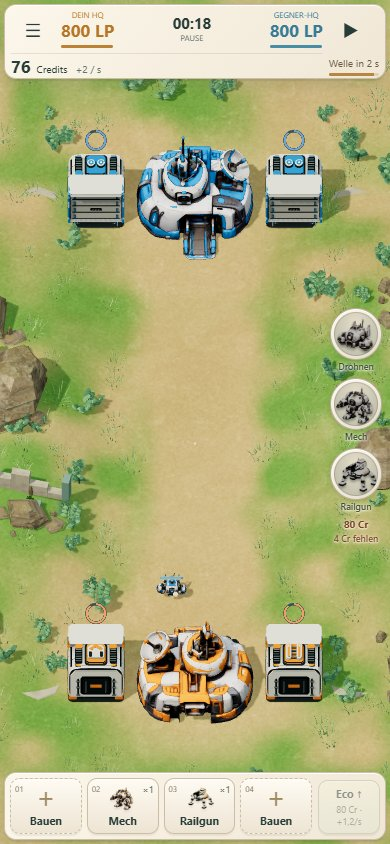
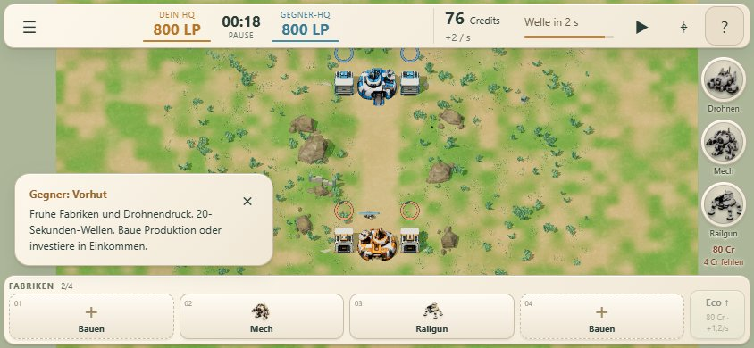

# Dezentere Fabrik-Produktionsringe

Die Ringe haben jetzt 22–28 statt 30–38 CSS-Pixel Durchmesser, abhängig vom Kamera-Zoom. Ihre Strichstärke ist reduziert; eine feine dunkle Kontur ersetzt den auffälligen hellen Außenrand. Das Warnsignal und der Produktionsimpuls sind weniger weiß; die Größenänderung beim Spawn beträgt nur noch 3 statt 8 Prozent.

Die Mindestgröße von 22 Pixel bleibt auch auf Mobile erhalten. Ein Mindestabstand zum Dach verhindert, dass die verkleinerten Ringe nach unten auf das Gebäude rutschen. Fortschritt, Produktionszeitpunkte und Sichtbarkeitsregeln bleiben unverändert. Keine Änderungen an Gameplay, Wirtschaft oder Balance.

## Prüfung

- 94 automatisierte Tests bestanden, statischer Build erfolgreich.
- Browserprüfung bei 1440×900, 390×844 und 844×390 bestanden; Hoch- und Querformat visuell geprüft.
- Beide Fraktionen, alle drei Missionen, Pause, halber Fortschritt, Warnung, Produktionsimpuls und Rücksetzung geprüft.
- Acht Fabriken, Ringabstände, Bauvorschauen, Spielende und Ressourcenfreigabe geprüft; Rendering verändert den Matchzustand nicht.
- Keine JavaScript- oder Shaderfehler. Mobile im Browser emuliert, keine Messung auf physischem Smartphone.

[Lokale Prüfergebnisse](local/results.json)
