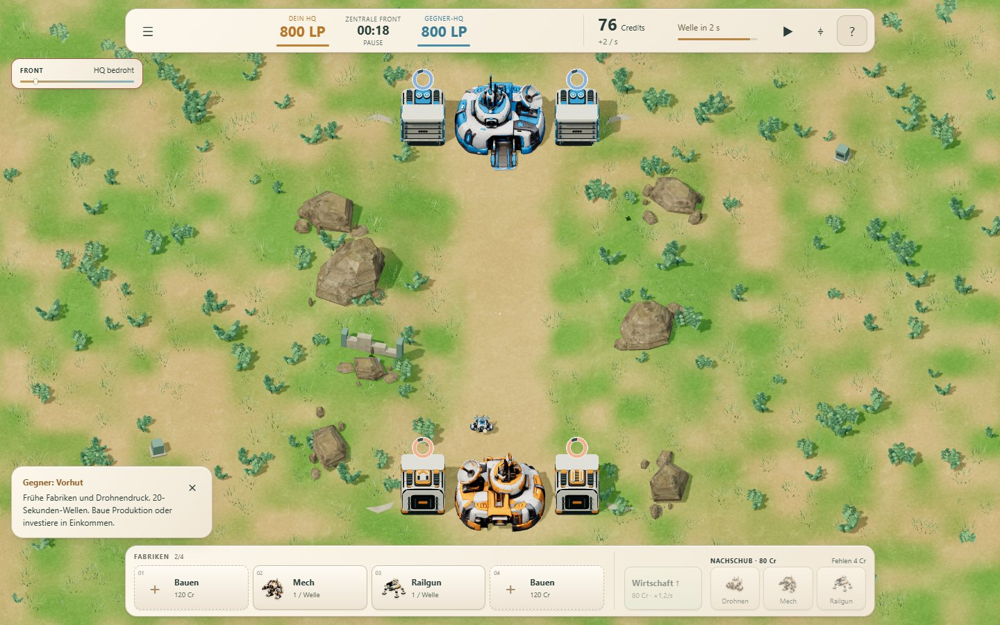
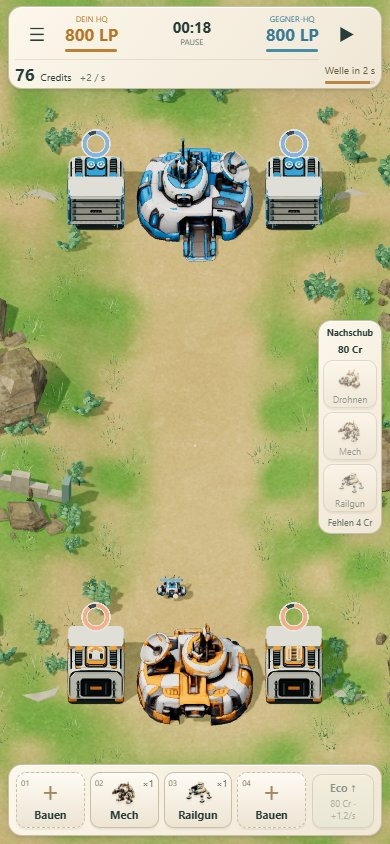
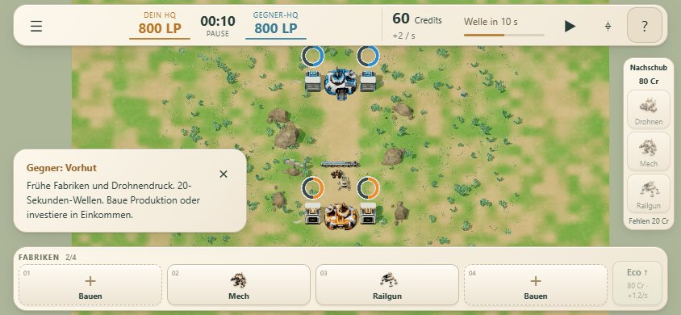

# Produktionsringe an Fabriken

Die aktiven Fabriken zeigen einen gemeinsamen, im Uhrzeigersinn gefüllten Ring in ihrer Fraktionsfarbe. In den letzten drei Sekunden wird er heller; beim Produzieren leuchtet er für 0,55 Sekunden auf. Der Ring schwebt über dem Dach, hat einen keramischen Rand und benötigt keine weiteren Zahlenanzeigen.

Die Anzeige bleibt mindestens 30 CSS-Pixel groß, auch beim Herauszoomen und auf Mobile. Bauvorschauen und leere Plätze erhalten keinen aktiven Ring. Vor dem Start und nach dem Spielende ist er verborgen; bei Pause bleibt er stehen. Zentrale Front verwendet unverändert 20 Sekunden, historische Missionen 15 Sekunden. Sofortnachschub verändert den Wellenring nicht.

## Technik und Prüfung

- Ausschließlich Darstellung: neues Modul `src/factory-wave-rings.js`, Einbindung und Ressourcenfreigabe in `src/match-view.js`. Keine Änderungen an Simulation, Wirtschaft, Balance, Produktionszeiten oder KI.
- Gemeinsame Quad-Geometrie und zwei gemeinsam genutzte Shader-Materialien. Maximal acht zusätzliche Draw Calls / 16 Dreiecke; keine Texturen, Schatten, zusätzlichen Lichtquellen oder DOM-Elemente pro Frame.
- 94 bestehende automatisierte Tests bestanden; statischer Build erfolgreich.
- `node tests/factory-rings-browser.mjs`: Desktop 1440×900, Mobile-Hochformat 390×844 und Querformat 844×390, alle drei Missionen, Halbzeit/Füllstand, letzte drei Sekunden, Produktionsimpuls und Pause. Acht aktive Fabriken, Ausblendung von Bauvorschauen, Aktivierung bei Fertigstellung, Spielende und Ressourcenfreigabe geprüft. Wiederholtes Rendern lässt den vollständigen gespeicherten Simulationszustand unverändert.
- `tests/hud-public.mjs`: echte UI-Bedienung, Bau/Abbruch, Wirtschaft, Speichern/Fortsetzen, Modellanzeige und komplette Partie bestanden. Referenzpartie unverändert: Orange gewinnt nach 213,5 Sekunden; HQ 764 : 0.
- Browserprüfung ohne JavaScript-/Shaderfehler. Mobile-Prüfung in Chromium mit Touch-/Mobile-Viewport-Emulation, keine Messung auf physischem Smartphone.

## Ansichten

Messprotokolle: [Ringe](local/results.json), [vollständige Partie und UI](local-game/public.json).

## Veröffentlichung

Laufzeitstand: `e7070886216f3061d9f0685a299c938d825ea04f`, ausschließlich auf `codex/lane-wars`. Die hervorgehobenen Playlinks in beiden READMEs zeigen auf diesen unveränderlichen Build.

Beide Browserprüfungen zusätzlich erfolgreich über den öffentlichen rawcdn.githack.com-Link durchgeführt: [Desktop, Hoch-/Querformat und Ringe](public/results.json), [UI und vollständige Partie](public-game/public.json). Keine Browser-/Shaderfehler. Die Online-Referenzpartie endet ebenfalls nach 213,5 Sekunden mit HQ 764 : 0.
