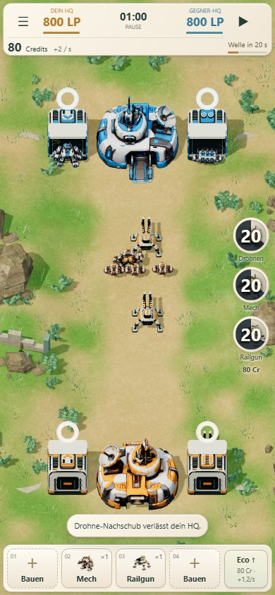
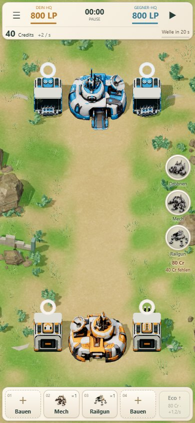

# Mobile HUD: Randnahe Leisten und freie Nachschub-Kreise

Auf Mobile sind die obere Statusleiste und die Fabrikleiste am unteren Rand mit 4 Pixel Abstand am Browser-Inhaltsbereich ausgerichtet. Die obere Leiste ist flacher; Innenabstände der Fabrikleiste sind reduziert. Standalone-/Vollbildansichten reservieren weiterhin die Geräte-Safe-Areas; seitliche Safe-Areas gelten auch im Browser. Die Kamera richtet sich nach den tatsächlichen HUD-Abmessungen und verwendet kleinere zusätzliche Sicherheitsabstände.

Rechts ersetzen drei unabhängige runde Keramikbuttons die große gemeinsame Platte. Durchmesser jeweils 52 Pixel, deutlich erkennbare Roboterporträts, radialer Cooldown und zentrale Restzeit. Kleine Namen stehen direkt unter den Kreisen. Preis und gegebenenfalls fehlende Credits stehen einmal unter der Gruppe; keine Nachschub-Überschrift. Die transparenten Zwischenräume blockieren keine Kartenbewegung. Desktop behält die bestehende Anordnung.

## Prüfung

- 94 bestehende Tests bestanden; statischer Build erfolgreich.
- Alle Nachschubzustände, exakter Cooldown-Ablauf, Pause, gesperrte Klicks ohne Matchänderung und Zwei-Lane-Nachschub geprüft.
- Kreisform, 52×52-Pixel-Touchflächen, fehlende Außenplatte, Randabstände und Durchlässigkeit der freien Seitenfläche zum Canvas explizit geprüft.
- Touch-Zoom/Pan/Abbruch und Bedienung von Bau, Abbruch, Wirtschaft und Nachschub in sechs Größen: 320×568, 360×640, 390×844, 412×915, 844×390 und Desktop 1440×960. Keine horizontale Überbreite und keine durch andere HUD-Elemente verdeckten Buttons.
- Gemessene Änderung bei 390×844: obere HUD-Unterkante 89 → 79 Pixel, Fabrikleiste 72 → 68 Pixel hoch und näher am unteren Rand. Freie vertikale Strecke zwischen beiden Leisten 675 → 693 Pixel. Die Nachschubgruppe ist 60 statt 70 Pixel breit und hat keine flächige Hintergrundplatte mehr.
- Browseremulation, keine Prüfung auf physischem Smartphone. Betriebssystem- und Browserleisten außerhalb der Webseite werden nicht verändert.
- Keine Änderung an Simulation, Wirtschaft, Balance, Produktionszeiten, Missionen oder KI.

[Status- und Layoutprüfung](local/results.json) · [Touch und sechs Bildschirmgrößen](touch/results.json)

## Laufzeitstand und Veröffentlichung

Laufzeitcommit `8f3ceaec3c514f27e992c9f1359fc56b6bb306a6`, Branch `codex/lane-wars`. Der Build ist auf GitHub veröffentlicht; beide README-Playlinks zeigen auf diesen Stand.

Die zusätzliche [lokale UI- und vollständige Match-Prüfung](local-game/public.json) ist bestanden: Bau/Abbruch, Wirtschaft, Speichern/Fortsetzen, Modellanzeige, historische Seiten und Partie. Die Referenzpartie endet unverändert nach 213,5 Sekunden mit HQ 764 : 0.

Auch die [vollständige öffentliche Partie und UI-Prüfung](public-game/public.json) ist bestanden: unverändertes Ergebnis nach 213,5 Sekunden bei HQ 764 : 0, keine Browserfehler.
Die [öffentlichen Status- und Layoutprüfungen](public/results.json) bestätigen ebenfalls Kreisform, freie Außenflächen, Randabstände und sämtliche Cooldown-/Credit-Zustände in vier Größen.
