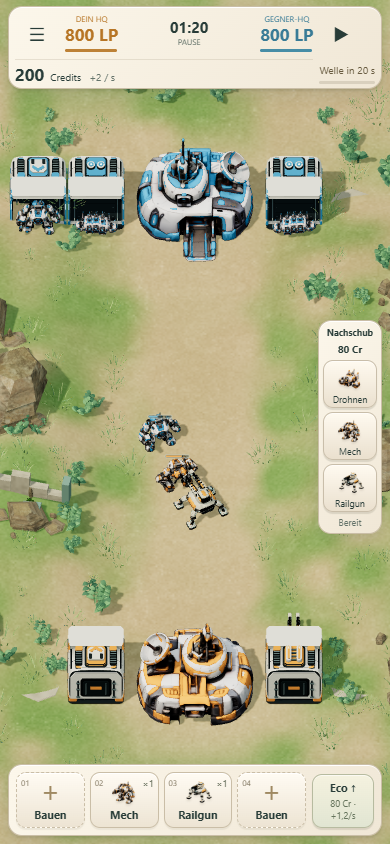
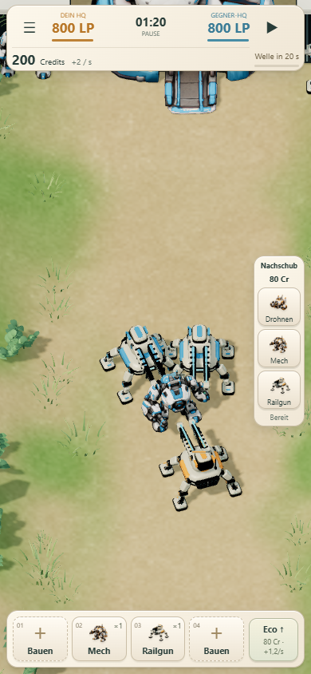

# Mobile: Touch-Zoom und seitlicher Nachschub

## Umsetzung

- Zwei Finger auf dem Schlachtfeld auseinander-/zusammenziehen: stufenloser Kamera-Zoom zwischen Übersicht (1×) und 3,2×. Der Punkt zwischen den Fingern bleibt beim Zoomen erhalten, soweit die Kartengrenzen das zulassen.
- Ein Finger verschiebt die Kamera. Nach dem Abheben eines Fingers aus der Zoomgeste lässt sich direkt weiter verschieben. Pinch, Ziehen und abgebrochene Gesten lösen keine Auswahl oder Nachschubbestellung aus.
- Eigene Eingabeschicht nur für MatchView/Lane Wars. Das Kampflabor und die frühere M1.5-Darstellung verwenden weiter ihre bisherige Eingabe. Simulationscode, Spielwerte, Produktion, KI und Karten unverändert.
- Mobile Front-Verlaufskachel ausgeblendet. Der zuvor dafür reservierte Kamerabereich wird wieder für das Schlachtfeld genutzt.
- Nachschub als drei vertikale Buttons am rechten Rand, mit Kosten und gemeinsamer Abklingzeit. In der Zwei-Lane-Mission erscheinen nach der Typwahl zwei temporäre Zielbuttons West/Ost; alternativ weiterhin direkt die Lane antippen oder den Typ dorthin ziehen.
- Wirtschaft als schmaler Button neben den Fabriken, verschwindet nach Ausbau. Bei 390×844 sinkt die untere Leiste von 139 auf 72 Pixel. Zwischen oberer Statusleiste und Fabrikleiste liegen rund 80 % der Bildschirmhöhe; rechts beansprucht Nachschub einen 64 Pixel breiten Streifen.
- Desktop behält die bisherige Anordnung mit Frontanzeige und Nachschub unten.

## Aktuelle Werte: Zentrale Front

| Einheit | Bewegung (Spieleinheiten/s) | Reichweite |
| --- | ---: | ---: |
| Drohne | 1,8 | 1,1 |
| Mech | 0,9 | 3,0 |
| Railgun | 0,8 | 5,2 |

Die historischen Missionen und das Kampflabor behalten Drohne 1,6 / 1,1, Mech 0,9 / 1,6 und Railgun 1,0 / 4,0 (Tempo / Reichweite).

## Prüfung

94 bestehende Node-Tests bestanden, statischer Build erfolgreich. Browser-Touchtests verwenden echte Chromium-Touch-Ereignisse über CDP: zentrierter und versetzter Pinch, rein/raus, Begrenzungen, Ein-Finger-Fortsetzung, Cancel/Neustart und Verhinderung unbeabsichtigter Spielbefehle auch bei vorausgewähltem Nachschub. Sechs Formate von 320×568 bis 1440×960; zusätzlich alle drei Missionen in acht Formaten. Die Gameplay-Snapshots vor/nach Kameragesten sind identisch.

[Touch-Protokoll](results.json) · [Missions-/Layoutregression](responsive/browser-results.json) · [Node-Tests](unit-tests.txt)

Die Prüfungen erfolgen in Desktop-Chromium mit Touch-Emulation; kein Test auf physischem iPhone/Android-Gerät. Der öffentliche Laufzeitstand `810d6a9` wurde nach dem Push ebenfalls geprüft: dieselben Touch-Gesten und sechs Layouts bestanden, keine Browser-/Ladefehler. Speichern/Fortsetzen und eine vollständige Partie bis zur HQ-Zerstörung (199 Sekunden, 800:0) bestanden. Die ausgelieferten HUD- und Kameradateien entsprechen den lokal geprüften Dateien. [Online-Touchtests](public/results.json) · [Online-Partie und Dateivergleich](public/public.json).

