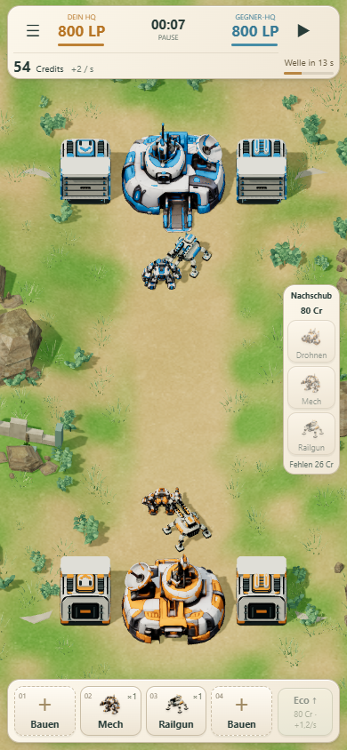

# Etwas sattere Landschaft und Teamfarben

Behutsame Material-/Palettenänderung ohne globalen Bildschirmfilter:

- Wiesen-Grundfarbe von RGB 111/142/78 auf 98/143/61; Wege von 183/161/123 auf 188/160/110. Farnmaterial etwas kräftiger grün.
- Orange von #f49a43 auf #f48924; Blau von #469dce auf #258fd6.
- HQs, Drohnen, Mechs, Railguns und Fabriken verwenden dieselbe Teampalette. Auch Fabrik-/Railgun-Viewer greifen darauf zu. Die vorhandene Texturmaske schützt weiße Keramik und dunkle Metallflächen.
- Keine Änderungen an Beleuchtung, Belichtung, HUD-Farben, Geometrie, Modellen, Kampf, Einheitenwerten, Wirtschaft, KI oder Missionen. Keine zusätzlichen Renderdurchgänge.

## Prüfung

94/94 Tests bestanden; statischer Build erfolgreich. Desktop (1440 × 900) und simuliertes Touch-Hochformat (390 × 844) geprüft. Der [Vorher-/Nachher-Vergleich](comparison.json) verwendet exakt dieselbe zentrale Partie nach sieben Sekunden. Die vollständigen Simulationszustände sind identisch. Keine JavaScript-Fehler; Draw Calls und Dreieckszahlen sind gleich geblieben.

| | Vorher | Nachher |
|---|---|---|
| Hochformat | [Bild](before-390.png) | [Bild](after-390.png) |
| Desktop | [Bild](before-1440.png) | [Bild](after-1440.png) |

Einheitenabstände und weitergehende Turmausrichtung bleiben vorgemerkte spätere Themen und wurden nicht geändert.
