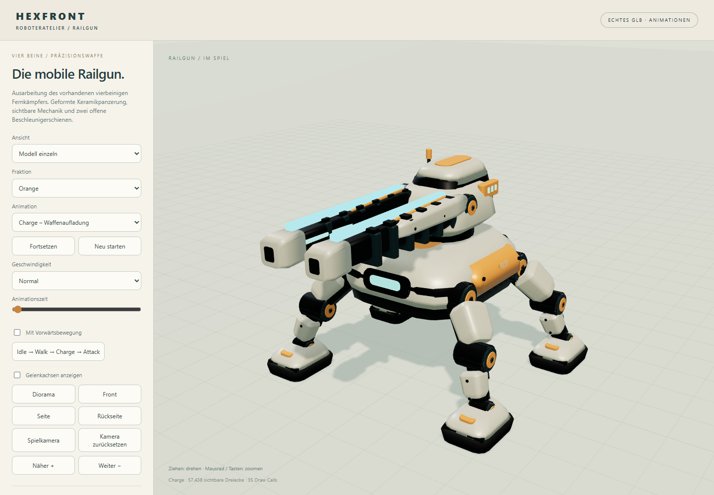
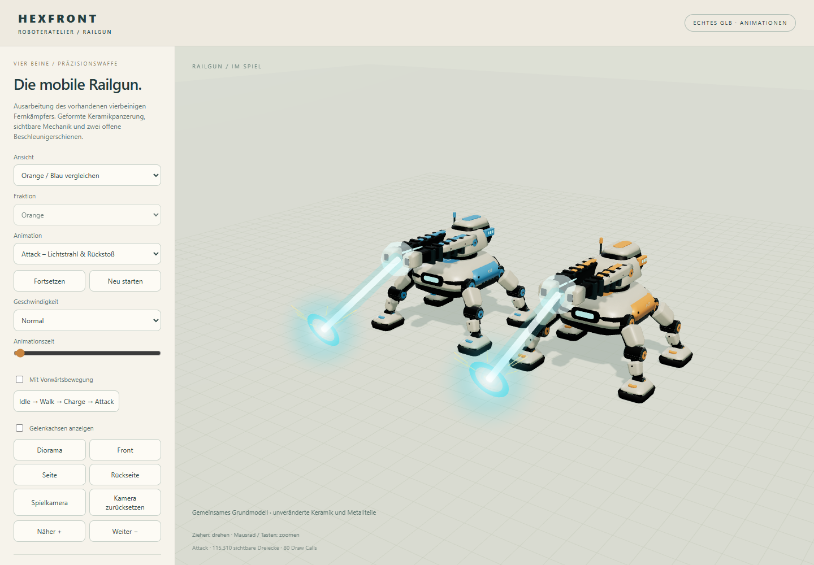
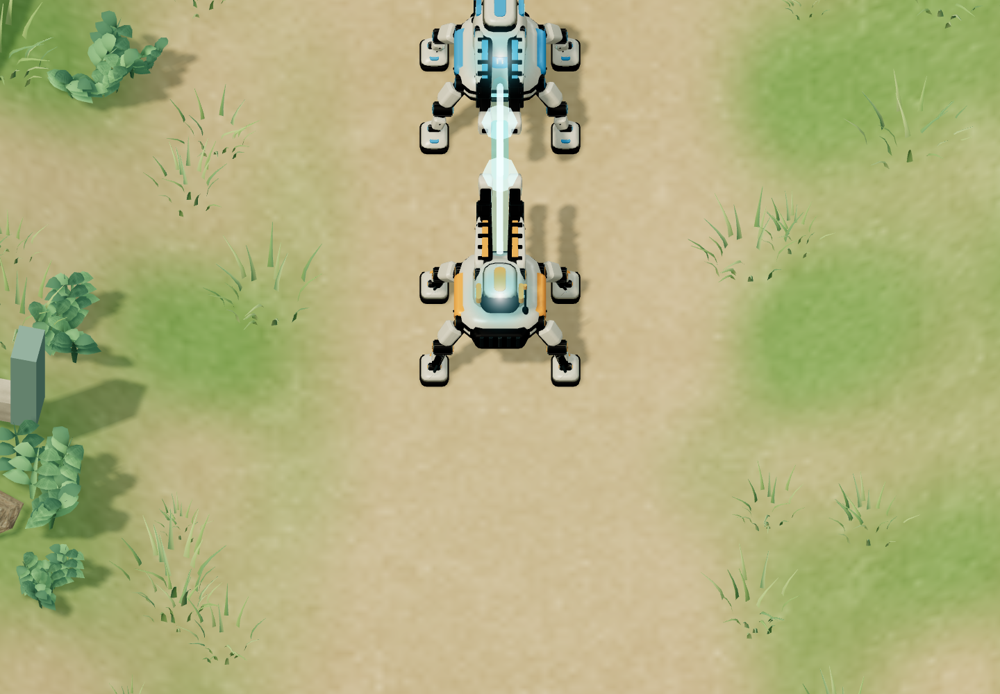

# Sichtbarer Railgun-Schuss

Reine Darstellungsänderung auf `codex/lane-wars`. Simulation, Reichweite, Schaden, Trefferzeitpunkte, Produktion und KI bleiben unverändert. Das vorhandene GLB und seine Animationen bleiben ebenfalls unverändert.

- Zwei leuchtende Schienen folgen dem animierten Waffenaufbau. Helligkeit und Breite wachsen während der bereits vorhandenen Ladephase; pro Fraktion ein gemeinsamer InstancedMesh statt zusätzlicher Lampen pro Roboter.
- Beim echten Schuss erscheint unmittelbar ein weißer Lichtkern mit türkisfarbenem Mantel, ausgehend von der tatsächlichen GLB-Mündung. Der Strahl klingt innerhalb von 130 ms ab, der Mündungsblitz innerhalb von 100 ms.
- Am tatsächlichen Zielpunkt erscheinen ein weicher Trefferblitz, ein expandierender Ring und acht kurze Funken. Der Trefferblitz wird als kleine, kameragerichtete Markierung über der Panzerung dargestellt, damit ihn das Zielmodell nicht vollständig verdeckt. Die übrigen Effekte behalten den Tiefentest. Nach 340 ms werden sämtliche Schussressourcen entfernt.
- Keine zusätzlichen dynamischen Lichter, Schatten oder Bloom-Durchläufe. Die acht Funken benötigen gemeinsam einen Draw Call.
- Der echte GLB-Viewer verwendet dieselben Effekte. Charge zeigt das Laden, Attack Strahl und Einschlag an einem Vorschauziel. Pause, Zeitlupe und Zeitleiste funktionieren auch für die Effekte; die Attack-Ansicht umfasst zusätzlich den Einschlag.

## Prüfung

`npm test`: **90/90 bestanden**. `npm run build`: erfolgreich.

`node tests/rail-effects.mjs`: echte Lade-/Schussereignisse beider Fraktionen, Ursprung an der Mündung, Einschlag am Ziel, unveränderter Simulationssnapshot beim Rendern, getrennte Abklingzeiten, Ressourcenbereinigung, Viewer-Pause, Zeitleiste und Smartphone-Hochformat bestanden. Keine Browserfehler.

`node tests/rail-browser.mjs` und `node tests/mech-browser.mjs`: bestehende Gelenk-, Bewegungs-, Kampf-, Treffer-, Zerstörungs- und Viewer-Prüfungen bestanden.

## Begrenzte Lastmessung

64 animierte Railguns in derselben Szene; Referenz ohne Effekte gegen 64 gleichzeitig ladende Waffen plus 16 eingefrorene, maximal helle Schüsse. Je 20 Aufwärmbilder und 80 Messbilder; Chromium auf AMD Radeon. Diese Messung isoliert die Renderinglast, nicht die Kosten laufender Simulation oder wiederholter Effekterzeugung.

| Ansicht | Median Bildabstand ohne / mit Effekten | P95 ohne / mit |
| --- | --- | --- |
| Desktop 1440 × 900 | 10,4 / 11,2 ms | 12,4 / 13,6 ms |
| Mobile-Viewport 390 × 844 | 8,7 / 9,7 ms | 10,5 / 12,3 ms |

Der Mobile-Viewport läuft auf derselben Desktop-GPU; dies ist **keine Messung auf einem echten Smartphone**. Vollständige Messwerte: [performance.json](performance.json), Funktionsprüfungen: [tests.json](tests.json).

## Öffentlicher Playlink

Runtime-Commit `6deae427cad60cc37409f89b9609e5f43f7fd111` auf rawcdn.githack.com geprüft: Viewer mit beiden Fraktionen und allen neuen Effekten, ausgeliefertes Effektmodul identisch zur geprüften lokalen Quelle. Eine vollständige öffentliche Testpartie endete nach 371,7 Sekunden mit HQ-Zerstörung (Orange 800, Blau 0). Keine Browserfehler. Details: [public.json](public.json). Beide Branch-READMEs verlinken diesen festen Spielstand.
