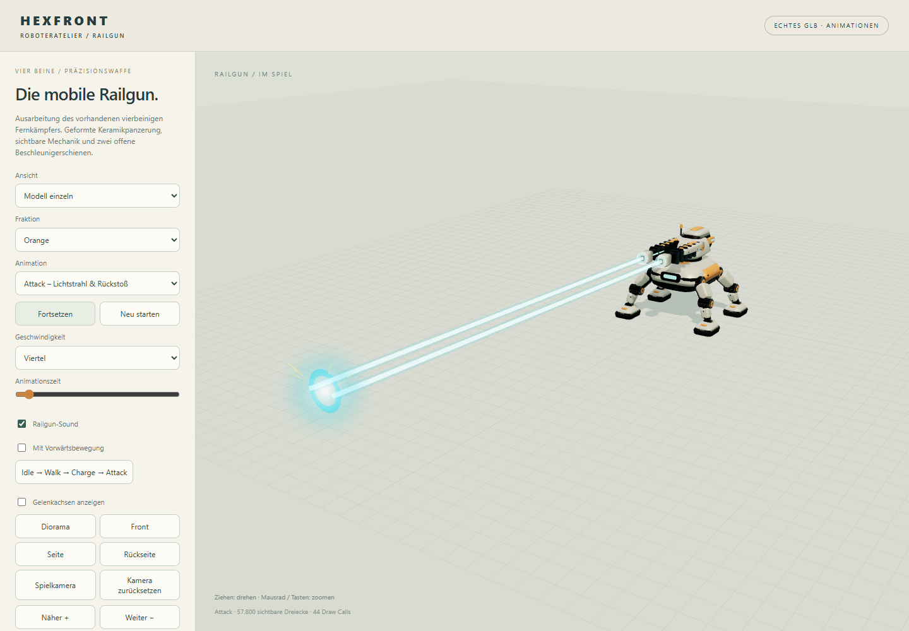
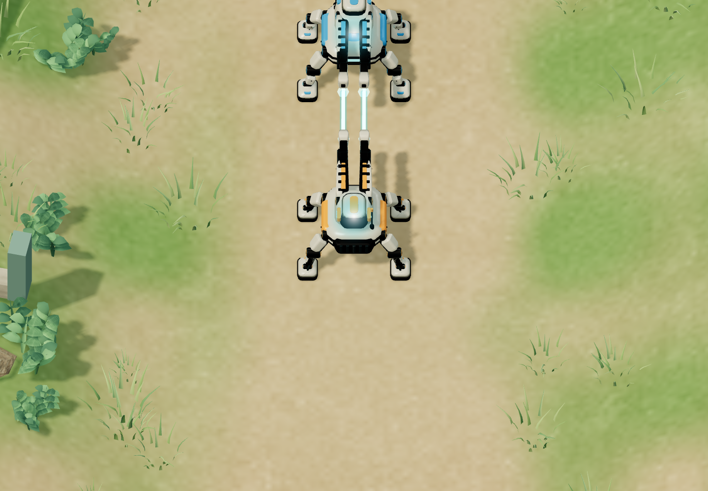

# Railgun: Sound, gerade Doppelstrahlen und Reichweite 5,2

## Umsetzung

- Elektrisches, ansteigendes Aufladen; kräftiger kurzer Impuls mit tiefem Anteil; metallischer Einschlag. Originale synthetisierte PCM-Klänge, einmal pro Audiokontext erzeugt und wiederverwendet. Keine externen Sounddownloads.
- Audio folgt dem vorhandenen Ladestatus und dem tatsächlichen Schussereignis. Pro Angriff genau ein Schuss-/Einschlagspaar, unabhängig von den zwei sichtbaren Strahlen. Der Einschlag startet zusammen mit dem sofort berechneten Treffer; keine zusätzliche Flugzeit.
- Audio startet erst nach Browserinteraktion. Stummschaltung unter Einstellungen bzw. im Viewer, lokal gespeichert. Pause, Menü, Tabwechsel und Neustart beenden aktive Stimmen. Maximal vier Lade- und sechs Schuss-/Einschlagsstimmen je Typ, Stereoausrichtung, Masterpegel und Kompressor begrenzen dichte Salven. Abgebrochene Stimmen blenden kurz aus.
- Zwei Strahlen beginnen an den wirklichen Rohröffnungen (Abstand 0,29 Modelleinheiten) und verlaufen parallel zu deren animierter Achse. Mündungsblitze bleiben getrennt. Zielausrichtung und Rückstoß werden berücksichtigt; eine doppelt addierte Zielhöhe beim Schuss wurde korrigiert. Kein zusätzlicher Treffer und kein zusätzlicher Schaden.
- Der Viewer zeigt einen 6 Modelleinheiten langen Vorschau-Schuss mit passendem Kameraausschnitt. Das ist ein Darstellungsabstand und keine Reichweitenangabe der Simulation. GLB/Blender-Dateien bleiben unverändert.

## Einzige Änderung der Spielwerte

Auf ausdrückliche nachträgliche Entscheidung: **Zentrale Front: Reichweite 4,8 → 5,2 (+8,3 %)**, für beide Fraktionen. Die kurz erwogene 7,2 wurde nicht umgesetzt. Schaden, Feuerrate, Wirtschaft, KI und Produktionszeiten bleiben unverändert. Historische Missionen und Kampflabor behalten Reichweite 4,0. Vorhandene zentrale Spielstände mit Standardreichweite 4,0 oder 4,8 übernehmen 5,2; andere individuelle Profile bleiben erhalten.

## Prüfung

92 automatisierte Logik-/Audiotests bestanden. Browserprüfungen bestätigen echte Rohrpositionen, parallele Strahlen, transformierte Waffenachsen, exakt ein Audioereignispaar pro Angriff, Audiofreigabe, Stimmenbegrenzung, Pause, stummes Scrubbing, Zeitlupe und persistente Stummschaltung. Der reale Web-Audio-Graph liefert ein Signal, im stummen Zustand Null. Auch im normalen Echtzeitablauf einer Partie wurde der Ton ausgelöst und beim Pausieren beendet ([local-playback.json](local-playback.json)). Keine Browserfehler. Die Klanggestaltung ist synthetisch; die subjektive Klangwirkung muss auf den verwendeten Lautsprechern beurteilt werden.

Vollständige Browserpartie: 137,75 s bis zur tatsächlichen HQ-Zerstörung; Save/Reload exakt erhalten. Erste Front, Wiesenpass, M1.5 und separates Kampflabor geprüft. Build erfolgreich.

## Reichweitenvergleich

Deterministische KI-Referenzen, keine menschlichen Siegraten. 720 s ist nur die Messgrenze, kein künstliches Spielende. Ausschließlich die Reichweite wurde variiert.

| Orange / Blau | Reichweite 4,8 | Reichweite 5,2 |
| --- | --- | --- |
| Pressure / Siege | Blau gewinnt, 371,7 s | Blau gewinnt, 137,75 s |
| Pressure / Economy | Blau gewinnt, 638,2 s | Nach 720 s offen, HQ 704 / 632 |
| Siege / Economy | Blau gewinnt, 695,15 s | Orange gewinnt, 93 s |

**Balancefolge:** Die kleine Reichweitenanhebung stärkt die Belagerungseröffnung deutlich. Zwei Referenzpartien liegen unter der gewünschten Matchdauer; die dritte bleibt länger offen. Keine weiteren Balanceanpassungen vorgenommen. Der Ergebnistest wurde auf diese dokumentierten Ergebnisse aktualisiert; Fraktionssymmetrie und wirtschaftliche Vergleichsprüfungen bleiben bestehen.

Messdaten: [range-audit.json](range-audit.json), [tests.json](tests.json), [modes.json](modes.json).

## Öffentliche Prüfung

Commit `65ba8647138cba8ec3f940160f21f0ca6be8bdf0` über den echten rawcdn.githack.com-Link geprüft: beide Strahlenachsen, Soundfreigabe und Stummschaltung im Viewer, Audio im Echtzeitspiel, Pause, angezeigte Reichweite 5,2 und vollständige Partie bis HQ-Zerstörung nach 137,75 s. Keine Browserfehler. [Öffentliches Prüfprotokoll](public.json).
