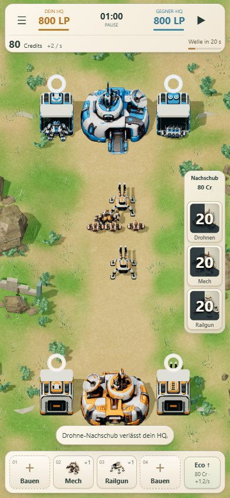
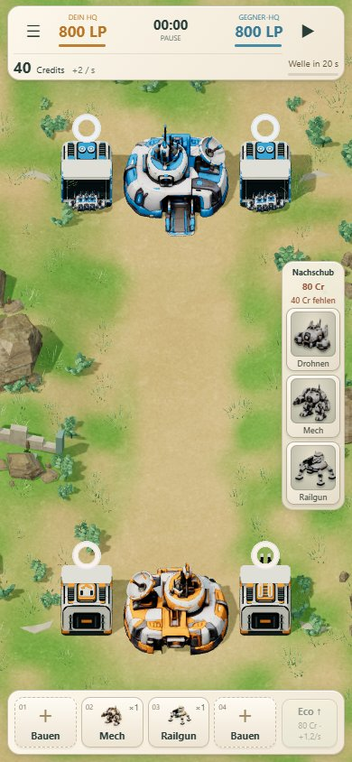

# Nachschub als Fähigkeiten-Icons

Die kleinteilige Statuskarten-Darstellung wurde ersetzt: deutlich größere Roboterporträts, radialer dunkler Cooldown direkt über dem Icon und eine große zentrale Sekundenanzeige. Der dunkle Anteil öffnet sich im Uhrzeigersinn anhand der tatsächlichen verbleibenden Abklingzeit.

Fehlende Credits werden einmal als ruhiger Hinweis unter dem gemeinsamen Preis angezeigt. Die Porträts bleiben erkennbar und werden bei Geldmangel entsättigt. Sobald beide Voraussetzungen erfüllt sind, verschwinden Countdown und Sperrhinweis; die Icons erhalten ihre volle Darstellung und einen warmen Rahmen. Keine zusätzlichen „Credits ✓“-/„Geladen“-Kästchen, keine mehrfachen Credit-Badges, kein separater Ladebalken. Keramikoptik und sämtliche bestehenden Regeln bleiben erhalten.

## Prüfung

- 94 bestehende Tests bestanden; statischer Build erfolgreich.
- Verfügbarkeit in vier Größen geprüft: 390×844, 320×568, 844×390 und 1440×900. Creditmangel allein, Cooldown allein, beide gleichzeitig, bereit, Pause, exaktes Cooldown-Ende, gesperrte Klicks ohne Zustandsänderung und Zwei-Lane-Versand.
- Radialfüllung am tatsächlichen Simulationswert geprüft (20 von 30 Sekunden verbleibend: 120 Grad bereits freigegeben). Darstellung verschwindet am Ablauf der Abklingzeit.
- Touch-Zoom, Pan, Gestenabbruch, Fabrikbedienung und Nachschub in sechs Bildschirmgrößen geprüft. Mindestens 44×44 Pixel große Touchziele; keine Überdeckung durch oberes HUD oder Fabrikleiste.
- Mobile-Prüfung per Chromium-Emulation; keine Messung auf physischem Telefon.
- Keine Änderungen an Wirtschaft, Balance, Produktionszeiten, KI oder Simulation. Rein visuelle Überarbeitung des bestehenden Nachschub-UI.

[Verfügbarkeits- und Layouttests](local/results.json) · [Touchtests](touch/results.json)
