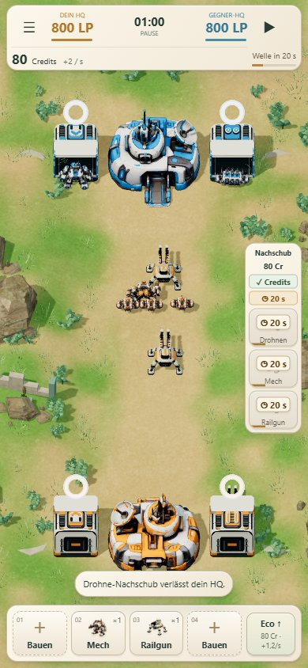
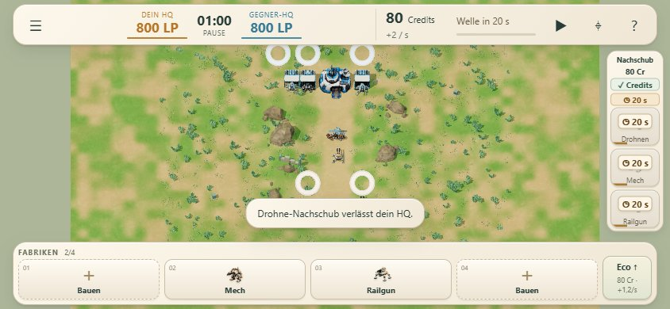

# Klarer Status für Sofortnachschub

Credits und Abklingzeit sind jetzt gleichzeitig sichtbar. Die keramische Nachschubleiste zeigt zwei getrennte Statusfelder: **✓ Credits** oder den fehlenden Betrag, daneben einen Countdown oder **✓ Geladen**. **✓ Bereit** erscheint nur, wenn beide Voraussetzungen erfüllt sind.

Auf jedem gesperrten Truppenbutton steht die verbleibende Zeit; ohne Cooldown steht dort der fehlende Creditbetrag. Ein schmaler Ladebalken ergänzt den Countdown. Nur das Roboterbild wird abgedimmt; Typname und Sperrgrund bleiben kontrastreich. Bereite Buttons erhalten wieder ihre volle Darstellung. Alle drei Truppentypen teilen weiterhin denselben Cooldown.

Ein Tipp auf einen gesperrten Button nennt beide Gründe, falls beide gelten. Er startet weder eine Zielauswahl noch einen Auftrag. Die Screenreader-Beschriftung enthält ebenfalls die vollständige Verfügbarkeit. Laufende Zwei-Lane-Zielauswahl und Drag-/Touch-Bedienung bleiben erhalten.

## Unverändertes Gameplay

Keine Änderungen an Simulation, Preisen, Wirtschaft, KI, Einheiten oder Produktionsrhythmus. Zentrale Front: 80 Credits / 30 Sekunden Sofortnachschub-Cooldown; historische Missionen behalten ihre Regeln. Die UI verhindert nur bereits ungültige Eingaben und visualisiert den tatsächlichen Zustand.

## Prüfungen

- 94 bestehende Tests bestanden; statischer Build erfolgreich.
- `tests/supply-readiness-browser.mjs`: fehlende Credits allein, Cooldown allein trotz ausreichendem Guthaben, beide Sperren gleichzeitig, bereit, Pause, Freigabe am exakten Cooldown-Ende, Zwei-Lane-Versand. Wiederholte gesperrte Klicks ändern den vollständigen Matchzustand nicht.
- Vier Größen für alle Zustände: 390×844, 320×568, 844×390, 1440×900. Keine überdeckten Buttons, keine horizontale Überbreite; Touchflächen mindestens 44×44 Pixel.
- `tests/touch-camera-browser.mjs`: native Chromium-Touchereignisse für Pinch/Pan/Abbruch, sechs Bildschirmgrößen, Bauen/Abbrechen/Wirtschaft/Nachschub und Zwei-Lane-Zielauswahl. Die Layoutprüfung verwendet nun die tatsächliche HUD-Unterkante statt eines festen 70-Pixel-Abstands. Querformat erhält kompaktere Zwischenräume und behält Abstand zum oberen HUD.
- `tests/hud-public.mjs`: Bau/Abbruch, Wirtschaft, Speichern/Fortsetzen, tatsächliche GLB-Modelle und vollständige Referenzpartie.
- Mobile-Prüfung per Browseremulation, nicht auf physischem Smartphone.

## Ansichten und Protokolle

[Statusprüfungen](local/results.json) · [Touch und sechs Layouts](touch/results.json) · [Komplette Partie](local-game/public.json)
