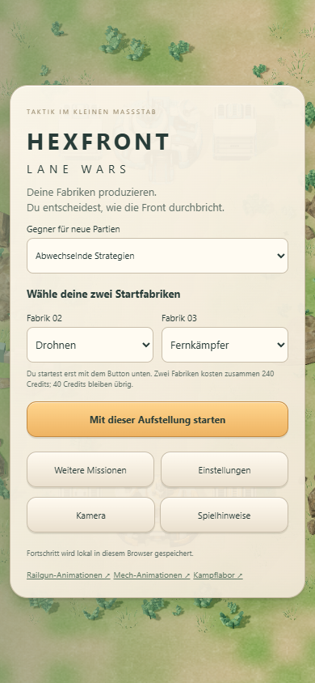
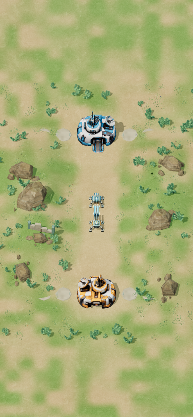

# Lesbare Schüsse und bewusster Rundenstart

## Darstellung

- Mech: kurzer länglicher Energiebolzen, heller Kern, Fraktionsfarbe und dezenter Kontrastsaum. Sichtbare Mündungs-/Trefferblitze und flacher Impulsring mit maximal 0,8 Welteinheiten Radius. Bolzenflug 120 ms, Effekte nach 280 ms entfernt.
- Der bestehende mechanische Attack-Clip wird beim Laden kopiert: Laufverschiebung verdoppelt, vorhandene Ellbogen-/Oberkörperrotation um Faktor 1,5 verstärkt. Gemessener Lauf-Rückstoß bei 50 ms: rund 0,098 statt 0,049 Welteinheiten. Keine Ganzkörper-Ersatzanimation und keine Änderung an Geometrie, Laufanimation oder GLB-Quelldateien. Derselbe angepasste Clip wird im Mech-Viewer verwendet.
- Railgun: weiterhin zwei gerade, parallele Strahlen ab den tatsächlichen Rohröffnungen. Heller Kern, Orange/Blau als Farbrand, dezenter dunkler Außenrand. Sichtbarkeit von 130 auf 180 ms erhöht; Einschlag bleibt bis 240 ms und Ring/Funken bis 340 ms sichtbar. Die gemeinsamen Effekte sind auch im Railgun-Viewer aktiv.
- In der Spielansicht haben beide Waffen mindestens 1,8 CSS-Pixel Kerndurchmesser. Bolzenlänge mindestens 8 Pixel, soweit die Entfernung dies zulässt; Blitze bekommen ebenfalls eine Mindestgröße. Das wird beim Zoomen neu berechnet, ohne Ursprung, Ziel oder Strahlachse zu verschieben.
- Keine zusätzlichen dynamischen Lichter, kein Bloom-Pass und keine Partikelphysik. Der Mech verwendet sechs kleine Effektobjekte; die Railgun elf statt neun. Abgelaufene Geometrien und Materialien werden entsorgt.

Alle Effekte entstehen aus tatsächlichen Schussereignissen. Der sichtbare Bolzen verzögert keinen Treffer; Trefferblitz und Rückstoß beginnen beim bestehenden Ereignis. Schaden, Reichweiten, HP, Angriffstakt, Wirtschaft, Produktion, KI und Missionen sind gegenüber 9cc31a6 unverändert. Die beiden Railgun-Strahlen visualisieren weiterhin zusammen einen Angriff. Der Mech-Ring ist rein visuell und berechnet keinen Flächenschaden.

## Start und Neustart

Die beiden Startfabriken stehen im Hauptmenü sichtbar nebeneinander. Erst **Mit dieser Aufstellung starten** beginnt die zentrale Partie und ihre Produktion. Die bestehenden 280 Startcredits, zwei Fabriken für 240 Credits und 40 verbleibende Credits sind unverändert.

Im Pausenmenü gibt es **Runde neu starten**. Bei einer zentralen Partie führt die Bestätigung zur Startauswahl; die alte Runde bleibt pausiert und gespeichert, bis die neue ausdrücklich gestartet wird. Abbruch erhält den Stand. Fortsetzen bleibt separat möglich. Auch nach dem Ergebnis führt eine neue zentrale Runde zunächst zurück zur Auswahl. Historische Missionen bleiben unter Weitere Missionen erreichbar.

## Prüfung

- 94/94 automatisierte Tests bestanden; statischer Build erfolgreich. Keine Änderungen an den Simulations-/Regeldateien. Die bisherigen exakten Match-, Konter- und Speicherregressionen bleiben grün.
- [Desktop-/Hochformat-Test](local/results.json): echte Schussereignisse beider Fraktionen, minimale Strahlbreite, Achsentreue, Rückstoß, unveränderter Spielstand durch Rendering und Entfernen abgelaufener Effekte; außerdem Wahl der Startfabriken, noch keine Produktion im Menü, Neustart/Abbruch, tatsächliche neue Fabriktypen, vollständige Partien und Rückkehr zur Auswahl.
- [Railgun-/Viewer-Regression](rail-regression/tests.json): Aufladung, Schüsse, Treffer, Pause, zeitliche Ausblendung und Hochformat.
- [Erhaltene Varianten](modes/modes.json): vollständige zentrale Partie, exaktes Speichern/Laden, Erste Front, Wiesenkrieg, M1.5-Demo und separates Kampflabor. Keine JavaScript-Fehler in diesen Prüfungen.
- Mobile wurde als Touch-/Hochformatansicht mit 390 × 844 Pixeln im Desktop-Chromium geprüft, nicht auf einem physischen Telefon.

## Aufwand

[Messdaten](performance.json): vorheriger öffentlicher Build 9cc31a6 gegen diese Fassung auf demselben Rechner. 64 mechanisch animierte Roboter; acht Mech- und acht Railgun-Schüsse gleichzeitig bei voller Helligkeit eingefroren. 15 Aufwärm- und 60 Messbilder pro Fall.

| Ansicht | CPU/Bild vorher → nachher (Median) | Bildabstand vorher → nachher (Median) | Draw Calls vorher → nachher |
|---|---|---|---|
| 1440 × 900 | 9,5 → 10,2 ms | 11,7 → 11,6 ms | 262 → 310 |
| 390 × 844 | 7,6 → 7,5 ms | 9,2 → 9,4 ms | 243 → 277 |

Die kleinen Unterschiede liegen teilweise im Messrauschen. Zusätzliche Zeichenschritte sind vorhanden; die Messung zeigt keinen großen Einbruch auf diesem Rechner, garantiert aber keine Smartphone-Framerate. Im normalen Spiel bleiben Effekte nur Bruchteile einer Sekunde aktiv.

## Bilder

Reproduktion: `npm test`, `npm run build`, `node tests/weapon-clarity-browser.mjs`, `node tests/rail-effects.mjs`. Für den öffentlichen Browserlauf `PUBLIC_PLAY_URL` auf das Build-Verzeichnis setzen und `WEAPON_OUTPUT` als separaten Ergebnisordner wählen. Der Performancevergleich ist mit `node tests/weapon-clarity-performance.mjs` reproduzierbar.
